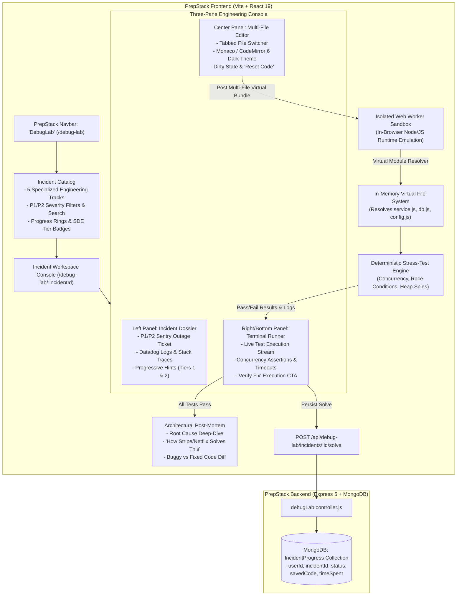

# DebugLab: Production Incident & Bug Hunt Simulator
### Comprehensive Technical Architecture & Master Plan (20-Incident Enterprise Edition)

> [!IMPORTANT]
> **Executive Summary & High-Signal Value Proposition:**
> Top engineering organizations (**Stripe, Uber, Datadog, Karat, Netflix, Meta**) have transitioned technical screening rounds from pure LeetCode trivia to **"Practical Production Debugging"**:
> *"Here is a multi-file microservice experiencing an active production outage. You have 25 minutes. Inspect the telemetry and logs, locate the architectural bug across files, fix it, and verify the stress test suite passes."*
> **No major prep platform (LeetCode, NeetCode, HackerRank) trains candidates for this.** 
> **DebugLab** delivers **20 multi-file, real-world production incidents** across 5 specialized tracks with **$0.00 AI token cost**, sub-50ms in-browser test execution, and zero server execution security risks.

---

## 1. End-to-End System Architecture



---

## 2. Core Architectural Pillars

### 2.1 $0.00 AI Token Cost & 100% Free-Tier Stability
- **No LLM Calls Needed for Core Gameplay**: All 20 scenarios, telemetry logs, test suites, and post-mortems are pre-engineered by real senior engineers.
- **Sub-50ms Instant Execution**: Stress tests run client-side inside an isolated Web Worker. No waiting in backend queues.
- **Zero Server Risk**: Untrusted candidate code **never** executes on your Node.js backend. The server only stores user progress, completion timestamps, and draft saves.

### 2.2 Multi-File Virtual Module Linking
Instead of single-file snippets, each incident contains **3 to 5 distinct files**:
- `server.js` / `app.js` (Express routing & middleware).
- `service.js` (Core domain logic).
- `db.js` / `cache.js` / `mutex.js` (Simulated persistence, Redis layer, or concurrency primitives).
- `config.js` (Timeouts, retry policies, connection limits).
- `test.js` (Read-only stress-test suite with concurrency & chaos injection).

The in-browser Web Worker contains a custom **Virtual Module Resolver** that links relative imports (`import { db } from './db.js'`) entirely in memory.

---

## 3. The 20 Enterprise Production Incidents Across 5 Tracks

### Track 1: Concurrency, Locking & Financial Invariants (4 Incidents)
*Target Company Style: **Stripe, Uber, Robinhood***

| # | Incident Title | Severity | Files | The Core Production Bug & Engineering Lesson |
| :-: | :--- | :-: | :--- | :--- |
| **01** | **Flash-Sale Wallet Double Spend** | `P1 Critical` | `app.js`, `walletService.js`, `db.js`, `test.js` | **Bug**: Asynchronous "check-then-act" gap allows two simultaneous requests to both see `balance >= 50` before either decrements.<br/>**Lesson**: Mutex queues, atomic Compare-And-Swap (CAS), and transaction isolation levels. |
| **02** | **Cross-Account Transfer Deadlock** | `P1 Critical` | `transferService.js`, `accountLock.js`, `test.js` | **Bug**: Account A $\to$ B locks A then B; concurrent B $\to$ A locks B then A, producing an unrecoverable deadlock under high throughput.<br/>**Lesson**: Global resource ordering (lock by sorted account ID) to prevent circular wait. |
| **03** | **Optimistic Concurrency Collision** | `P2 Major` | `profileService.js`, `entityModel.js`, `test.js` | **Bug**: Concurrent updates without version check silently overwrite fields, losing user updates (Lost Update Anomaly).<br/>**Lesson**: Implementing version counters (`__v` / ETag) with retry loops. |
| **04** | **Payment Idempotency Key Collision** | `P1 Critical` | `paymentService.js`, `idempotencyStore.js`, `test.js` | **Bug**: Network timeout causes client retry before initial payment finishes processing; second request executes as a distinct charge.<br/>**Lesson**: State-aware idempotency keys (`STARTED` $\to$ `COMPLETED`) with lock leases. |

---

### Track 2: Node.js Internals, Memory Leaks & Event Loop (4 Incidents)
*Target Company Style: **Datadog, Discord, Cloudflare***

| # | Incident Title | Severity | Files | The Core Production Bug & Engineering Lesson |
| :-: | :--- | :-: | :--- | :--- |
| **05** | **The Unbounded EventEmitter Leak** | `P1 Critical` | `server.js`, `metricsTracker.js`, `test.js` | **Bug**: Request handler registers an `EventEmitter.on('metric')` listener without cleaning it up on socket termination, causing V8 heap exhaustion.<br/>**Lesson**: Teardown lifecycles, `removeListener`, and `AbortSignal` for automated cleanup. |
| **06** | **Event Loop Starvation by ReDoS** | `P1 Critical` | `validator.js`, `userRouter.js`, `test.js` | **Bug**: Catastrophic backtracking in a naive email/markdown regex blocks the Node.js single thread for 25 seconds during peak traffic.<br/>**Lesson**: Avoiding polynomial/exponential regex, atomic grouping, and non-blocking worker threads. |
| **07** | **Stream Backpressure Pipe Overflow** | `P2 Major` | `exportService.js`, `csvStream.js`, `test.js` | **Bug**: Fast data source pushes directly into a slow network response without pausing, buffering 200MB into memory and triggering an OOM crash.<br/>**Lesson**: Understanding `stream.write() === false` drainage and `stream.pipeline()`. |
| **08** | **Timer Closure Context Hoisting** | `P2 Major` | `sessionManager.js`, `timerService.js`, `test.js` | **Bug**: Recurring `setInterval` callback retains a reference to an entire HTTP request context, preventing garbage collection of multi-megabyte payloads.<br/>**Lesson**: Scope isolation and decoupling timers from request lifecycles. |

---

### Track 3: Distributed Systems, Caching & Resilience (4 Incidents)
*Target Company Style: **Netflix, AWS, Shopify***

| # | Incident Title | Severity | Files | The Core Production Bug & Engineering Lesson |
| :-: | :--- | :-: | :--- | :--- |
| **09** | **The Thundering Herd Cache Stampede** | `P1 Critical` | `cacheService.js`, `productApi.js`, `db.js`, `test.js` | **Bug**: Hot cache key expires simultaneously for 5,000 active users; all requests miss and hammer MongoDB at once, crashing the database.<br/>**Lesson**: Mutual exclusion locking on cache miss (Singleflight) and probabilistic early expiration (XFetch). |
| **10** | **Cascading Circuit Breaker Failure** | `P1 Critical` | `gateway.js`, `circuitBreaker.js`, `test.js` | **Bug**: Downstream shipping API latency spikes; gateway fails to trip open, exhausting connection pool and taking down the entire API gateway.<br/>**Lesson**: Circuit breaker half-open state thresholds, error rate sampling, and fallback degradation. |
| **11** | **The Retry Storm with Zero Jitter** | `P2 Major` | `httpClient.js`, `authSync.js`, `test.js` | **Bug**: Failed auth calls retry on a fixed 1-second interval; synchronized retry waves prevent recovering microservice from standing back up.<br/>**Lesson**: Full Jitter Exponential Backoff formula: `sleep = rand(0, min(cap, base * 2^attempt))`. |
| **12** | **Cache-Aside Invalidation Race** | `P2 Major` | `userService.js`, `redisCache.js`, `db.js`, `test.js` | **Bug**: Read request misses cache, reads DB; concurrent write updates DB and purges cache; slow read writes old DB data into cache.<br/>**Lesson**: Write-around caching, cache leases, and CDC (Change Data Capture) invalidation. |

---

### Track 4: Auth, Session Security & Data Leaks (4 Incidents)
*Target Company Style: **Auth0, GitHub, Okta***

| # | Incident Title | Severity | Files | The Core Production Bug & Engineering Lesson |
| :-: | :--- | :-: | :--- | :--- |
| **13** | **Refresh Token Rotation Desync** | `P1 Critical` | `tokenService.js`, `authMiddleware.js`, `test.js` | **Bug**: 4 parallel frontend requests when access token expires trigger 4 simultaneous refresh calls; rotation detects "reuse" and locks out the user.<br/>**Lesson**: Grace-period token rotation and single-flight in-flight request deduplication. |
| **14** | **Timing Attack on Webhook Signature** | `P2 Major` | `webhookVerifier.js`, `cryptoUtils.js`, `test.js` | **Bug**: Uses standard `===` string equality to verify HMAC SHA-256 signatures; early exit on first mismatched character permits timing side-channel.<br/>**Lesson**: Constant-time comparison using `crypto.timingSafeEqual()`. |
| **15** | **Prototype Pollution in Config Merger** | `P1 Critical` | `configMerger.js`, `appConfig.js`, `test.js` | **Bug**: Recursive deep merge of user settings copies `__proto__` properties, injecting malicious defaults into all global Object instances.<br/>**Lesson**: Disallowing prototype keys (`__proto__`, `constructor`) and `Object.create(null)`. |
| **16** | **Session Fixation in OAuth Flow** | `P2 Major` | `oauthController.js`, `sessionStore.js`, `test.js` | **Bug**: User session ID remains identical before and after OAuth completion, allowing an attacker who set the initial cookie to hijack the account.<br/>**Lesson**: Regenerating session identifiers upon authentication boundary crossings. |

---

### Track 5: Database, Aggregation & Query Bottlenecks (4 Incidents)
*Target Company Style: **Airbnb, MongoDB, LinkedIn***

| # | Incident Title | Severity | Files | The Core Production Bug & Engineering Lesson |
| :-: | :--- | :-: | :--- | :--- |
| **17** | **The N+1 Query Waterfall** | `P2 Major` | `dashboardController.js`, `projectRepo.js`, `test.js` | **Bug**: Team dashboard fetches 50 projects, then executes an `await` query per project inside a `map()` loop, timing out at 4.8 seconds.<br/>**Lesson**: Batching via `$in` queries or MongoDB `$lookup` aggregation pipelines. |
| **18** | **Unindexed Compound Query Memory Spill**| `P1 Critical` | `orderSearchService.js`, `dbClient.js`, `test.js` | **Bug**: Query with filter on `status` and sort on `createdAt` lacks a compound index, hitting the MongoDB 32MB in-memory sort limit and aborting.<br/>**Lesson**: Equality-Sort-Range (ESR) indexing rule. |
| **19** | **Unbounded Cursor Stream Memory Leak** | `P2 Major` | `exportPipeline.js`, `batchWorker.js`, `test.js` | **Bug**: Calling `.find()` on 150k documents loads entire collection into Node memory array instead of streaming with batch pagination cursor.<br/>**Lesson**: Cursor streaming, `.lean()`, and cursor-based `_id` keyset pagination. |
| **20** | **Partial Failure in Multi-Doc Write** | `P1 Critical` | `checkoutService.js`, `inventoryRepo.js`, `test.js` | **Bug**: Order record saves successfully, but inventory reduction throws; system has no transaction rollback, resulting in ghost orders.<br/>**Lesson**: Two-phase commits and MongoDB multi-document ACID transactions with session abort. |

---

## 4. Multi-File Code Editor & Sandboxed Test Engine

### 4.1 In-Browser Web Worker Sandbox (`client/src/workers/sandbox.worker.js`)
```javascript
/**
 * Isolated Web Worker Sandbox
 * Executes multi-file user code and stress tests in an isolated thread.
 * Completely detached from DOM, window, and network APIs.
 */

self.onmessage = async (e) => {
  const { files, testFile } = e.data;
  const logs = [];

  // Override console.log to stream back to the UI terminal
  const originalLog = console.log;
  console.log = (...args) => {
    logs.push(args.map(a => (typeof a === 'object' ? JSON.stringify(a) : String(a))).join(' '));
  };

  try {
    // 1. In-Memory Virtual Module Cache
    const modules = new Map();

    // 2. Transpile and wrap files into modules
    for (const file of files) {
      const wrapped = new Function(
        "module", "exports", "require",
        file.content
      );
      const mod = { exports: {} };
      modules.set(file.name, { fn: wrapped, mod, executed: false });
    }

    // 3. Virtual require implementation
    function customRequire(path) {
      const cleanPath = path.replace(/^\.\//, '').replace(/\.js$/, '') + '.js';
      const target = modules.get(cleanPath);
      if (!target) throw new Error(`Cannot find module '${path}'`);
      
      if (!target.executed) {
        target.fn(target.mod, target.mod.exports, customRequire);
        target.executed = true;
      }
      return target.mod.exports;
    }

    // 4. Execute the test runner file with 3000ms hard timeout
    const testFn = new Function("require", "assert", testFile.content);
    
    function assert(condition, message) {
      if (!condition) {
        const err = new Error(message || "Assertion failed");
        err.name = "AssertionError";
        throw err;
      }
    }

    const timeoutPromise = new Promise((_, reject) =>
      setTimeout(() => reject(new Error("EXECUTION_TIMEOUT: Test exceeded 3000ms limit")), 3000)
    );

    const testExecution = Promise.resolve(testFn(customRequire, assert));
    const testResults = await Promise.race([testExecution, timeoutPromise]);

    self.postMessage({
      success: true,
      results: testResults || [{ name: "All Assertions Passed", passed: true }],
      logs,
    });
  } catch (error) {
    self.postMessage({
      success: false,
      error: {
        name: error.name,
        message: error.message,
        stack: error.stack,
      },
      logs,
    });
  } finally {
    console.log = originalLog;
  }
};
```

---

## 5. Database Schema Design (MongoDB / Mongoose)

### `IncidentProgress` Model (`server/src/models/incidentProgress.model.js`)
```javascript
import mongoose from "mongoose";

const fileDraftSchema = new mongoose.Schema({
  filename: { type: String, required: true },
  content: { type: String, required: true },
});

const incidentProgressSchema = new mongoose.Schema(
  {
    userId: {
      type: mongoose.Schema.Types.ObjectId,
      ref: "User",
      required: true,
      index: true,
    },
    incidentId: {
      type: String,
      required: true,
      index: true,
    },
    status: {
      type: String,
      enum: ["unattempted", "in_progress", "solved"],
      default: "unattempted",
      index: true,
    },
    savedFiles: [fileDraftSchema],
    attemptsCount: { type: Number, default: 0 },
    timeSpentSeconds: { type: Number, default: 0 },
    solvedAt: { type: Date, default: null },
  },
  {
    timestamps: true,
    toJSON: {
      transform: (doc, ret) => {
        delete ret.__v;
        return ret;
      },
    },
  }
);

// Compound index to guarantee 1 document per user per incident
incidentProgressSchema.index({ userId: 1, incidentId: 1 }, { unique: true });

export default mongoose.model("IncidentProgress", incidentProgressSchema);
```

---

## 6. Backend API Design (`server/src/controllers/debugLab.controller.js`)

All endpoints use PrepStack’s unified `formatSuccess` and `formatError` envelopes:

1. **`GET /api/debug-lab/incidents`**
   - Protected route.
   - Returns all 20 scenarios grouped by track with user's completion status (`solved`, `in_progress`, `unattempted`), category, difficulty, and target company style.
2. **`GET /api/debug-lab/incidents/:id`**
   - Protected route.
   - Returns the complete incident ticket, Sentry/Datadog logs, files, test suite, and the user's latest saved code drafts.
3. **`POST /api/debug-lab/incidents/:id/save`**
   - Protected route.
   - Saves current user code drafts and elapsed time without marking as solved.
4. **`POST /api/debug-lab/incidents/:id/solve`**
   - Protected route.
   - Marks incident as `solved`, updates `solvedAt` timestamp, increments user's total solved stats, and unlocks the post-mortem.

---

## 7. Frontend UI / UX Architecture (`client/src/pages/DebugLab/`)

### 7.1 New Route & Navigation Setup
- In `client/src/App.jsx`:
  ```jsx
  <Route path="/debug-lab" element={<Protected><DebugLab /></Protected>} />
  <Route path="/debug-lab/:incidentId" element={<Protected><IncidentWorkspace /></Protected>} />
  ```
- In `client/src/components/layout/Navbar.jsx`:
  - Add **"DebugLab"** nav link with a subtle amber badge (`NEW`).

### 7.2 Catalog View (`DebugLab.jsx`)
- **Metric Summary Bar**:
  - *Active Outages*, *Resolved P1s*, *Average Resolution Time*, *System Reliability Index*.
- **5 Track Switchers / Accordions**:
  - Concurrency & Financial Invariants
  - Node.js Internals & Memory Leaks
  - Distributed Systems & Caching
  - Auth, Security & Leaks
  - Database & Query Bottlenecks
- **Card Badges**:
  - `P1 CRITICAL` (Crimson) / `P2 MAJOR` (Amber).
  - Target Company Tag (*Stripe*, *Uber*, *Datadog*, *Netflix*).
  - Status Indicator (*Unsolved* / *In Progress* / *Resolved*).

### 7.3 Three-Pane Incident Workspace (`IncidentWorkspace.jsx`)
- **Top Bar**:
  - Incident Title, Severity Badge, Category.
  - Active Timer (optional 25-minute countdown).
  - "Reset Files" button.
  - "Run Stress Tests" primary amber CTA.
- **Left Panel (Incident Dossier)**:
  - Tab 1: **Incident Ticket**: Sentry outage report, customer impact, steps to reproduce.
  - Tab 2: **Live Telemetry & Logs**: Datadog stack traces with syntax styling.
  - Tab 3: **Progressive Hints**: Hint 1 (Directional) $\to$ Hint 2 (Architectural).
- **Center Panel (Multi-File Editor)**:
  - Tab bar for switching between files (`service.js`, `db.js`, `config.js`, `test.js` [read-only]).
  - Monaco / CodeMirror editor styled in PrepStack's obsidian `#060608` palette with line highlighting and code autocomplete.
- **Right/Bottom Panel (Terminal Runner)**:
  - Streamed console logs.
  - Test result cards showing exact assertion diffs on failure.
  - Instant celebration state + **"Unlock Architectural Post-Mortem"** banner when all tests pass.

### 7.4 Architectural Post-Mortem Modal (`PostMortemModal.jsx`)
- Root cause breakdown.
- "How Stripe/Netflix Solves This" architectural design diagram.
- Side-by-side code diff showing the buggy code vs. the production fix.

---

## 8. Phased Execution Roadmap

### Phase 1: Scenario Knowledge Base & Backend API
- [ ] Create `server/src/models/incidentProgress.model.js`.
- [ ] Author all 20 production scenarios in `server/src/data/incidents.data.js`.
- [ ] Implement `server/src/controllers/debugLab.controller.js` and `server/src/routes/debugLab.routes.js`.
- [ ] Mount routes at `/api/debug-lab` in `server/src/app.js`.
- [ ] Automated API verification test script (`verify_debug_lab_api.js`).

### Phase 2: Sandboxed Web Worker & Virtual Module Resolver
- [ ] Implement `client/src/workers/sandbox.worker.js` with module caching, virtual `require`, and timer sandboxing.
- [ ] Build test runner bridge (`client/src/utils/testRunner.js`).
- [ ] Unit test worker with simulated concurrency races and verify clean pass/fail assertions.

### Phase 3: Multi-File Code Editor & Workspace Console
- [ ] Install `@monaco-editor/react` (or CodeMirror) in `client/`.
- [ ] Build multi-file tabbed editor with dirty state tracking and file switching.
- [ ] Build Left Panel dossier (Incident Report, Sentry logs, Hints).
- [ ] Build Right/Bottom Panel terminal with color-coded test results and error diffs.

### Phase 4: Catalog View, Post-Mortems & UI Polish
- [ ] Build `DebugLab.jsx` catalog view with 5 track accordions, severity badges, and metric cards.
- [ ] Build `PostMortemModal.jsx` with root cause analysis and code diffs.
- [ ] Add "DebugLab" navigation link in Navbar.
- [ ] Match PrepStack's signature obsidian/amber design language.

### Phase 5: Automated Verification & Testing
- [ ] Solve Incident #01 (Flash Sale Double Spend) by writing the concurrency lock and verify tests turn green.
- [ ] Verify progress persistence across reloads.
- [ ] Run `npm run lint` and `npm run build` to confirm 0 compilation or lint warnings.


