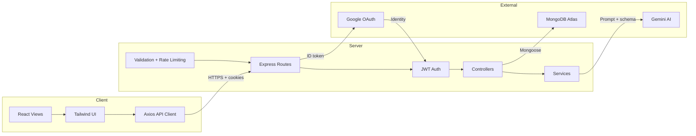
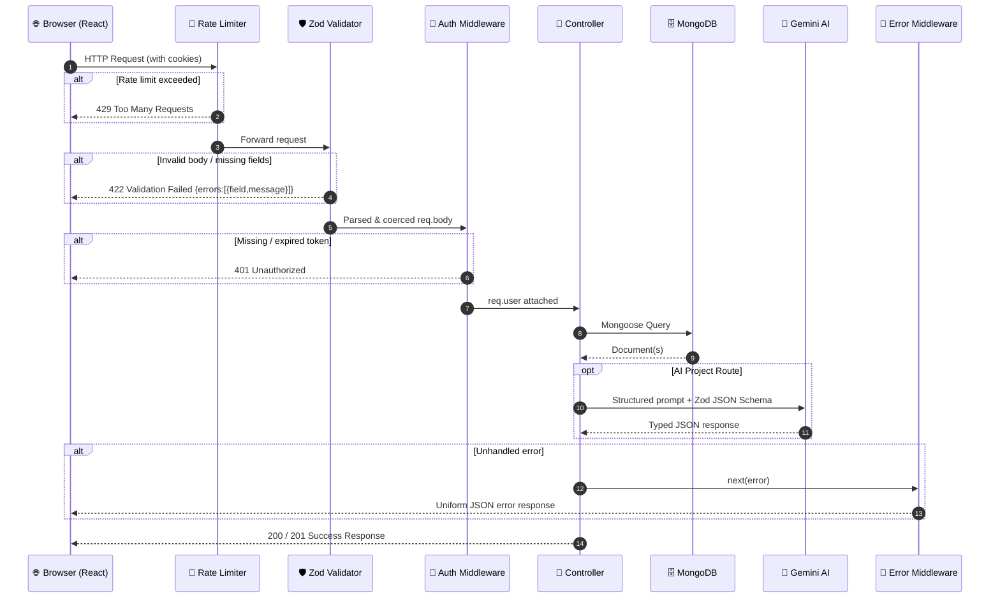
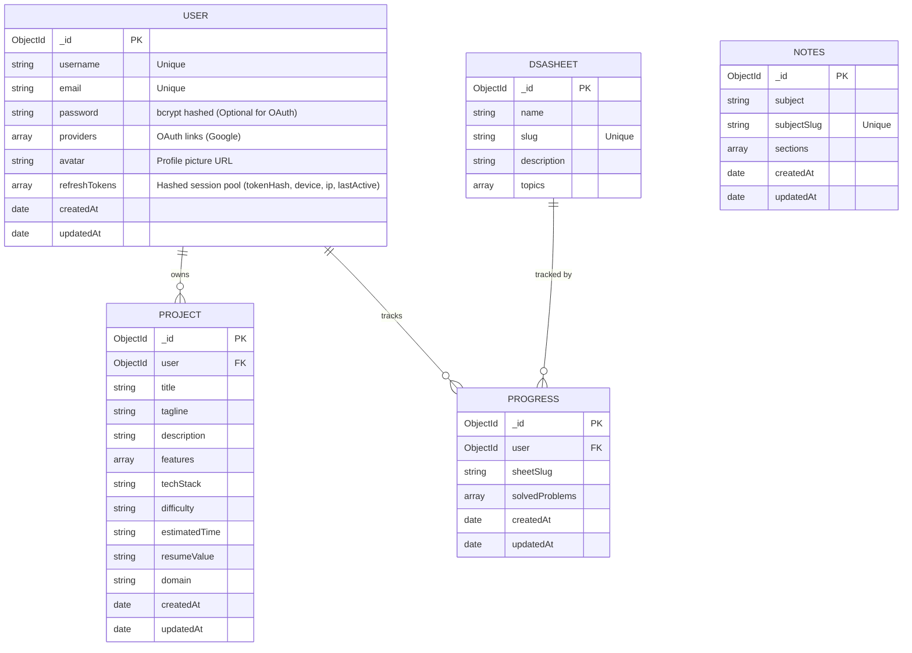

# PrepStack 🚀 <!-- omit in toc -->

<div align="center">

[](LICENSE)
[](https://github.com/SahilSameer18/prepstack/pulls)
[](https://react.dev/)
[](https://tailwindcss.com/)
[](https://expressjs.com/)
[](https://ai.google.dev/)

**A premium, full-stack SDE interview preparation ecosystem.**

[Live Demo](https://prepstack-ss.vercel.app) · [Report Bug](https://github.com/SahilSameer18/prepstack/issues) · [Request Feature](https://github.com/SahilSameer18/prepstack/issues)

</div>

---

PrepStack is a full-stack SDE interview preparation platform that unifies **AI-powered project generation**, **DSA progress tracking**, **CS fundamentals revision**, and **behavioral interview workflows** in one place.

---

## 📋 Table of Contents <!-- omit in toc -->

- [🎯 The Problem PrepStack Solves](#-the-problem-prepstack-solves)
- [⚡ High-Yield Technical Highlights](#-high-yield-technical-highlights)
- [📁 Directory Structure](#-directory-structure)
- [🏗️ Architectural Blueprint](#️-architectural-blueprint)
- [✨ Core Features \& Business Value](#-core-features--business-value)
- [🛠️ Deep-Dive Tech Stack](#️-deep-dive-tech-stack)
- [💾 Database Schema ERD](#-database-schema-erd)
- [🔗 API Endpoint Reference](#-api-endpoint-reference)
- [🚀 Local Installation \& Seeding Guide](#-local-installation--seeding-guide)
- [💼 Available Scripts](#-available-scripts)
- [🤝 Contributing](#-contributing)
- [📄 License](#-license)

---

## 🎯 The Problem PrepStack Solves

Candidates typically scatter preparation workflows across multiple disconnected tools: LeetCode/CodeStudio for DSA sheets, blog posts for CS theory, general-purpose LLMs for generic project ideas, and static templates for behavioral resumes.

PrepStack centralizes the workflow:

1. **Generates unique, recruiter-ready SDE project profiles** tailored to your tech stack and domain, returning STAR-style resume bullet points via Gemini AI.
2. **Tracks problem-solving progress asynchronously** across industry-standard DSA sheets (Striver A2Z + SDE, Blind75, NeetCode, Love Babbar) in one clean dashboard.
3. **Consolidates core CS theory revisions** (OS, DBMS, Networks, OOP) and behavioral STAR strategies in an interactive hub.

---

## ⚡ High-Yield Technical Highlights

- **Single-Roundtrip Dashboard Engine:** Aggregates all sheet progress, problem statistics, and AI project metrics into a single optimized `/api/user/dashboard-summary` endpoint using parallel Mongoose lookups and O(1) in-memory progress mapping.
- **Type-Safe GenAI Pipeline:** Builds the response schema with Zod's built-in `z.toJSONSchema` and sends it to the Gemini SDK. The reply is then checked again with `safeParse` before anything is saved; a malformed or incomplete reply never reaches the database.
- **Enterprise Multi-Device Hashed Auth:** Refresh tokens are never stored in plaintext: they are stored at rest as cryptographic **SHA-256 hashes** (`crypto.createHash('sha256')`), delivering sub-millisecond OpenSSL performance without blocking the Node.js event loop. Supports up to 10 simultaneous active devices with single-device logout and global session flushing (`/logout-all`).
- **Device Fingerprinting & Active Sessions Manager:** Native, zero-dependency User-Agent and client IP resolution utility mapping active sessions into human-readable device identifiers (*"Chrome on Windows 11"*, *"Safari on iPhone"*) with an interactive Profile UI supporting granular remote revocation.
- **Automated Password Revocation Policy:** Changing an account password immediately purges all *other* active device sessions from the database while seamlessly preserving the user's current device session.
- **GDPR Self-Service Data Erasure:** Full GDPR Article 17 compliance via `DELETE /api/user/account` featuring dual-mode credential verification (password check or email confirmation) and an atomic cascade wipeout across user progress, saved AI projects, and credentials.
- **Layered Request Validation:** Custom Express middleware `validate(schema)` intercepts and validates incoming HTTP requests using Zod schemas before hitting controllers, returning structured `422` field-specific errors.
- **Centralized Error Middleware:** Uniform error handler intercepts Zod validation errors, Mongoose validator/CastErrors (preventing internal DB leaks on invalid object IDs), JWT errors, and duplicate key constraints.
- **Route Rate Limiting:** In-memory, fixed-window limits via `express-rate-limit`, keyed by client IP (`req.ip`, using Express `trust proxy`) for `authLimiter` (10 failed tries / 15 min, used by login, Google sign-in and set-password), `registerLimiter` (30 / 15 min), `linkGoogleLimiter` (5 / 15 min) and `refreshLimiter` (30 / 15 min), and by user id for the AI generator (4 / hour). On login and Google sign-in only **failed** attempts count (so wrong-password guessing is throttled, but many students behind one campus Wi-Fi address can still log in); sign-ups and refreshes count every request; the AI limiter skips failed requests. Counters live in the server process: they reset on restart and are not shared between instances, so run a single instance or move them to a shared store (e.g. Redis) before scaling out.
- **Security Headers:** `helmet` sets standard hardening headers (`X-Content-Type-Options`, `Strict-Transport-Security`, `X-Frame-Options`, ...) and removes `X-Powered-By`.
- **Safe Startup & Shutdown:** The server listens only after MongoDB is connected, and `SIGTERM`/`SIGINT`/unhandled errors close the HTTP server and the database connection before exiting.
- **Health Check & Access Log:** `GET /health` (no login) returns `200 {"status":"ok","db":"up"}` while the database is connected and `503` when it is not, for hosts and uptime monitors. Every other request writes one log line (`METHOD /path status ms`); query strings and bodies are never logged.
- **Robust OAuth 2.0 Integration:** Built-in Google Sign-In with advanced account linking, anti-hijacking conflict resolution, and automatic unique username generation for OAuth users.
- **Interactive Live Avatar Customizer:** Integrates deterministic DiceBear bottts generation supporting live preset switching, randomized seed generation, and real-time reactive SVG previews.
- **Strict Cookie-Only Auth Transport:** Stripped raw JWTs from JSON responses; enforced 100% `httpOnly`, `secure`, and `sameSite` cookie transport across all auth endpoints to prevent client-side token leakage and XSS vulnerabilities.
- **Atomic Cascade Erasure:** MongoDB multi-document transactions (`session.withTransaction`) guarantee atomic deletion across user records, problem progress, and AI projects during GDPR account deletion.
- **Startup Secret Validation:** Fail-fast environment checks on server boot enforce the presence and minimum cryptographic length (≥32 characters) for `ACCESS_SECRET` and `REFRESH_SECRET`, and the presence of `GOOGLE_CLIENT_ID` (without it the Google sign-in token check would silently weaken).
- **Refresh-Token Replay Defence:** if a refresh token that was already rotated is used again after the 10-second grace window, the whole login session is deleted, so a stolen copy and the real user are both signed out. Password change and account deletion allow 10 failed attempts per 15 minutes per signed-in user.
- **Typed CS Notes Schema:** Enforced explicit `sectionSchema` validation ensuring structured and predictable payloads across all CS fundamental revision topics.
- **Apple Fluid Motion & Tactile Feedback:** Integrated physics-based spring curves across accordions, drawers, and modal sheets, paired with mobile-safe haptic taps (`navigator.vibrate(10)`) and full accessibility support (`prefers-reduced-motion`, `prefers-reduced-transparency`, `forced-colors`).
- **Zero-CLS Skeletons & Fluid UX:** Custom pixel-matched skeleton loaders prevent Cumulative Layout Shift (CLS) during asynchronous data fetching, coupled with a full-screen animated logout transition overlay.

---

## 📁 Directory Structure

```text
prepstack/
├── docs/                   # Design notes, debugging labs and audit write-ups
├── client/                 # React 19 Frontend
│   ├── public/             # Static public assets
│   ├── src/
│   │   ├── api/            # Axios instance and endpoints service layer
│   │   ├── components/     # Reusable UI components (skeletons, page loaders, errors)
│   │   ├── context/        # React Context stores (AuthContext, ProjectContext)
│   │   ├── data/           # Local static metadata (roadmaps, behavioral questions)
│   │   ├── hooks/          # React hooks interfacing contexts (useAuth, useProject, useNotes)
│   │   ├── layout/         # UI templates (NavBar, SideBar)
│   │   ├── pages/          # Heavy routing pages (DSA, CS Notes, Dashboard, Resume, Profile)
│   │   ├── utils/          # Client utilities (avatar generator, error extractors)
│   │   ├── seo/            # Per-page titles, descriptions and share tags (one source of truth)
│   │   ├── app.routes.jsx  # Route table (login-protected pages use ProtectedRoute)
│   │   ├── App.jsx         # App shell
│   │   └── main.jsx        # React entrypoint configuration
│   ├── scripts/            # Build-time prerender and SEO checks
│   └── vite.config.js      # Bundling settings
└── server/                 # Express 5 Backend
    ├── src/
    │   ├── config/         # Database configurations
    │   ├── controllers/    # Express controllers (handling requests and next errors)
    │   ├── data/           # Seeder markdown payloads for notes
    │   ├── middlewares/    # Custom middlewares (auth, validation, global error, rate limit)
    │   ├── models/         # MongoDB schemas (User, Notes, Progress, Project, DSASheet)
    │   ├── routes/         # Express API routers
    │   ├── seed/           # Seed executors and dataset definitions (LoveBabbar, Striver, NeetCode)
    │   ├── services/       # AI generation wrappers
    │   ├── utils/          # Token operations and helper utilities
    │   ├── validators/     # Zod validation schemas (auth, project, user)
    │   └── app.js          # Express app entry definition
    ├── test/               # API tests (node:test + supertest + in-memory MongoDB)
    └── server.js           # Database listener bootstrap
```

---

## 🏗️ Architectural Blueprint

### System Overview



---

### Request Lifecycle



---

### Multi-Device Hashed Token Refresh Flow

```mermaid
sequenceDiagram
    autonumber
    participant Browser as 🌐 Browser (Device)
    participant API as ⚙️ Express API
    participant DB as 🗄️ MongoDB (user.refreshTokens)

    Browser->>API: POST /api/auth/refresh (Cookie: refreshToken)
    API->>API: jwt.verify(token, REFRESH_SECRET)
    API->>API: hashToken(token) -> SHA-256 Hash
    API->>DB: findOneAndUpdate: swap in the new hash only if this session still holds the old one (one atomic step)

    alt Swap matched (normal case)
        API-->>Browser: 200 OK (Set-Cookie: new accessToken & new refreshToken)
    else No match, but this exact token was rotated less than 10 s ago (two tabs refreshed together)
        API-->>Browser: 200 OK (new accessToken only; the winning tab already set the new refresh cookie)
    else Unknown, revoked, expired or older replayed token
        API-->>Browser: 403 Forbidden { message: "Invalid or expired refresh token" }
    end
```

---

## ✨ Core Features & Business Value

### 🤖 AI-Powered Project Generation

- **Dynamic Prompts:** Accepts tech stack, domain (FinTech, SaaS, Web3), complexity level (`beginner`/`intermediate`/`advanced`), and extra constraints.
- **Recruiter-Ready Output:** Gemini generates project descriptions, tagging, estimated timeline, and STAR resume bullets.
- **Reliable AI cascade (free tier only):** idea generation tries `gemini-3-flash-preview`, then `gemini-3.5-flash-lite`, then `gemini-3.1-flash-lite`, then Groq `openai/gpt-oss-120b`. One retry for "overloaded" errors (never for quota errors), 20 s per call, 55 s in total, at most 5 calls, and a circuit breaker that skips a provider that keeps failing. Model names and keys are settings (`GEMINI_*_MODEL`, `GROQ_MODEL`, `GROQ_API_KEY`), so retiring a model is a config change. If every provider fails the user gets a clear message and the attempt does not count. Full design and limits: `GROQ.md`.
- **Abuse Protection:** 4 project requests per hour and 15 saved ideas per 24 hours per signed-in user (failed requests are not counted), and only one idea can be generated at a time per user (a second request gets `409`). The page offers 14 tech stack buttons plus **Other (type your own)**: a typed name must be 2 to 40 characters of letters, numbers and `+ # . / & ( ) -`, and the AI is first asked whether it is a real technology (answers are remembered; if the check cannot run the idea is still generated). A user who gets 5 "not a technology" answers in an hour is paused for the rest of the hour, so junk input cannot drain the shared free quota.

### 📈 Dynamic DSA Trackers

- **Industry Sheets:** Tracks Blind 75, NeetCode 150, Striver A2Z, Striver SDE, and Love Babbar 450.
- **Live Sync:** Problem completions toggle asynchronously, instantly refreshing dashboard metrics.

### 📚 CS Fundamentals Library

- **Pre-Seeded Notes:** High-performance revision cards covering OS, DBMS, Computer Networks, and OOP.

### 📝 STAR Resume & Behavioral Hub

- **STAR Prompts:** Complete, interactive STAR templates for mapping experiences.
- **Behavioral Bank:** Category-sorted bank of questions with expert strategies and answer blueprints.

### 🗺️ Curated Developer Roadmaps

- **6 End-to-End Learning Tracks:** Structured roadmaps for **Frontend**, **Backend**, **Full Stack MERN**, **Android Development**, **Data Analytics**, and **Machine Learning**.
- **Actionable Steps & Milestones:** Breaks down complex subjects into step-by-step milestones with estimated completion times, difficulty tiers, and curated free resources.

### 👤 Unified Profile & Security Hub

- **Dual-Identity Management:** Seamlessly link Google OAuth and Email/Password authentications, including the ability for OAuth-only users to establish a permanent password directly from their profile page.
- **Active Devices & Sessions Manager:** Visual inspection of all authenticated devices (*"Chrome on Windows 11"*, *"Safari on iPhone"*) with IP addresses, last-active timestamps, live current device indicators, and individual remote session revocation.
- **Dual Session Sign-Out Controls:** Supports isolated single-device logout or global session flushing (*"Sign Out of All Devices"* via `POST /api/auth/logout-all`).
- **GDPR Self-Service Account Deletion:** Built-in modal allowing users to permanently erase their account with password/email verification, executing an atomic cascade wipe of all progress and projects.
- **Full-Screen Logout Overlay:** Seamless full-screen transition overlay that smoothly clears session state with visual feedback.
- **Dynamic Avatars:** Integrates the open-source DiceBear API to automatically generate unique, tech-themed robot avatars for users without Google profile pictures.
- **Live Stats Engine:** Real-time aggregation of your total solved DSA problems and generated AI projects.

---

## 🛠️ Deep-Dive Tech Stack

### Frontend

| Technology          | Version | Role                                        |
| ------------------- | ------- | ------------------------------------------- |
| React               | 19.2    | UI library (concurrent rendering)           |
| Vite                | 7       | Build tooling & HMR                         |
| Tailwind CSS        | v4      | Utility-first styling engine                |
| Framer Motion       | 12      | Fluid UI transitions & animations           |
| React Router DOM    | 7       | Client routing layer                        |
| Axios               | latest  | Configured HTTP client (with credentials)   |
| @react-oauth/google | latest  | Secure Google Identity Services integration |
| DiceBear API        | 7.x     | Dynamic, deterministic avatar generation    |

### Backend

| Technology          | Version | Role                                                  |
| ------------------- | ------- | ----------------------------------------------------- |
| Node.js + Express   | 5.2     | Web app framework (native async errors)               |
| Mongoose            | 9       | MongoDB Object Document Mapper (ODM)                  |
| Zod                 | 4       | Server validation and structured schema config        |
| helmet              | 8       | Standard HTTP security headers                        |
| @google/genai       | 1.47    | Official SDK client for Gemini integrations           |
| groq-sdk            | 1.6     | Backup AI provider when Gemini is busy                |
| jsonwebtoken        | 9       | Cryptographic user session tokens                     |
| bcrypt              | 6       | Salted security hashing (12 rounds)                   |
| cookie-parser       | 1.4     | Secure browser cookie management                      |
| express-rate-limit  | 8.5     | IP request flood limiter                              |
| google-auth-library | latest  | Official backend SDK for Google ID token verification |

---

## 💾 Database Schema ERD



---

## 🔗 API Endpoint Reference

### Authentication: `/api/auth`

| Method   | Endpoint                | Auth   | Description                                                    |
| -------- | ----------------------- | ------ | -------------------------------------------------------------- |
| `POST`   | `/register`             | None   | Register user _(rate-limited: 30/15min)_                       |
| `POST`   | `/login`                | None   | Login user _(10 failed tries/15min)_                           |
| `POST`   | `/google`               | None   | Google OAuth login/registration                                |
| `POST`   | `/link-google`          | ✅ JWT | Link Google account to existing user _(rate-limited: 5/15min)_ |
| `PUT`    | `/set-password`         | ✅ JWT | Sets a permanent password for OAuth-only users                 |
| `POST`   | `/refresh`              | Cookie | Rotates access token and refresh token hash _(30/15min)_        |
| `POST`   | `/logout`               | ✅ JWT | Clears session cookie on current device                        |
| `POST`   | `/logout-all`           | ✅ JWT | Revokes all active device sessions globally                    |
| `GET`    | `/sessions`             | ✅ JWT | Lists all active device sessions with telemetry                |
| `DELETE` | `/sessions/:sessionId`  | ✅ JWT | Revokes a specific active device session                       |
| `GET`    | `/current-user`         | ✅ JWT | Retrieves current user session data                            |

### User Profile: `/api/user`

| Method   | Endpoint             | Auth   | Description                                                     |
| -------- | -------------------- | ------ | --------------------------------------------------------------- |
| `GET`    | `/dashboard-summary` | ✅ JWT | Single-roundtrip pre-aggregated dashboard metrics & sheet stats |
| `GET`    | `/stats`             | ✅ JWT | Aggregates and returns total solved DSA and AI projects         |
| `PUT`    | `/profile`           | ✅ JWT | Updates unique username and avatar with strict Zod validation   |
| `PUT`    | `/change-password`   | ✅ JWT | Verifies password, updates hash, and revokes other devices      |
| `DELETE` | `/account`           | ✅ JWT | Permanently deletes account & wipes progress (GDPR Erasure)     |

### AI Projects: `/api/project`

| Method   | Endpoint      | Auth   | Description                                          |
| -------- | ------------- | ------ | ---------------------------------------------------- |
| `POST`   | `/generate`   | ✅ JWT | Generates an idea with the AI cascade _(4/hr, 15/24h, one at a time)_ |
| `GET`    | `/`           | ✅ JWT | Returns all saved projects                           |
| `GET`    | `/:projectId` | ✅ JWT | Returns specific project metadata                    |
| `DELETE` | `/:projectId` | ✅ JWT | Deletes project profile                              |

### DSA Sheets: `/api/sheets`

| Method | Endpoint          | Auth   | Description                                |
| ------ | ----------------- | ------ | ------------------------------------------ |
| `GET`  | `/`               | None   | Lists all DSA sheets                       |
| `GET`  | `/:slug`          | None   | Returns sheet sections and problem links   |
| `GET`  | `/:slug/progress` | ✅ JWT | Returns active user solved problems        |
| `POST` | `/:slug/progress` | ✅ JWT | Toggles state of problem (solved/unsolved) |

### CS Notes: `/api/notes`

| Method | Endpoint    | Auth | Description                               |
| ------ | ----------- | ---- | ----------------------------------------- |
| `GET`  | `/`         | None | Returns CS note categories                |
| `GET`  | `/:subject` | None | Returns core sections/content for subject |

---

## 🚀 Local Installation & Seeding Guide

### 1. Setup Codebase

```bash
git clone https://github.com/SahilSameer18/prepstack.git
cd prepstack
```

### 2. Configure Server (`server/`)

```bash
cd server
npm install
cp .env.example .env
```

Configure your `.env` file under `/server`:

```env
PORT=3000
MONGO_URI=mongodb://127.0.0.1:27017/prepstack
ACCESS_SECRET=your_ultra_secure_access_token_secret
REFRESH_SECRET=your_ultra_secure_refresh_token_secret
GOOGLE_API_KEY=AIzaSyYourGeminiApiKeyHere
GOOGLE_CLIENT_ID=your_google_oauth_client_id

# Optional AI fallbacks (all in server/.env.example): a Groq key and the model names tried, in order
GROQ_API_KEY=
GEMINI_PRIMARY_MODEL=gemini-3-flash-preview
GEMINI_FALLBACK_MODEL=gemini-3.5-flash-lite
GEMINI_FALLBACK_2_MODEL=gemini-3.1-flash-lite
GROQ_MODEL=openai/gpt-oss-120b
AI_DAILY_LIMIT=15

# Optional (all explained in server/.env.example)
NODE_ENV=development
ALLOWED_ORIGINS=
ENABLE_CUSTOM_DNS=
```

`ALLOWED_ORIGINS` is a comma-separated list of extra front-end URLs allowed by CORS (exact match). Set `ENABLE_CUSTOM_DNS=true` only if your ISP cannot resolve `mongodb+srv://` addresses. On a production host set `NODE_ENV=production` and add your deployed front-end URL to `ALLOWED_ORIGINS`.

Boot Express server:

```bash
npm run dev
```

### 3. Configure Client (`client/`)

In a new terminal:

```bash
cd client
npm install
cp .env.example .env.development
```

Configure your `.env.development` file under `/client`:

```env
VITE_API_URL=http://localhost:3000
VITE_GOOGLE_CLIENT_ID=your_google_oauth_client_id
```

Optional (production builds only): `VITE_SITE_URL` (your public address, used in canonical links and the sitemap) and `VITE_GSC_VERIFICATION` (Google Search Console verification code).

Boot Vite dev server:

```bash
npm run dev
```

### 4. Database Seed

To populate sheets and CS revision datasets:

```bash
cd server
npm run seed:all
```

_(Uses idempotent upsert logic: safe to run multiple times)._

---

## 💼 Available Scripts

### Backend (`server/`)

| Script               | Description                                |
| -------------------- | ------------------------------------------ |
| `npm run dev`        | Boots dev environment using nodemon        |
| `npm start`          | Launches server                            |
| `npm run seed:notes` | Seeds CS Note items                        |
| `npm run seed:all`   | Idempotently seeds DSA Sheets and CS notes |
| `npm test`           | Runs the API test suite (in-memory database, no real keys needed) |
| `npm run test:coverage` | Same, with a coverage report              |

### Frontend (`client/`)

| Script            | Description                       |
| ----------------- | --------------------------------- |
| `npm run dev`     | Launches dev build server         |
| `npm run build`   | Builds the bundle, then writes one HTML page per route (title, description, share tags), `sitemap.xml` and `robots.txt`, and fails if any SEO check fails |
| `npm run build:app` | Plain Vite build only (no SEO step) |
| `npm run lint`    | Analyzes code styling with ESLint |
| `npm run preview` | Previews production bundle output |

---

## 🤝 Contributing

We welcome open-source contributions! Please follow the **[Conventional Commits](https://www.conventionalcommits.org/)** specification when submitting pull requests.

1. Fork the Project.
2. Create your Feature Branch (`git checkout -b feat/amazing-feature`).
3. Commit changes using Conventional Commits format (`git commit -m 'feat: add amazing feature'`).
   - `feat: ...` for new features
   - `fix: ...` for bug fixes
   - `refactor: ...` for code restructuring
   - `docs: ...` for documentation updates
4. Push feature branch (`git push origin feat/amazing-feature`).
5. Open a Pull Request.

---

## 📄 License

Distributed under the MIT License. See `LICENSE` for details.

---

<p align="center">Made with ❤️ by Sahil Sameer Siddique</p>