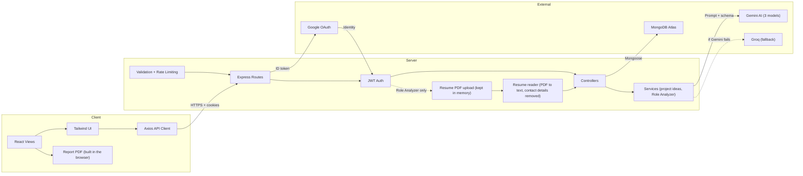
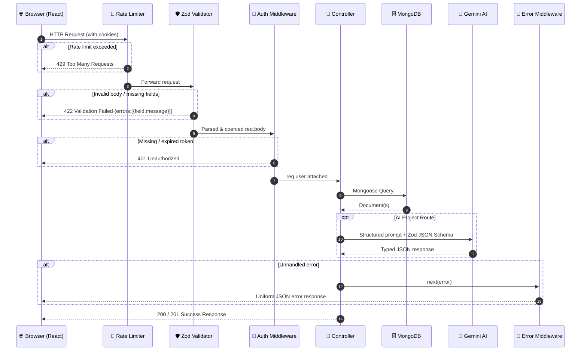
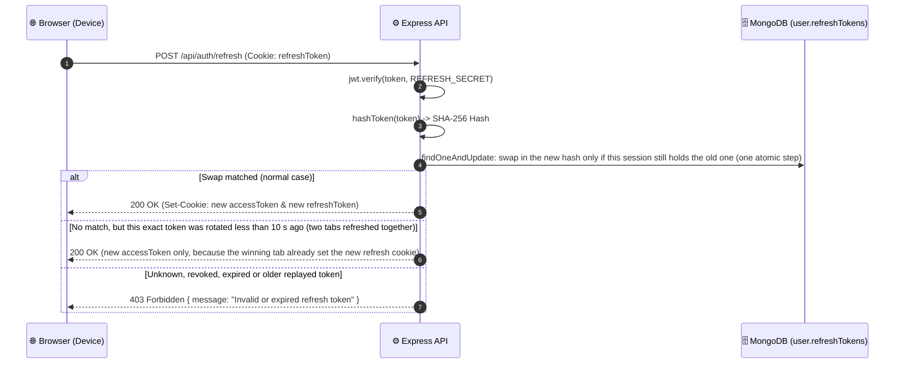
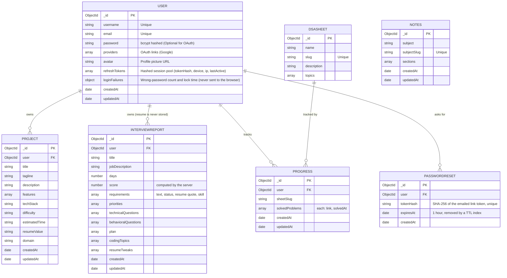

# PrepStack 🚀 <!-- omit in toc -->

<div align="center">

[](LICENSE)
[](https://github.com/SahilSameer18/prepstack/pulls)
[](https://react.dev/)
[](https://tailwindcss.com/)
[](https://expressjs.com/)
[](https://ai.google.dev/)

**A full-stack SDE interview preparation platform: DSA sheets, CS notes, AI project ideas and a resume-vs-job analyzer.**

[Live Demo](https://prepstack-ss.vercel.app) · [Report Bug](https://github.com/SahilSameer18/prepstack/issues) · [Request Feature](https://github.com/SahilSameer18/prepstack/issues)

</div>

---

PrepStack is a full-stack SDE interview preparation platform that unifies **AI-powered project generation**, **DSA progress tracking**, **CS fundamentals revision**, **behavioral interview workflows** and a **Role Analyzer** (match your resume to a job description) in one place.

---

## 📋 Table of Contents <!-- omit in toc -->

- [🎯 The Problem PrepStack Solves](#-the-problem-prepstack-solves)
- [⚡ High-Yield Technical Highlights](#-high-yield-technical-highlights)
- [📁 Directory Structure](#-directory-structure)
- [🏗️ Architectural Blueprint](#️-architectural-blueprint)
- [✨ Core Features \& Business Value](#-core-features--business-value)
- [🛠️ Deep-Dive Tech Stack](#️-deep-dive-tech-stack)
- [💾 Database Schema ERD](#-database-schema-erd)
- [🔗 API Endpoint Reference](#-api-endpoint-reference)
- [🚀 Local Installation \& Seeding Guide](#-local-installation--seeding-guide)
- [💼 Available Scripts](#-available-scripts)
- [🧪 Testing](#-testing)
- [⚠️ Known Limitations](#️-known-limitations)
- [🤝 Contributing](#-contributing)
- [📄 License](#-license)

---

## 🎯 The Problem PrepStack Solves

Candidates typically scatter preparation workflows across multiple disconnected tools: LeetCode/CodeStudio for DSA sheets, blog posts for CS theory, general-purpose LLMs for generic project ideas, and static templates for behavioral resumes.

PrepStack centralizes the workflow:

1. **Generates unique, recruiter-ready SDE project profiles** tailored to your tech stack and domain, returning STAR-style resume bullet points via Gemini AI.
2. **Tracks problem-solving progress asynchronously** across industry-standard DSA sheets (Striver A2Z + SDE, Blind75, NeetCode, Love Babbar) in one clean dashboard.
3. **Consolidates core CS theory revisions** (OS, DBMS, Networks, OOP) and behavioral STAR strategies in an interactive hub.
4. **Matches your resume to a real job description** and turns the gaps into a study plan that links back to PrepStack's own sheets, notes and roadmaps (the Role Analyzer: score computed by code, every quote checked against the resume).

---

## ⚡ High-Yield Technical Highlights

- **Single-Roundtrip Dashboard Engine:** Aggregates all sheet progress, problem statistics, and AI project metrics into a single optimized `/api/user/dashboard-summary` endpoint using parallel Mongoose lookups and O(1) in-memory progress mapping.
- **Type-Safe GenAI Pipeline:** Builds the response schema with Zod's built-in `z.toJSONSchema` and sends it to the Gemini SDK. The reply is then checked again with `safeParse` before anything is saved; a malformed or incomplete reply never reaches the database.
- **Multi-Device Hashed Auth:** Refresh tokens are never stored in plaintext: they are stored at rest as **SHA-256 hashes** (`crypto.createHash('sha256')`, from Node's built-in `crypto`, no extra package). Supports up to 10 simultaneous active devices with single-device logout and global session flushing (`/logout-all`).
- **Refresh-Token Replay Defence:** if a refresh token that was already rotated is used again after the 10-second grace window, the whole login session is deleted, so a stolen copy and the real user are both signed out. Password change and account deletion allow 10 failed attempts per 15 minutes per signed-in user.
- **Per-Account Login Lock:** 10 wrong passwords on one account within 15 minutes lock password logins for that account for 15 minutes, even when the guesses come from many different addresses. Google sign-in, token refresh and devices that are already logged in are not affected. The count is one atomic database update, so parallel guesses cannot skip it. Known trade-off: someone can lock a victim out for 15 minutes by failing on purpose.
- **Password Reset by Email:** "Forgot password?" answers the same for known and unknown emails, and sends the mail in the background through Brevo's SMTP relay. The link holds 32 random bytes; only its SHA-256 hash is stored; it works once for 1 hour; setting the new password signs out every device and lifts any login lock, and changing the password in Settings cancels any link that is still waiting.
- **Layered Request Validation:** Custom Express middleware `validate(schema)` intercepts and validates incoming HTTP requests using Zod schemas before hitting controllers, returning structured `422` field-specific errors.
- **Route Rate Limiting:** In-memory, fixed-window limits via `express-rate-limit`, keyed by client IP (`req.ip`, using Express `trust proxy`) for `authLimiter` (10 failed tries / 15 min, used by login, Google sign-in and set-password), `registerLimiter` (30 / 15 min), `linkGoogleLimiter` (5 / 15 min), `refreshLimiter` (30 / 15 min), `forgotPasswordLimiter` (5 / 15 min) and `resetPasswordLimiter` (10 failed / 15 min), and by user id for the AI generator (4 / hour) and the Role Analyzer (3 / hour). On login and Google sign-in only **failed** attempts count (so wrong-password guessing is throttled, but many students behind one campus Wi-Fi address can still log in); sign-ups and refreshes count every request; the AI limiter skips failed requests. Counters live in the server process: they reset on restart and are not shared between instances, so run a single instance or move them to a shared store (e.g. Redis) before scaling out.
- **Startup Secret Validation:** Fail-fast environment checks on server boot enforce the presence and minimum cryptographic length (≥32 characters) for `ACCESS_SECRET` and `REFRESH_SECRET`, and the presence of `GOOGLE_CLIENT_ID` (without it the Google sign-in token check would silently weaken).
- **Safe Startup & Shutdown:** The server listens only after MongoDB is connected, and `SIGTERM`/`SIGINT`/unhandled errors close the HTTP server and the database connection before exiting.
- **Health Check & Access Log:** `GET /health` (no login) returns `200 {"status":"ok","db":"up"}` while the database is connected and `503` when it is not, for hosts and uptime monitors. Every other request writes one log line (`METHOD /path status ms`); query strings and bodies are never logged.

> **More:** 12 more engineering details (sessions, account erasure, OAuth, cookies, motion and loading work) are in [docs/ENGINEERING.md](docs/ENGINEERING.md). Testing is described in [TESTING.md](TESTING.md).

---

## 📁 Directory Structure

```text
prepstack/
├── docs/                        # More technical details (ENGINEERING.md) and working notes
├── PROJECT_STATUS.md            # What is done, what is left, and the build order
├── CLAUDE.md                    # Rules for AI agents working on the project
├── TESTING.md                   # What is tested and how
├── LICENSE                      # MIT
├── client/                      # React 19 frontend
│   ├── public/                  # Static public assets
│   ├── scripts/                 # Build-time prerender and SEO checks
│   ├── src/
│   │   ├── api/                 # Axios instance (with refresh interceptor) and service layer
│   │   ├── components/          # Navbar, Footer, home page blocks, auth guard, UI states
│   │   │   ├── analyzer/        # Score ring, requirement rows, skill gap cards, dashboard reports tab
│   │   │   └── pdf/             # The report as a PDF (loaded only on download)
│   │   ├── context/             # React Context stores (Auth, Project)
│   │   ├── data/                # Static data (roadmaps, behavioral questions)
│   │   ├── hooks/               # useAuth, useProject, useNotes, ...
│   │   ├── layout/              # MainLayout
│   │   ├── pages/               # DSA sheets, CS notes, roadmaps, AI projects, Role Analyzer, Dashboard, Profile, legal
│   │   ├── seo/                 # Per-page titles, descriptions and share tags (one source of truth)
│   │   ├── utils/               # Error messages, dates and titles, report links, PDF export, avatars
│   │   ├── app.routes.jsx       # Route table (login-protected pages use ProtectedRoute)
│   │   └── main.jsx             # React entrypoint
│   └── vite.config.js           # Bundling settings
└── server/                      # Express 5 backend
    ├── scripts/                 # Hand-run tools: list models, compare models, evaluate the analyzer on sample resumes
    ├── src/
    │   ├── config/              # Database configuration
    │   ├── controllers/         # Request handlers (auth, user, sheets, notes, project, analyzer)
    │   ├── data/                # CS notes content, skill catalog (120 skills), behavioral question bank
    │   ├── middlewares/         # Auth, validation, errors, rate limits, PDF upload
    │   ├── models/              # User, Notes, Progress, Project, DSASheet, InterviewReport, ProblemNote, PasswordReset
    │   ├── routes/              # Express routers
    │   ├── seed/                # Seed scripts and dataset definitions
    │   ├── services/            # AI provider chain, analyzer, resume reader, skill matcher, email sender
    │   ├── utils/               # Tokens, device parsing, response helpers
    │   ├── validators/          # Zod schemas (auth, sheets, project, user, analyzer)
    │   └── app.js               # Express app definition
    ├── test/                    # API and service tests (node:test + supertest + in-memory MongoDB)
    └── server.js                # Startup and shutdown
```

---

## 🏗️ Architectural Blueprint

### System Overview



_The Role Analyzer path: the resume PDF is read in memory, contact details are removed, the text goes to the AI, and the reply is checked again by code. The resume itself is never stored._

---

### Request Lifecycle



_This is a simplified view. The exact middleware order differs per route: for example the Role Analyzer route runs auth first, then its rate limit, then the PDF upload, then validation._

---

### Multi-Device Hashed Token Refresh Flow



---

## ✨ Core Features & Business Value

### 🤖 AI-Powered Project Generation

- **Dynamic Prompts:** Accepts tech stack, domain (FinTech, SaaS, Web3), complexity level (`beginner`/`intermediate`/`advanced`), and extra constraints.
- **Recruiter-Ready Output:** Gemini generates project descriptions, tagging, estimated timeline, and STAR resume bullets.
- **Reliable AI cascade (free tier only):** idea generation tries `gemini-3-flash-preview`, then `gemini-3.5-flash-lite`, then `gemini-3.1-flash-lite`, then Groq `openai/gpt-oss-120b`. One retry for "overloaded" errors (never for quota errors), 20 s per call, 55 s in total, at most 5 calls, and a circuit breaker that skips a provider that keeps failing. Model names and keys are settings (`GEMINI_*_MODEL`, `GROQ_MODEL`, `GROQ_API_KEY`), so retiring a model is a config change. If every provider fails the user gets a clear message and the attempt does not count.
- **Abuse Protection:** 4 project requests per hour and 15 saved ideas per 24 hours per signed-in user (failed requests are not counted), and only one idea can be generated at a time per user (a second request gets `409`). The page offers 13 tech stack buttons plus **Other (type your own)**: a typed name must be 2 to 40 characters of letters, numbers and `+ # . / & ( ) -`, and the AI is first asked whether it is a real technology (answers are remembered; if the check cannot run the idea is still generated). A user who gets 5 "not a technology" answers in an hour is paused for the rest of the hour, so junk input cannot drain the shared free quota.

### 🎯 Role Analyzer (resume vs job description)

Paste a job description and add your resume (PDF or pasted text). You get a report with a match score, each requirement marked met / partly / missing with a quote from your resume, the skills you lack with where to learn them, likely technical and behavioral questions, and a day-by-day plan. Everything it links to is something PrepStack really has.

- **The code decides, not the AI.** The AI only reads the text: it lists the job's requirements, marks each one, and quotes proof. The score is computed by the server (must-have = 3 points, nice-to-have = 1; met = full, partly = half). Every quote is checked against the resume; a quote that cannot be found downgrades that requirement. Skill names come from a closed list of 120 skills (`server/src/data/skillCatalog.json`; the AI may write any text, and the code turns a name that is not on the list into "none"), titles must come from the job description (and are shown in Title Case, at most 60 characters), and plan links are kept only if they point at content that exists (Blind 75 topics, CS notes sections, roadmaps, behavioral questions).
- **Privacy:** the resume is never stored. Email, phone number and links are removed before anything leaves the server, and only the report (with short quotes) is saved. The user must tick a consent box (the text goes to Google and, if Gemini is busy, to Groq). Deleting an account deletes its reports.
- **Limits:** PDF only (checked by its first bytes), 3 MB, 5 pages, 10 s to read, scanned PDFs are rejected with a clear message. 3 reports per hour and 5 per 24 hours per user (`ANALYZER_DAILY_LIMIT`; failed attempts are not counted), one report at a time (`409`).
- **Skill advice is computed on every read** from the catalog (never stored), so improving the catalog improves old reports. Each skill points at DSA topics, CS notes, a roadmap, the Behavioral Prep page (soft skills) or an AI project idea (`/ai-projects?stack=...`), plus official docs. About half of the catalog has no PrepStack lessons yet; those skills show docs links only.
- **Screens:** `/analyzer` (form and recent reports) and `/analyzer/:id` (tabs: Plan, Skills, Questions, Resume tips). Both are behind login and hidden from search engines.
- **PDF download:** built in the browser with `@react-pdf/renderer` (PrepStack links and docs links stay clickable). The library is a separate ~1.2 MB chunk that loads only when the user clicks Download PDF. It uses the standard PDF fonts, so characters outside basic Latin may not draw.

### 📈 Dynamic DSA Trackers

- **Industry Sheets:** Tracks Blind 75, NeetCode 150, Striver A2Z, Striver SDE, and Love Babbar 450.
- **Live Sync:** Problem completions toggle asynchronously, instantly refreshing dashboard metrics.

### 📚 CS Fundamentals Library

- **Notes written from sources:** All five subjects are written as Markdown sections from sources: DBMS 10, Computer Networks 10, Operating Systems 11, OOP 10 (OOP uses Java, and every Java example was compiled and run) and System Design 23 (11 concepts and 12 case studies, with architecture and sequence diagrams and every number computed by a script). Each has an overview, topics with an example and a failure case, interview questions, mistakes, a 5-question quiz and diagrams, in easy words, with a source list and a claims table in `docs/content/`. Diagrams are drawn from plain data in four kinds: flow, layers, graph (architecture pictures with database, queue and cache shapes, zone boxes and numbered or dashed arrows) and sequence (messages over time); the planned System Design notes (`docs/plans/HLD_NOTES_PLAN.md`) may have up to 6 per section, every other subject 3. A section shows its last-checked date; none has been read by an outside reviewer yet.

### 📝 STAR Resume & Behavioral Hub

- **STAR Prompts:** Complete, interactive STAR templates for mapping experiences.
- **Behavioral Bank:** 50 questions in 10 groups (personal, teamwork, conflict, failure, leadership, responsibility, deadlines, unclear situations, feedback, motivation). Each has what the interviewer is looking for, a four-part STAR plan, a made-up example answer and two mistakes to avoid, in easy words.

### 🗺️ Curated Developer Roadmaps

- **9 Learning Tracks:** **Frontend**, **Backend**, **Full Stack MERN**, **Android Development**, **Data Analytics**, **Machine Learning**, **DSA & Problem Solving**, **Java & Spring Boot** and **DevOps & Cloud**. Every step has a goal, topics, a time range, practice links into PrepStack, a checkpoint, a mini-project and 2 to 3 free official resources, all in plain words.
- **Actionable Steps & Milestones:** Breaks down complex subjects into step-by-step milestones with estimated completion times, difficulty tiers, and curated free resources.

### 👤 Unified Profile & Security Hub

- **Dual-Identity Management:** Seamlessly link Google OAuth and Email/Password authentications, including the ability for OAuth-only users to establish a permanent password directly from their profile page.
- **Active Devices & Sessions Manager:** Visual inspection of all authenticated devices (*"Chrome on Windows 11"*, *"Safari on iPhone"*) with IP addresses, last-active timestamps, live current device indicators, and individual remote session revocation.
- **Password Reset by Email:** "Forgot password?" on the login page sends a one-time link (valid for 1 hour, works once). Setting a new password signs out all devices.
- **Dual Session Sign-Out Controls:** Supports isolated single-device logout or global session flushing (*"Sign Out of All Devices"* via `POST /api/auth/logout-all`).
- **Self-Service Account Deletion:** Built-in modal allowing users to permanently erase their account with password/email verification. All of their data (progress, projects and role reports) is wiped in one step; this is a single transaction on a replica set such as MongoDB Atlas, and falls back to a plain sequence of deletes on a standalone MongoDB.
- **Full-Screen Logout Overlay:** Seamless full-screen transition overlay that smoothly clears session state with visual feedback.
- **Dynamic Avatars:** Integrates the open-source DiceBear API to automatically generate unique, tech-themed robot avatars for users without Google profile pictures.
- **Live Stats Engine:** Aggregation of your total solved DSA problems, generated AI projects and role reports, shown in a dashboard with DSA / Projects / Reports tabs.

---

## 🛠️ Deep-Dive Tech Stack

### Frontend

| Technology          | Version | Role                                        |
| ------------------- | ------- | ------------------------------------------- |
| React               | 19.2    | UI library (concurrent rendering)           |
| Vite                | 7       | Build tooling & HMR                         |
| Tailwind CSS        | v4      | Utility-first styling engine                |
| Framer Motion       | 12      | Fluid UI transitions & animations           |
| React Router DOM    | 7       | Client routing layer                        |
| Axios               | latest  | Configured HTTP client (with credentials)   |
| @react-oauth/google | latest  | Secure Google Identity Services integration |
| DiceBear API        | 7.x     | Dynamic, deterministic avatar generation    |
| @react-pdf/renderer | 4.9     | Role Analyzer report PDF (loaded only on download) |
| react-hot-toast     | 2.6     | Toast notifications                         |

### Backend

| Technology          | Version | Role                                                  |
| ------------------- | ------- | ----------------------------------------------------- |
| Node.js + Express   | 5.2     | Web app framework (native async errors)               |
| Mongoose            | 9       | MongoDB Object Document Mapper (ODM)                  |
| Zod                 | 4       | Server validation and structured schema config        |
| helmet              | 8       | Standard HTTP security headers                        |
| @google/genai       | 1.47    | Official SDK client for Gemini integrations           |
| groq-sdk            | 1.6     | Backup AI provider when Gemini is busy                |
| nodemailer          | 10.4    | Sends the password reset email (Brevo SMTP)           |
| multer              | 2.5     | Resume PDF upload (kept in memory, never written to disk) |
| pdf-parse           | 2.4     | Reads the text of an uploaded PDF resume              |
| jsonwebtoken        | 9       | Cryptographic user session tokens                     |
| bcrypt              | 6       | Salted security hashing (12 rounds)                   |
| cookie-parser       | 1.4     | Secure browser cookie management                      |
| express-rate-limit  | 8.5     | IP request flood limiter                              |
| google-auth-library | latest  | Official backend SDK for Google ID token verification |

---

## 💾 Database Schema ERD



---

## 🔗 API Endpoint Reference

### Authentication: `/api/auth`

| Method   | Endpoint                | Auth   | Description                                                    |
| -------- | ----------------------- | ------ | -------------------------------------------------------------- |
| `POST`   | `/register`             | None   | Register user _(rate-limited: 30/15min)_                       |
| `POST`   | `/login`                | None   | Login user _(10 failed tries/15min per address; 10 per account locks it for 15min)_ |
| `POST`   | `/google`               | None   | Google OAuth login/registration                                |
| `POST`   | `/link-google`          | ✅ JWT | Link Google account to existing user _(rate-limited: 5/15min)_ |
| `PUT`    | `/set-password`         | ✅ JWT | Sets a permanent password for OAuth-only users                 |
| `POST`   | `/forgot-password`      | None   | Emails a one-time reset link _(same answer for any email; 5/15min)_ |
| `POST`   | `/reset-password`       | None   | Sets a new password with the link, signs out all devices _(10 failed/15min)_ |
| `POST`   | `/refresh`              | Cookie | Rotates access token and refresh token hash _(30/15min)_        |
| `POST`   | `/logout`               | ✅ JWT | Clears session cookie on current device                        |
| `POST`   | `/logout-all`           | ✅ JWT | Revokes all active device sessions globally                    |
| `GET`    | `/sessions`             | ✅ JWT | Lists all active device sessions with telemetry                |
| `DELETE` | `/sessions/:sessionId`  | ✅ JWT | Revokes a specific active device session                       |
| `GET`    | `/current-user`         | ✅ JWT | Retrieves current user session data                            |

### User Profile: `/api/user`

| Method   | Endpoint             | Auth   | Description                                                     |
| -------- | -------------------- | ------ | --------------------------------------------------------------- |
| `GET`    | `/dashboard-summary` | ✅ JWT | Single-roundtrip pre-aggregated dashboard metrics & sheet stats, plus the current streak (IST days) and each sheet's last solved date |
| `GET`    | `/stats`             | ✅ JWT | Aggregates and returns total solved DSA and AI projects         |
| `PUT`    | `/profile`           | ✅ JWT | Updates unique username and avatar with strict Zod validation   |
| `PUT`    | `/change-password`   | ✅ JWT | Verifies password, updates hash, and revokes other devices      |
| `DELETE` | `/account`           | ✅ JWT | Permanently deletes the account and all of its data              |

### Usage: `/api/usage`

| Method   | Endpoint | Auth   | Description                                                                                      |
| -------- | -------- | ------ | ------------------------------------------------------------------------------------------------ |
| `GET`    | `/`      | ✅ JWT | How much of today's allowance is used for project ideas and reports (`used`, `allowed`, `resetsAt`, last 24 hours) |

### AI Projects: `/api/project`

| Method   | Endpoint      | Auth   | Description                                          |
| -------- | ------------- | ------ | ---------------------------------------------------- |
| `POST`   | `/generate`   | ✅ JWT | Generates an idea with the AI cascade _(4/hr, 15/24h, one at a time)_ |
| `GET`    | `/`           | ✅ JWT | Returns 20 saved projects, newest first, with the total; `?before=<id>` gives the next 20 |
| `GET`    | `/:projectId` | ✅ JWT | Returns specific project metadata                    |
| `DELETE` | `/:projectId` | ✅ JWT | Deletes project profile                              |

### Role Analyzer: `/api/analyzer`

| Method   | Endpoint | Auth   | Description                                                                                          |
| -------- | -------- | ------ | ---------------------------------------------------------------------------------------------------- |
| `POST`   | `/`      | ✅ JWT | Creates a report from a resume (PDF field `resume` or `resumeText`), `jobDescription`, `days`, `consent` _(3/hr, 5/24h, one at a time)_ |
| `GET`    | `/`      | ✅ JWT | Lists your reports (title, score, date), newest first                                                |
| `GET`    | `/today` | ✅ JWT | Today's plan items from your latest report (the dashboard "Today" card); `null` when there is no report with a plan |
| `GET`    | `/:id`   | ✅ JWT | Returns one report with computed skill advice and `todayDay` (the plan day that is today, in IST)     |
| `PATCH`  | `/:id/plan` | ✅ JWT | Ticks or unticks one study-plan item: body `{ day, index, done }`; sets the state (does not flip it) _(60/min)_ |
| `DELETE` | `/:id`   | ✅ JWT | Deletes a report                                                                                     |

### DSA Sheets: `/api/sheets`

| Method | Endpoint          | Auth   | Description                                |
| ------ | ----------------- | ------ | ------------------------------------------ |
| `GET`  | `/`               | None   | Lists all DSA sheets                       |
| `GET`  | `/:slug`          | None   | Returns sheet sections and problem links   |
| `GET`  | `/:slug/progress` | ✅ JWT | Returns active user solved problems        |
| `POST` | `/:slug/progress` | ✅ JWT | Toggles state of problem (solved/unsolved) |

### Problem notes: `/api/problem-notes`

Your notes on DSA problems (pattern, time and space complexity, up to 5,000 characters of text), saved to your account. One note per problem link; the same link in two sheets is one note. Notes are deleted with the account.

| Method   | Endpoint  | Auth   | Description |
| -------- | --------- | ------ | ----------- |
| `GET`    | `/`       | ✅ JWT | Lists your notes, newest first |
| `PUT`    | `/`       | ✅ JWT | Saves one whole note `{ problemLink, pattern, timeComplexity, spaceComplexity, approach }`; the link must belong to a sheet _(120/min)_ |
| `DELETE` | `/?problemLink=` | ✅ JWT | Deletes a note (also for a link no longer in any sheet) _(120/min)_ |
| `POST`   | `/import` | ✅ JWT | One-time move of the notes kept in the browser, at most 15 per request. It only adds: a note the account already has is never overwritten _(120/min)_ |

### CS Notes: `/api/notes`

| Method | Endpoint    | Auth | Description                               |
| ------ | ----------- | ---- | ----------------------------------------- |
| `GET`  | `/`         | None | Returns each subject with its section count, topic count, reading time and last checked date (no sections) |
| `GET`  | `/:subject` | None | Returns the subject with its sections; each section has a permanent `id` and its reading time |

---

## 🚀 Local Installation & Seeding Guide

### 1. Setup Codebase

```bash
git clone https://github.com/SahilSameer18/prepstack.git
cd prepstack
```

### 2. Configure Server (`server/`)

```bash
cd server
npm install
cp .env.example .env
```

Configure your `.env` file under `/server`:

```env
PORT=3000
MONGO_URI=mongodb://127.0.0.1:27017/prepstack
ACCESS_SECRET=your_ultra_secure_access_token_secret
REFRESH_SECRET=your_ultra_secure_refresh_token_secret
GOOGLE_API_KEY=AIzaSyYourGeminiApiKeyHere
GOOGLE_CLIENT_ID=your_google_oauth_client_id

# Optional AI fallbacks (all in server/.env.example): a Groq key and the model names tried, in order
GROQ_API_KEY=
GEMINI_PRIMARY_MODEL=gemini-3-flash-preview
GEMINI_FALLBACK_MODEL=gemini-3.5-flash-lite
GEMINI_FALLBACK_2_MODEL=gemini-3.1-flash-lite
GROQ_MODEL=openai/gpt-oss-120b
AI_DAILY_LIMIT=15
ANALYZER_DAILY_LIMIT=5

# Password reset email (Brevo SMTP). Without these, "Forgot password?" answers 503.
EMAIL_PROVIDER=brevo
EMAIL_FROM="PrepStack <your-verified-sender@example.com>"
BREVO_SMTP_LOGIN=
BREVO_SMTP_KEY=
CLIENT_URL=http://localhost:5173

# Optional (all explained in server/.env.example)
NODE_ENV=development
ALLOWED_ORIGINS=
ENABLE_CUSTOM_DNS=
```

`ALLOWED_ORIGINS` is a comma-separated list of extra front-end URLs allowed by CORS (exact match). Set `ENABLE_CUSTOM_DNS=true` only if your ISP cannot resolve `mongodb+srv://` addresses. On a production host set `NODE_ENV=production` and add your deployed front-end URL to `ALLOWED_ORIGINS`.

Boot Express server:

```bash
npm run dev
```

### 3. Configure Client (`client/`)

In a new terminal:

```bash
cd client
npm install
cp .env.example .env.development
```

Configure your `.env.development` file under `/client`:

```env
VITE_API_URL=http://localhost:3000
VITE_GOOGLE_CLIENT_ID=your_google_oauth_client_id
```

Optional (production builds only): `VITE_SITE_URL` (your public address, used in canonical links and the sitemap) and `VITE_GSC_VERIFICATION` (Google Search Console verification code).

Boot Vite dev server:

```bash
npm run dev
```

### 4. Database Seed

To populate sheets and CS revision datasets:

```bash
cd server
npm run seed:all
```

_(Uses idempotent upsert logic: safe to run multiple times)._

---

## 💼 Available Scripts

### Backend (`server/`)

| Script               | Description                                |
| -------------------- | ------------------------------------------ |
| `npm run dev`        | Boots dev environment using nodemon        |
| `npm start`          | Launches server                            |
| `npm run seed:notes` | Checks the notes data, then wipes and re-inserts the CS notes (run it after changing `src/data/notes`) |
| `npm run check:links` | Checks that the outside links (roadmaps, skill catalog, resume guide tools) still answer; run by hand before a release, needs the network |
| `npm run seed:all`   | Idempotently seeds DSA Sheets and CS notes |
| `node scripts/migrate-solved-at.js` | One-time: converts old solved-problem links to the dated format (`--dry-run` only prints counts). Run it on the live database before deploying the dated-progress code |
| `npm test`           | Runs the API test suite (in-memory database, no real keys needed) |
| `npm run test:coverage` | Same, with a coverage report              |

### Frontend (`client/`)

| Script            | Description                       |
| ----------------- | --------------------------------- |
| `npm run dev`     | Launches dev build server         |
| `npm run build`   | Builds the bundle, then writes one HTML page per route (title, description, share tags), `sitemap.xml` and `robots.txt`, and fails if any SEO check fails |
| `npm run build:app` | Plain Vite build only (no SEO step) |
| `npm run lint`    | Analyzes code styling with ESLint |
| `npm run preview` | Previews production bundle output |

---

## 🧪 Testing

The server has **771 automated tests** (`node:test` + `supertest` + an in-memory MongoDB). They need no real keys and no network: the AI providers and Google sign-in are faked.

```bash
cd server
npm test
```

They cover auth and sessions (refresh rotation, replay defence, revocation), the DSA, notes and project APIs, account deletion, the per-account login lock, password reset by email (the mail sender is faked), rate limits, the AI provider chain, and the Role Analyzer (score maths, quote checking, closed skill list, PDF checks, privacy rules). The client has **72 tests** (`cd client && npm test`, Vitest, no browser): 14 for the login token refresh (refresh once, share it between parallel requests, sign out only when the server refuses it, never on a timeout) , 5 that fail when a component uses a raw color instead of a design token, 2 for the resume checklist PDF (it must draw as one page), and the rest for the notes quiz scoring and diagram layout, the roadmap data rules and links, the Analyzer link builder, the study-plan checklist helpers, the problem-note import and merge helpers and the page titles. The screens themselves have no automated tests: they were checked by hand in a browser at phone and desktop widths. Details, and what is not covered: [TESTING.md](TESTING.md).

The Role Analyzer was also checked against the real AI with hand-run scripts in `server/scripts/` (they need your own keys and use free-tier quota).

---

## ⚠️ Known Limitations

- **Rate limits live in the server's memory.** They reset on restart and are not shared between servers, so run one instance, or move them to a shared store such as Redis before scaling out.
- **The AI runs on free tiers** (Gemini, then Groq). A quota or an outage can make generation fail for a while; the user then gets a clear message and the attempt is not counted. Reports and ideas can differ from run to run.
- **Progress dates start on 9 Nov 2026.** Problems ticked before that have no date, so they do not count toward the streak or the last solved date. The streak is counted in IST (Indian time). The "used / allowed today" numbers on the forms count the last 24 hours; the hourly limit is not shown because it lives in server memory.
- **77 of the 120 skills in the Role Analyzer's catalog point at PrepStack lessons (notes, DSA topics or a roadmap); the other 43 link only to official documentation.** Four soft skills point at the Behavioral page.
- **Resume PDFs must contain text.** Scanned (image-only) PDFs are rejected, and the PDF export uses standard fonts, so characters outside basic Latin may not draw.
- **Password reset emails go out through Brevo's free plan (300 a day) from a free Gmail address.** They reached the inbox in the owner's test, but other mail providers may put them in spam. A domain you own, authenticated in Brevo, is the proper fix.
- **Account deletion is one transaction only on a replica set** (for example MongoDB Atlas). On a standalone MongoDB it falls back to separate deletes.

---

## 🤝 Contributing

We welcome open-source contributions! Please follow the **[Conventional Commits](https://www.conventionalcommits.org/)** specification when submitting pull requests.

1. Fork the Project.
2. Create your Feature Branch (`git checkout -b feat/amazing-feature`).
3. Commit changes using Conventional Commits format (`git commit -m 'feat: add amazing feature'`).
   - `feat: ...` for new features
   - `fix: ...` for bug fixes
   - `refactor: ...` for code restructuring
   - `docs: ...` for documentation updates
4. Push feature branch (`git push origin feat/amazing-feature`).
5. Open a Pull Request.

---

## 📄 License

Distributed under the MIT License. See `LICENSE` for details.

---

<p align="center">Engineered by <a href="https://www.linkedin.com/in/sahil-sameer-siddique/">Sahil Sameer Siddique</a> &middot; <a href="https://www.linkedin.com/in/sahil-sameer-siddique/">LinkedIn</a></p>