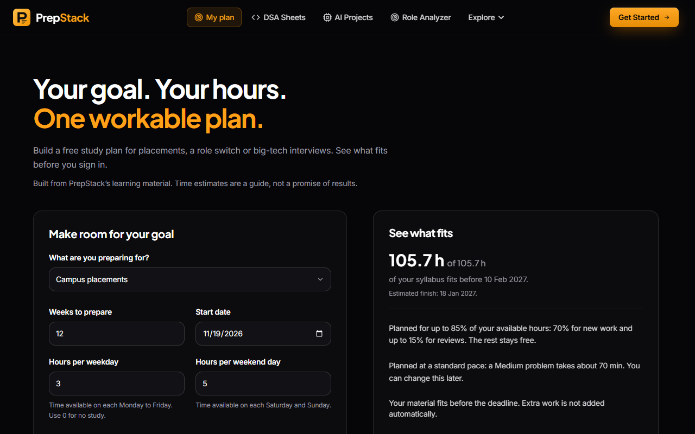
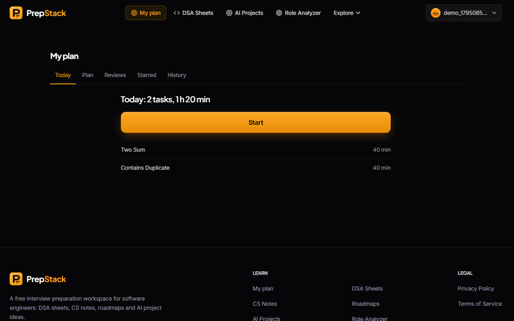
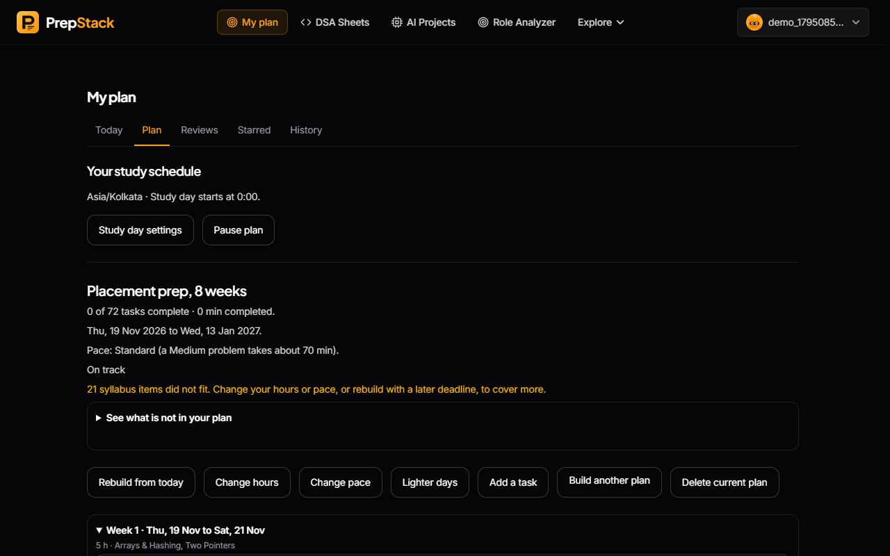
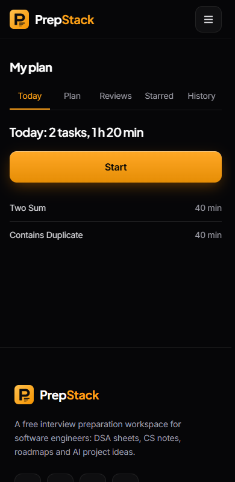
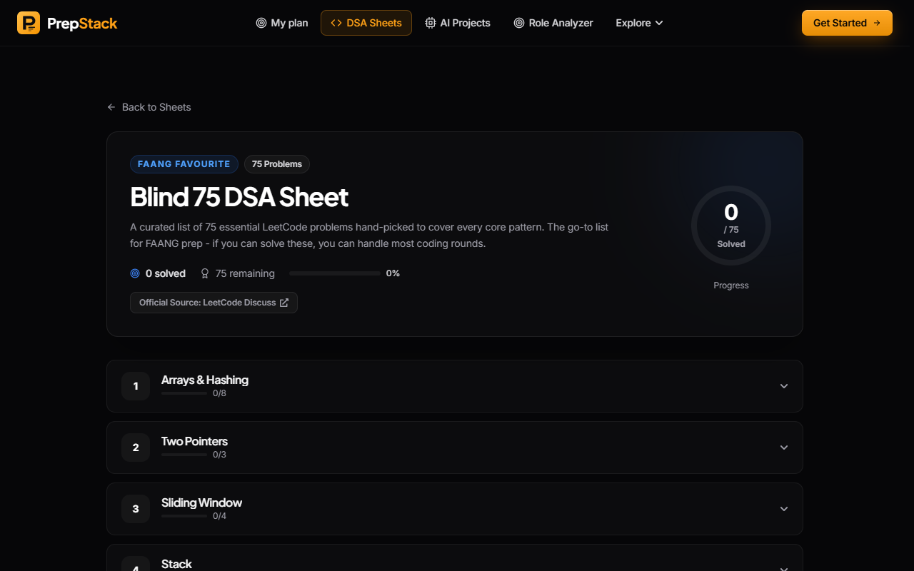
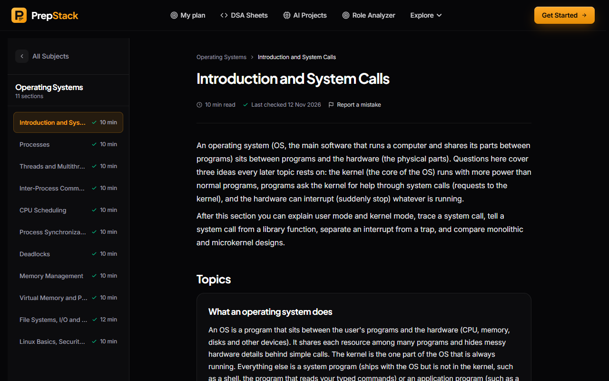
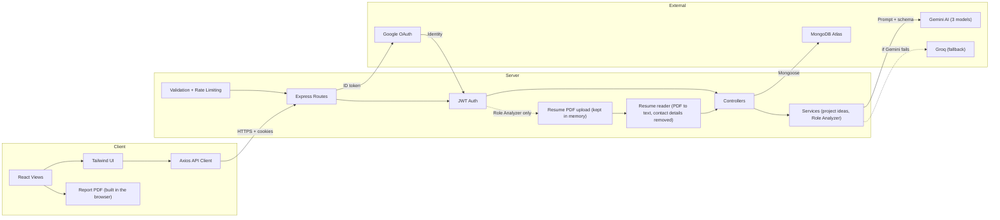
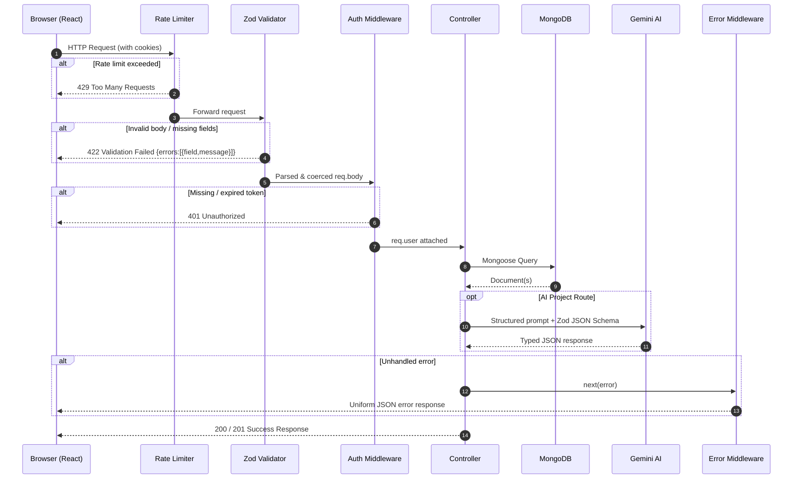
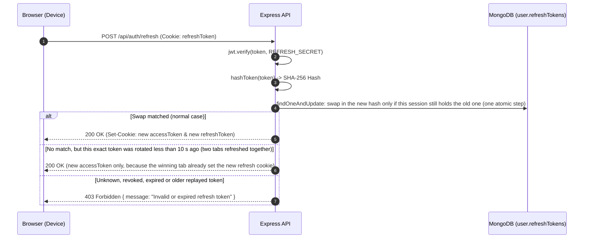
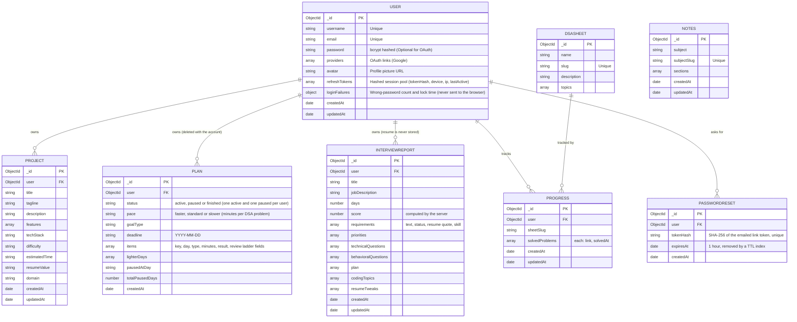

# PrepStack

<div align="center">

[](LICENSE)
[](https://github.com/SahilSameer18/prepstack/pulls)
[](https://react.dev/)
[](https://tailwindcss.com/)
[](https://expressjs.com/)
[](https://ai.google.dev/)

**A free study plan for software interviews that fits your hours and survives a missed week.**

[Live Demo](https://prepstack-ss.vercel.app) · [Report Bug](https://github.com/SahilSameer18/prepstack/issues) · [Request Feature](https://github.com/SahilSameer18/prepstack/issues)

</div>

---

Most people do not fail interview preparation for lack of material. They fail because the plan breaks: they miss a week, fall behind, feel guilty and quit. PrepStack is built around that problem.

**What it does**

- **Builds a plan from your goal and your hours** (campus placements, a switch to a developer role, or big-tech interviews). It shows what fits before you sign in, and an honest finish date when it does not.
- **Keeps going after a bad week.** Pause, resume, rebuild from today, lighter days and a changed study calendar all show a preview before anything is saved, and finished work is kept.
- **Brings problems back for review** (spaced reviews that depend on whether you solved it alone, with hints, or needed the solution).
- **Keeps everything in one place:** five DSA sheets, sourced CS notes with quizzes (OS, DBMS, networks, OOP, system design), nine roadmaps, a behavioral guide, and a Role Analyzer that matches your resume to a job description and turns the gaps into a plan.
- **The schedule is plain code, not AI guesses**, so the same input gives the same plan. AI is used only for project ideas and for reading a resume and a job description, and its replies are checked by code.

**Free.** Reading (sheets, notes, roadmaps, the plan preview) needs no account; saving a plan and progress needs a login.

**Status:** live at [prepstack-ss.vercel.app](https://prepstack-ss.vercel.app) and in active development. Current focus: a study of My plan with students and a benchmark for the Role Analyzer (see [Roadmap](#deployment-notes-and-roadmap)).

## Product Tour

_Screenshots use disposable test data._

| | |
|---|---|
| **See what fits, before you sign in.** The planner preview shows the hours and the finish date. | **Today stays simple:** only today's tasks, the time needed and one Start button. |
|  |  |
| **The whole schedule** can be adjusted with a preview before saving. | **On a phone** the same screen fits at 390 px. |
|  |  |
| **DSA sheets** (Blind 75, NeetCode 150, Striver, Love Babbar) with progress. | **CS notes** written from sources, with a last-checked date and quizzes. |
|  |  |

## Why It Is Different

Candidates scatter their preparation across disconnected tools: LeetCode or a sheet for DSA, blog posts for CS theory, a general chatbot for project ideas, a spreadsheet or notes app for the schedule. Each is good at its own job. The part that breaks is the schedule that ties them together, because a fixed 90-day calendar does not survive a missed week.

1. **The plan is the product.** It fits your hours, shows what does not fit, brings problems back for review, and recovers when you fall behind. A chatbot can write a plan once; it does not keep it honest week after week.
2. **One place for the pieces the plan points at:** the sheets, the notes, the roadmaps and the resume-to-job gap analysis link into each other.
3. **It works alongside the tools you already use.** Solve and judge code on LeetCode, follow roadmap.sh for breadth, polish a resume in a resume tool; PrepStack plans around them and keeps the schedule honest.

## Table of Contents

- [Product Tour](#product-tour)
- [Why It Is Different](#why-it-is-different)
- [Features](#features)
- [Key Engineering Decisions](#key-engineering-decisions)
- [Architecture](#architecture)
- [Engineering Highlights](#engineering-highlights)
- [Tech Stack](#tech-stack)
- [Database Schema](#database-schema)
- [API Reference](#api-reference)
- [Getting Started](#getting-started)
- [Scripts](#scripts)
- [Testing](#testing)
- [Deployment Notes and Roadmap](#deployment-notes-and-roadmap)
- [Project Documentation](#project-documentation)
- [Contributing](#contributing)
- [License](#license)

## Features

### My Plan

The planner is free to preview and needs a login to save. You pick a goal (big-tech SDE, placements, a role roadmap), a sheet, the weeks you have and the hours you can study, and the server builds a day-by-day plan.

- **Plain code, no AI.** The schedule is made by deterministic code (`planGenerator.js`, `planAdjust.js`): about 85% of each day is planned, 70% of that for new items and 15% for reviews. Core topics come first, in dependency order. The same input always gives the same plan, and the numbers can be tested.
- **Public preview.** `/my-plan` shows the totals and week 1 without an account. Saving, studying and syncing need a login.
- **A fair share when time is short.** Sheet plans target at least one problem per DSA topic and three sections per chosen CS subject when time allows. Hard problems are trimmed first. The plan and its preview explain what only partly fits and what was left out. A roadmap step longer than the whole plan is planned in parts and the rest is reported as not included, so a role plan is never empty while there are study hours. When something does not fit, the preview also says when the whole syllabus would be finished at the same hours (found by planning the same request over the longest plan allowed, 52 weeks; "more than a year" beyond that).
- **My pace.** Faster, Standard or Slower changes the minutes planned for each DSA problem. It can be changed later with a preview.
- **Calm Today screen.** Only today's items, the time they need and one Start button. Graphs, history, reviews and settings live in other tabs.
- **Review ladder.** Finishing a problem schedules reviews at fixed gaps that depend on how you solved it (alone, with hints, or with the solution). Today shows due reviews within its review allowance. The Reviews tab shows the full due list.
- **Sheet sync.** Ticking a problem in the plan ticks it on its DSA sheet, and a problem already solved on a sheet shows as done in the plan. A problem split over several days is solved on the sheet only when its last part is done.
- **Safe changes.** Rebuild from today (optionally with a later deadline), new hours and lighter days always show a preview with a diff first. Nothing is saved until you confirm, and a stale preview is refused.
- **Life happens.** A study calendar (your timezone and the hour the day starts, for night owls), pause and resume (the whole calendar and all review dates move forward together), review catch-up that spreads overdue reviews over several days, one paused main plan next to a short interview sprint, and a substitute for a problem whose link is dead or paywalled (the original stays unsolved).
- **From the Role Analyzer.** A report's study plan can be merged into the plan, or replace it, after a preview. History of replaced and finished plans is read-only.
- **Privacy.** Plans belong to the account and are deleted with it.

Design and decisions: [docs/plans/MY_PLAN_PLAN.md](docs/plans/MY_PLAN_PLAN.md).

### Role Analyzer (resume vs job description)

Paste a job description and add your resume (PDF or pasted text). You get a report with a match score, each requirement marked met / partly / missing with a quote from your resume, the skills you lack with where to learn them, likely technical and behavioral questions, and a day-by-day plan. Everything it links to is something PrepStack really has.

- **The code decides, not the AI.** The AI only reads the text: it lists the job's requirements, marks each one, and quotes proof. The score is computed by the server (must-have = 3 points, nice-to-have = 1; met = full, partly = half). Every quote is checked against the resume; a quote that cannot be found downgrades that requirement. Skill names come from a closed list of 120 skills (`server/src/modules/analyzer/skillCatalog.json`; the AI may write any text, and the code turns a name that is not on the list into "none"), titles must come from the job description (and are shown in Title Case, at most 60 characters), and plan links are kept only if they point at content that exists (Blind 75 topics, CS notes sections, roadmaps, behavioral questions).
- **Privacy:** the resume is never stored. Email, phone number and links are removed before anything leaves the server, and only the report (with short quotes) is saved. The user must tick a consent box (the text goes to Google and, if Gemini is busy, to Groq). Deleting an account deletes its reports.
- **Limits:** PDF only (checked by its first bytes), 3 MB, 5 pages, 10 s to read, scanned PDFs are rejected with a clear message. 3 reports per hour and 5 per 24 hours per user (`ANALYZER_DAILY_LIMIT`; failed attempts are not counted), one report at a time (`409`).
- **Skill advice is computed on every read** from the catalog (never stored), so improving the catalog improves old reports. Each skill points at DSA topics, CS notes, a roadmap, the Behavioral Prep page (soft skills) or an AI project idea (`/ai-projects?stack=...`), plus official docs. About half of the catalog has no PrepStack lessons yet; those skills show docs links only.
- **Screens:** `/analyzer` (form and recent reports) and `/analyzer/:id` (tabs: Plan, Skills, Questions, Resume tips). Both are behind login and hidden from search engines.
- **PDF download:** built in the browser with `@react-pdf/renderer` (PrepStack links and docs links stay clickable). The library is a separate ~1.2 MB chunk that loads only when the user clicks Download PDF. It uses the standard PDF fonts, so characters outside basic Latin may not draw.

### AI-Powered Project Generation

- **Dynamic Prompts:** Accepts tech stack, domain (FinTech, SaaS, Web3), complexity level (`beginner`/`intermediate`/`advanced`), and extra constraints.
- **Recruiter-Ready Output:** Gemini generates project descriptions, tagging, estimated timeline, and STAR resume bullets.
- **Reliable AI cascade (free tier only):** idea generation tries `gemini-3-flash-preview`, then `gemini-3.5-flash-lite`, then `gemini-3.1-flash-lite`, then Groq `openai/gpt-oss-120b`. One retry for "overloaded" errors (never for quota errors), 20 s per call, 55 s in total, at most 5 calls, and a circuit breaker that skips a provider that keeps failing. Model names and keys are settings (`GEMINI_*_MODEL`, `GROQ_MODEL`, `GROQ_API_KEY`), so retiring a model is a config change. If every provider fails the user gets a clear message and the attempt does not count.
- **Abuse Protection:** 4 project requests per hour and 15 saved ideas per 24 hours per signed-in user (failed requests are not counted), and only one idea can be generated at a time per user (a second request gets `409`). The page offers 13 tech stack buttons plus **Other (type your own)**: a typed name must be 2 to 40 characters of letters, numbers and `+ # . / & ( ) -`, and the AI is first asked whether it is a real technology (answers are remembered; if the check cannot run the idea is still generated). A user who gets 5 "not a technology" answers in an hour is paused for the rest of the hour, so junk input cannot drain the shared free quota.

### Dynamic DSA Trackers

- **Industry Sheets:** Tracks Blind 75, NeetCode 150, Striver A2Z, Striver SDE, and Love Babbar 450.
- **Live Sync:** Problem completions toggle asynchronously, instantly refreshing dashboard metrics.

### CS Fundamentals Library

- **Notes written from sources:** All five subjects are written as Markdown sections from sources: DBMS 10, Computer Networks 10, Operating Systems 11, OOP 10 (OOP uses Java, and every Java example was compiled and run) and System Design 23 (11 concepts and 12 case studies, with architecture and sequence diagrams and every number computed by a script). Each has an overview, topics with an example and a failure case, interview questions, mistakes, a 5-question quiz and diagrams, in easy words, with a source list and a claims table in `docs/content/`. Diagrams are drawn from plain data in four kinds: flow, layers, graph (architecture pictures with database, queue and cache shapes, zone boxes and numbered or dashed arrows) and sequence (messages over time); the planned System Design notes (`docs/archive/HLD_NOTES_PLAN.md`) may have up to 6 per section, every other subject 3. A section shows its last-checked date.

### STAR Resume & Behavioral Hub

- **STAR Prompts:** Complete, interactive STAR templates for mapping experiences.
- **Behavioral Bank:** 50 questions in 10 groups (personal, teamwork, conflict, failure, leadership, responsibility, deadlines, unclear situations, feedback, motivation). Each has what the interviewer is looking for, a four-part STAR plan, a made-up example answer and two mistakes to avoid, in easy words.

### Curated Developer Roadmaps

- **9 Learning Tracks:** **Frontend**, **Backend**, **Full Stack MERN**, **Android Development**, **Data Analytics**, **Machine Learning**, **DSA & Problem Solving**, **Java & Spring Boot** and **DevOps & Cloud**. Every step has a goal, topics, a time range, practice links into PrepStack, a checkpoint, a mini-project and 2 to 3 free official resources, all in plain words.
- **Actionable Steps & Milestones:** Breaks down complex subjects into step-by-step milestones with estimated completion times, difficulty tiers, and curated free resources.

### Security and Accounts

- **Dual-Identity Management:** Seamlessly link Google OAuth and Email/Password authentications, including the ability for OAuth-only users to establish a permanent password directly from their profile page.
- **Active Devices & Sessions Manager:** Visual inspection of all authenticated devices (*"Chrome on Windows 11"*, *"Safari on iPhone"*) with IP addresses, last-active timestamps, live current device indicators, and individual remote session revocation.
- **Password Reset by Email:** "Forgot password?" on the login page sends a one-time link (valid for 1 hour, works once). Setting a new password signs out all devices.
- **Dual Session Sign-Out Controls:** Supports isolated single-device logout or global session flushing (*"Sign Out of All Devices"* via `POST /api/auth/logout-all`).
- **Self-Service Account Deletion:** Built-in modal allowing users to permanently erase their account with password/email verification. All of their data (progress, projects and role reports) is wiped in one step; this is a single transaction on a replica set such as MongoDB Atlas, and falls back to a plain sequence of deletes on a standalone MongoDB.
- **Full-Screen Logout Overlay:** Seamless full-screen transition overlay that smoothly clears session state with visual feedback.
- **Dynamic Avatars:** Integrates the open-source DiceBear API to automatically generate unique, tech-themed robot avatars for users without Google profile pictures.
- **Live Stats Engine:** Aggregation of your total solved DSA problems, generated AI projects and role reports, shown in a dashboard with DSA / Projects / Reports tabs.

---

## Key Engineering Decisions

| Decision | Why | Read more |
|---|---|---|
| **The plan is made by deterministic code, not AI** | The same input always gives the same plan, so the numbers can be tested; it has been run against generated scenarios and simulated student lives | [My plan](#my-plan), [TESTING.md](TESTING.md) |
| **The Role Analyzer's score is computed by the server; the AI only reads and quotes** | Every quote is checked against the resume and a quote that cannot be found downgrades that requirement, so the score can be traced | [Role Analyzer](#role-analyzer-resume-vs-job-description) |
| **Refresh tokens are hashed, single use and rotated by one atomic swap; replaying an old one signs the whole session out** | A stolen token is detected, and two tabs refreshing together do not log the user out | [Security](#security-engineering) |
| **Redis is optional, and its cost was measured** | A Redis rate-limit count adds about 36 ms per request (laptop to the free Aiven service), so the two chattiest limiters stay in memory by default; every Redis use falls back to memory | [Performance and scale](#performance-and-scale), [REDIS_PLAN.md](docs/plans/REDIS_PLAN.md) |
| **Caches are bounded and expire** | The free Redis host has 298 MB and evicts nothing, so every key has a jittered expiry, a refill takes one lock, and writes have a budget | [Performance and scale](#performance-and-scale) |
| **Measure before scaling** | A load test and a CPU profile showed the one Node thread was the limit; cheap CPU fixes took 100 simultaneous users from 24 to 122 requests a second | [SCALING_REPORT.md](docs/research/SCALING_REPORT.md) |
| **Free AI tiers are protected by a provider chain, a circuit breaker and an app-wide budget** | Quotas are small and shared; a spent or failing provider is skipped without a call, and a wrong budget number can never make AI unavailable | [AI project ideas](#ai-powered-project-generation), [Performance and scale](#performance-and-scale) |
| **The resume is never stored** | It is read in memory, contact details are removed before anything leaves the server, and only the report with short quotes is saved | [Role Analyzer](#role-analyzer-resume-vs-job-description) |
| **Backend code is grouped by feature, and a test enforces the boundaries** | A new feature lives in one folder; the architecture test fails on a forbidden import or a circular dependency | [Architecture](#architecture) |

---

## Architecture

### Overview



_The Role Analyzer path: the resume PDF is read in memory, contact details are removed, the text goes to the AI, and the reply is checked again by code. The resume itself is never stored._

_The Role Analyzer path: the resume PDF is read in memory, contact details are removed, the text goes to the AI, and the reply is checked again by code. The resume itself is never stored._

### Request Lifecycle



_This is a simplified view. The exact middleware order differs per route: for example the Role Analyzer route runs auth first, then its rate limit, then the PDF upload, then validation._

_This is a simplified view. The exact middleware order differs per route: for example the Role Analyzer route runs auth first, then its rate limit, then the PDF upload, then validation._

### Multi-Device Hashed Token Refresh Flow



### Directory Structure

```text
prepstack/
├── docs/                        # Technical notes, plans, research, content sources and README screenshots
├── PROJECT_STATUS.md            # What is done, what is left, and the build order
├── CLAUDE.md                    # Rules for AI agents working on the project
├── TESTING.md                   # What is tested and how
├── LICENSE                      # MIT
├── client/                      # React 19 frontend
│   ├── public/                  # Static public assets
│   ├── scripts/                 # Build-time prerender and SEO checks
│   ├── src/
│   │   ├── api/                 # Axios instance (with refresh interceptor) and service layer
│   │   ├── components/          # Navbar, Footer, home page blocks, auth guard, UI states
│   │   │   ├── analyzer/        # Score ring, requirement rows, skill gap cards, dashboard reports tab
│   │   │   └── pdf/             # The report as a PDF (loaded only on download)
│   │   ├── context/             # React Context stores (Auth, Project)
│   │   ├── data/                # Static data (roadmaps, behavioral questions)
│   │   ├── hooks/               # useAuth, useProject, useNotes, ...
│   │   ├── layout/              # MainLayout
│   │   ├── pages/               # DSA sheets, CS notes, roadmaps, AI projects, Role Analyzer, Dashboard, Profile, legal
│   │   ├── seo/                 # Per-page titles, descriptions and share tags (one source of truth)
│   │   ├── utils/               # Error messages, dates and titles, report links, PDF export, avatars
│   │   ├── app.routes.jsx       # Route table (login-protected pages use ProtectedRoute)
│   │   └── main.jsx             # React entrypoint
│   └── vite.config.js           # Bundling settings
└── server/                      # Express 5 backend
    ├── scripts/                 # Hand-run tools: list models, compare models, evaluate the analyzer, build catalogs, check a Redis host, measure the cache
    ├── src/
    │   ├── modules/             # Feature code grouped by responsibility
    │   │   ├── auth/            # Login, sessions, User model, password reset and email
    │   │   ├── user/            # Profile, dashboard summary and account deletion
    │   │   ├── sheets/          # DSA sheets, progress, problem identity and seeds
    │   │   ├── problem-notes/   # Saved problem notes and allowed choices
    │   │   ├── notes/           # CS notes, validators, content and notes seed
    │   │   ├── ai/              # AI provider chain and shared provider budgets
    │   │   ├── project/         # Generated project ideas
    │   │   ├── usage/           # Usage API
    │   │   ├── analyzer/        # Resume analysis, reports, skill catalog and PDF upload
    │   │   └── plan/            # My plan, scheduling, recovery and plan catalog
    │   ├── shared/              # Infrastructure and utilities used across features
    │   │   ├── config/          # Database, limits, Redis and seed connection setup
    │   │   ├── http/            # Errors, validation, rate limits and response helpers
    │   │   ├── infra/           # Caches, locks and rate-limit store
    │   │   ├── calendar/        # Study dates, streaks and the shared clock
    │   │   ├── usage/           # Rolling usage counts
    │   │   └── content/         # Roadmap catalog, behavioral questions and link validation
    │   └── app.js               # Express app definition
    ├── test/                    # Architecture guard, API and service tests (node:test + supertest + in-memory MongoDB; a fake Redis in test/helpers)
    ├── cluster.js               # Optional: one server copy per CPU core (needs Redis)
    └── server.js                # Startup and shutdown
```

---

## Engineering Highlights

More detail on sessions, account erasure, OAuth, cookies and loading work is in [docs/ENGINEERING.md](docs/ENGINEERING.md).

### Security Engineering

- **Multi-device hashed auth:** refresh tokens are stored only as SHA-256 hashes (Node's built-in `crypto`), up to 10 devices at once, with single-device logout and `/logout-all`. Rotation is one atomic compare-and-swap, so two parallel refreshes cannot both win.
- **Refresh-token replay defence:** if a token that was already rotated is used again after the 10-second grace window, the whole login session is deleted, so a stolen copy and the real user are both signed out.
- **Revocation takes effect at once:** the access token carries a session id that is checked against the live session. A short cache of that check (5 seconds in the process, up to 30 in Redis) is cleared by every logout, revoke, password change or reset, replayed token, account deletion and study-calendar change.
- **Per-account login lock:** 10 wrong passwords on one account within 15 minutes lock password logins for 15 minutes, even when the guesses come from many addresses; Google sign-in, token refresh and devices already logged in are not affected. The count is one atomic update, so parallel guesses cannot skip it.
- **Password reset by email:** "Forgot password?" answers the same for known and unknown emails and sends the mail in the background through Brevo's SMTP relay. The link holds 32 random bytes, only its SHA-256 hash is stored, it works once for 1 hour, setting the password signs out every device and lifts any login lock, and changing the password in Settings cancels any link still waiting.
- **Cross-site requests are refused:** cookies are `SameSite=None`, so protection comes from an exact-match Origin allowlist: a request with a foreign or `null` Origin is answered 403 before any handler runs.
- **Layered validation:** a `validate(schema)` middleware checks every body with Zod before a controller runs and returns structured `422` field errors; malformed or oversize JSON is a `400` or `413`.
- **Fail-fast secrets:** at start the server requires `ACCESS_SECRET` and `REFRESH_SECRET` (warns under 32 characters) and `GOOGLE_CLIENT_ID`.

### Rate limiting

12 of the 14 limiters count in **Redis** when it is on (both algorithms are atomic Lua scripts: a sliding window for login, a fixed window for the rest), so every server copy shares one count and a restart keeps it. Plan ticks and problem-note saves count in memory by default, because a Redis count costs about 36 ms per request (measured); `RATE_LIMIT_REDIS` opts them in. With Redis off or failing, every limiter counts in memory, per server.

| Limiter | Keyed by | Limit |
|---|---|---|
| Login, Google sign-in, set password | client IP | 10 failed tries / 15 min |
| Register | client IP | 30 / 15 min |
| Link Google | client IP | 5 / 15 min |
| Token refresh | client IP | 30 / 15 min |
| Forgot password | client IP | 5 / 15 min |
| Reset password | client IP | 10 failed / 15 min |
| Change password, delete account | signed-in user | 10 failed / 15 min |
| AI project ideas | signed-in user | 4 / hour (and 15 saved per 24 hours) |
| Role Analyzer | signed-in user | 3 / hour (and 5 per 24 hours) |

On login and Google sign-in only **failed** attempts count, so many students behind one campus Wi-Fi address can still log in; sign-ups and refreshes count every request; the AI limiters skip failed requests. There are also limiters on plan and note writes.

### Reliability

- **Optional Redis with graceful degradation:** `REDIS_URL` is optional. Without it, or when Redis is unreachable, the server starts and runs on MongoDB and memory, prints one status line (never the address) and closes the connection cleanly on shutdown. MongoDB stays the source of truth.
- **Locks:** the "an idea or report is being generated now" locks use Redis `SET NX PX` with a token, so a double click makes one AI call even across servers.
- **Safe startup and shutdown:** the server listens only after MongoDB is connected; `SIGTERM`, `SIGINT` and unhandled errors close the HTTP server and the database before exiting.
- **Health check and access log:** `GET /health` (no login) returns `200 {"status":"ok","db":"up"}` while the database is connected and `503` when it is not. Every other request writes one log line (`METHOD /path status ms`); query strings and bodies are never logged.

### Performance and scale

- **Single-roundtrip dashboard:** `/api/user/dashboard-summary` returns all sheet progress, problem statistics and AI project metrics in one call, using parallel Mongoose lookups and an O(1) in-memory progress map.
- **Caching:** public sheet and notes reads, the dashboard's sheet list and the My plan preview are cached cache-aside (jittered expiry, one refill against a stampede, "not found" cached briefly, a write budget), with an in-process layer (60 seconds, bounded) in front of Redis; the four public reads send `Cache-Control: public, max-age=300, stale-while-revalidate=600`.
- **Measured scaling work:** `npm run load:test` starts the real server and measures it at 10, 50 and 100 requests at once. A CPU profile showed the one Node thread was the limit, so read-only reads return plain objects instead of Mongoose documents and the planner's date helpers remember their answers. On a 12-core laptop that took 100 simultaneous users from 24 to 122 requests a second (median 3.5 s to 0.7 s), and `npm run start:cluster` (one copy per core, needs Redis) reached 401. Caveats and what is not fixed: [docs/research/SCALING_REPORT.md](docs/research/SCALING_REPORT.md).
- **Type-safe AI pipeline:** the response schema is built with Zod's `z.toJSONSchema` and sent to the Gemini SDK, and the reply is checked again with `safeParse` before anything is saved.
- **App-wide AI budget:** `AI_BUDGETS` reserves each AI call with an atomic Lua script; a spent provider is skipped without a call, and if every provider is spent they are all tried anyway.

The Redis plan and the interview-oriented notes are in [docs/plans/REDIS_PLAN.md](docs/plans/REDIS_PLAN.md) and [docs/research/REDIS_INTERVIEW_NOTES.md](docs/research/REDIS_INTERVIEW_NOTES.md).

---

## Tech Stack

### Frontend

| Technology          | Version | Role                                        |
| ------------------- | ------- | ------------------------------------------- |
| React               | 19.2    | UI library (concurrent rendering)           |
| Vite                | 7       | Build tooling & HMR                         |
| Tailwind CSS        | v4      | Utility-first styling engine                |
| Framer Motion       | 12      | Fluid UI transitions & animations           |
| React Router DOM    | 7       | Client routing layer                        |
| Axios               | latest  | Configured HTTP client (with credentials)   |
| @react-oauth/google | latest  | Secure Google Identity Services integration |
| DiceBear API        | 7.x     | Dynamic, deterministic avatar generation    |
| @react-pdf/renderer | 4.9     | Role Analyzer report PDF (loaded only on download) |
| react-hot-toast     | 2.6     | Toast notifications                         |

### Backend

| Technology          | Version | Role                                                  |
| ------------------- | ------- | ----------------------------------------------------- |
| Node.js + Express   | 5.2     | Web app framework (native async errors)               |
| Mongoose            | 9       | MongoDB Object Document Mapper (ODM)                  |
| Zod                 | 4       | Server validation and structured schema config        |
| helmet              | 8       | Standard HTTP security headers                        |
| @google/genai       | 1.47    | Official SDK client for Gemini integrations           |
| groq-sdk            | 1.6     | Backup AI provider when Gemini is busy                |
| nodemailer          | 10.4    | Sends the password reset email (Brevo SMTP)           |
| multer              | 2.5     | Resume PDF upload (kept in memory, never written to disk) |
| pdf-parse           | 2.4     | Reads the text of an uploaded PDF resume              |
| jsonwebtoken        | 9       | Cryptographic user session tokens                     |
| bcrypt              | 6       | Salted security hashing (12 rounds)                   |
| cookie-parser       | 1.4     | Secure browser cookie management                      |
| express-rate-limit  | 8.5     | Request flood limiter (counts in Redis when it is on, in memory otherwise) |
| ioredis             | 5.11    | Optional Redis (Valkey) client: caches, shared rate limits, locks, AI budget and session cache; the app runs without it |
| ioredis-mock (dev)  | 8.13    | Test-only Redis with a Lua engine, so the real rate-limit, lock and budget scripts run in the tests |
| google-auth-library | latest  | Official backend SDK for Google ID token verification |

---

## Database Schema



---

## API Reference

### Authentication: `/api/auth`

| Method   | Endpoint                | Auth   | Description                                                    |
| -------- | ----------------------- | ------ | -------------------------------------------------------------- |
| `POST`   | `/register`             | None   | Register user _(rate-limited: 30/15min)_                       |
| `POST`   | `/login`                | None   | Login user _(10 failed tries/15min per address; 10 per account locks it for 15min)_ |
| `POST`   | `/google`               | None   | Google OAuth login/registration                                |
| `POST`   | `/link-google`          | ✅ JWT | Link Google account to existing user _(rate-limited: 5/15min)_ |
| `PUT`    | `/set-password`         | ✅ JWT | Sets a permanent password for OAuth-only users                 |
| `POST`   | `/forgot-password`      | None   | Emails a one-time reset link _(same answer for any email; 5/15min)_ |
| `POST`   | `/reset-password`       | None   | Sets a new password with the link, signs out all devices _(10 failed/15min)_ |
| `POST`   | `/refresh`              | Cookie | Rotates access token and refresh token hash _(30/15min)_        |
| `POST`   | `/logout`               | ✅ JWT | Clears session cookie on current device                        |
| `POST`   | `/logout-all`           | ✅ JWT | Revokes all active device sessions globally                    |
| `GET`    | `/sessions`             | ✅ JWT | Lists all active device sessions with telemetry                |
| `DELETE` | `/sessions/:sessionId`  | ✅ JWT | Revokes a specific active device session                       |
| `GET`    | `/current-user`         | ✅ JWT | Retrieves current user session data                            |

### User Profile: `/api/user`

| Method   | Endpoint             | Auth   | Description                                                     |
| -------- | -------------------- | ------ | --------------------------------------------------------------- |
| `GET`    | `/dashboard-summary` | ✅ JWT | Single-roundtrip pre-aggregated dashboard metrics & sheet stats, plus the current streak (IST days) and each sheet's last solved date |
| `GET`    | `/stats`             | ✅ JWT | Aggregates and returns total solved DSA and AI projects         |
| `PUT`    | `/profile`           | ✅ JWT | Updates unique username and avatar with strict Zod validation   |
| `PUT`    | `/change-password`   | ✅ JWT | Verifies password, updates hash, and revokes other devices      |
| `DELETE` | `/account`           | ✅ JWT | Permanently deletes the account and all of its data              |

### Usage: `/api/usage`

| Method   | Endpoint | Auth   | Description                                                                                      |
| -------- | -------- | ------ | ------------------------------------------------------------------------------------------------ |
| `GET`    | `/`      | ✅ JWT | How much of today's allowance is used for project ideas and reports (`used`, `allowed`, `resetsAt`, last 24 hours) |

### AI Projects: `/api/project`

| Method   | Endpoint      | Auth   | Description                                          |
| -------- | ------------- | ------ | ---------------------------------------------------- |
| `POST`   | `/generate`   | ✅ JWT | Generates an idea with the AI cascade _(4/hr, 15/24h, one at a time)_ |
| `GET`    | `/`           | ✅ JWT | Returns 20 saved projects, newest first, with the total; `?before=<id>` gives the next 20 |
| `GET`    | `/:projectId` | ✅ JWT | Returns specific project metadata                    |
| `DELETE` | `/:projectId` | ✅ JWT | Deletes project profile                              |

### Role Analyzer: `/api/analyzer`

| Method   | Endpoint | Auth   | Description                                                                                          |
| -------- | -------- | ------ | ---------------------------------------------------------------------------------------------------- |
| `POST`   | `/`      | ✅ JWT | Creates a report from a resume (PDF field `resume` or `resumeText`), `jobDescription`, `days`, `consent` _(3/hr, 5/24h, one at a time)_ |
| `GET`    | `/`      | ✅ JWT | Lists your reports (title, score, date), newest first                                                |
| `GET`    | `/today` | ✅ JWT | Today's plan items from your latest report (the dashboard "Today" card); `null` when there is no report with a plan |
| `GET`    | `/:id`   | ✅ JWT | Returns one report with computed skill advice and `todayDay` (the plan day that is today, in IST)     |
| `PATCH`  | `/:id/plan` | ✅ JWT | Ticks or unticks one study-plan item: body `{ day, index, done }`; sets the state (does not flip it) _(60/min)_ |
| `DELETE` | `/:id`   | ✅ JWT | Deletes a report                                                                                     |

### DSA Sheets: `/api/sheets`

| Method | Endpoint          | Auth   | Description                                |
| ------ | ----------------- | ------ | ------------------------------------------ |
| `GET`  | `/`               | None   | Lists all DSA sheets (cached; `Cache-Control: public, max-age=300, stale-while-revalidate=600`) |
| `GET`  | `/:slug`          | None   | Returns sheet sections and problem links (cached, same header) |
| `GET`  | `/:slug/progress` | ✅ JWT | Returns active user solved problems        |
| `POST` | `/:slug/progress` | ✅ JWT | Toggles state of problem (solved/unsolved) |

### Problem notes: `/api/problem-notes`

Your notes on DSA problems (pattern, time and space complexity, up to 5,000 characters of text), saved to your account. One note per problem link; the same link in two sheets is one note. Notes are deleted with the account.

| Method   | Endpoint  | Auth   | Description |
| -------- | --------- | ------ | ----------- |
| `GET`    | `/`       | ✅ JWT | Lists your notes, newest first |
| `PUT`    | `/`       | ✅ JWT | Saves one whole note `{ problemLink, pattern, timeComplexity, spaceComplexity, approach }`; the link must belong to a sheet _(120/min)_ |
| `DELETE` | `/?problemLink=` | ✅ JWT | Deletes a note (also for a link no longer in any sheet) _(120/min)_ |
| `POST`   | `/import` | ✅ JWT | One-time move of the notes kept in the browser, at most 15 per request. It only adds: a note the account already has is never overwritten _(120/min)_ |

### Study plan: `/api/plan`

Everything except the preview and the options needs a login. Changes are two calls: a preview that returns a checksum, then an apply that must send it back.

| Method | Endpoint | Auth | Description |
| ------ | -------- | ---- | ----------- |
| `GET` | `/options` | Public | Goals, sheets, roadmaps and limits for the builder |
| `POST` | `/preview` | Public | Totals and week 1 for a form, plus when the whole syllabus would finish when something does not fit; writes nothing; cached for about 10 minutes per input when Redis is on _(20/min per IP)_ |
| `GET` | `/` | ✅ JWT | The active plan, Today, the study calendar and any paused plan |
| `POST` | `/` | ✅ JWT | Saves a plan; `replace: true` keeps the old one as history _(10 saved an hour)_ |
| `DELETE` | `/` | ✅ JWT | Deletes the active plan |
| `POST` | `/changes/preview`, `/changes/apply` | ✅ JWT | Rebuild (optionally with a later deadline), new hours, lighter days, a new pace _(20/min)_ |
| `POST` | `/lifecycle/preview`, `/lifecycle/apply` | ✅ JWT | Study calendar, pause, resume, discard a paused plan, review catch-up |
| `GET` | `/paused/:id` | ✅ JWT | Read-only snapshot of the paused plan |
| `POST` | `/reports/:reportId/preview`, `/apply` | ✅ JWT | Merge or replace from a Role Analyzer report |
| `GET` | `/review` | ✅ JWT | Weekly review: done, moved, on-track and weak topics |
| `GET`, `DELETE` | `/history`, `/history/:id` | ✅ JWT | Read-only finished plans; clear history |
| `POST` | `/items` | ✅ JWT | Adds your own task |
| `PATCH` | `/items/:id` | ✅ JWT | Ticks or unticks an item (and its sheet problem when the last part is done) |
| `POST` | `/items/:id/result`, `/review`, `/skip`, `/unskip` | ✅ JWT | Result (alone, hints, solution), a review, skip, unskip |
| `PATCH` | `/items/:id/star` | ✅ JWT | Stars an item |
| `GET`, `POST` | `/items/:id/substitutes`, `/substitute` | ✅ JWT | Suggests and adds a replacement for an unfinished problem |

### CS Notes: `/api/notes`

| Method | Endpoint    | Auth | Description                               |
| ------ | ----------- | ---- | ----------------------------------------- |
| `GET`  | `/`         | None | Returns each subject with its section count, topic count, reading time and last checked date (no sections); cached, with the public `Cache-Control` header above |
| `GET`  | `/:subject` | None | Returns the subject with its sections; each section has a permanent `id` and its reading time; cached, same header |

---

## Getting Started

You need Node.js (the live server runs 22), a MongoDB database (local, or a free Atlas cluster), a Gemini API key and a Google OAuth client ID. Redis is optional.

### 1. Clone

```bash
git clone https://github.com/SahilSameer18/prepstack.git
cd prepstack
```

### 2. Server (`server/`)

```bash
cd server
npm install
cp .env.example .env
```

Set at least these in `server/.env`:

```env
PORT=3000
MONGO_URI=mongodb://127.0.0.1:27017/prepstack
ACCESS_SECRET=your_ultra_secure_access_token_secret
REFRESH_SECRET=your_ultra_secure_refresh_token_secret
GOOGLE_API_KEY=AIzaSyYourGeminiApiKeyHere
GOOGLE_CLIENT_ID=your_google_oauth_client_id
```

The two token secrets should be at least 32 characters. Everything else is optional and explained in `server/.env.example`; the settings you are most likely to want are in the table below.

```bash
npm run dev
```

### 3. Client (`client/`)

In a new terminal:

```bash
cd client
npm install
cp .env.example .env.development
```

```env
VITE_API_URL=http://localhost:3000
VITE_GOOGLE_CLIENT_ID=your_google_oauth_client_id
```

Optional (production builds only): `VITE_SITE_URL` (your public address, used in canonical links and the sitemap) and `VITE_GSC_VERIFICATION` (Google Search Console verification code).

```bash
npm run dev
```

### 4. Seed the database

```bash
cd server
npm run seed:all
```

_(Idempotent upserts: safe to run more than once. It also clears the cached copies when Redis is set.)_

### Optional settings

| Setting | What it does |
|---|---|
| `GROQ_API_KEY`, `GEMINI_PRIMARY_MODEL`, `GEMINI_FALLBACK_MODEL`, `GEMINI_FALLBACK_2_MODEL`, `GROQ_MODEL` | The AI providers tried in order (defaults: `gemini-3-flash-preview`, `gemini-3.5-flash-lite`, `gemini-3.1-flash-lite`, then Groq `openai/gpt-oss-120b`) |
| `AI_DAILY_LIMIT` (15), `ANALYZER_DAILY_LIMIT` (5) | Saved ideas and reports per user per 24 hours |
| `AI_BUDGETS` | An app-wide budget of AI calls per provider or family, as JSON taken from your own AI consoles, for example `{"gemini":{"perMinute":5,"perDay":20}}`. A provider with no entry has no limit; if every provider is spent they are all tried anyway. `AI_BUDGET_DAY_TIMEZONE` sets when the day starts (default `America/Los_Angeles`) |
| `EMAIL_PROVIDER`, `EMAIL_FROM`, `BREVO_SMTP_LOGIN`, `BREVO_SMTP_KEY`, `CLIENT_URL` | Password reset email through Brevo SMTP. Without them, "Forgot password?" answers 503 |
| `REDIS_URL` | Optional. Empty means the server runs on memory and MongoDB only, and an unreachable Redis never stops it. The address holds a password: keep it only in your own `.env` |
| `REDIS_PREFIX` | Key prefix (default `prepstack:<NODE_ENV>:`) so development and the live site never share keys |
| `RATE_LIMIT_MEMORY_ONLY` | The way back if a Redis limiter misbehaves: `all`, or a list such as `login,register`, keeps those limiters in memory |
| `RATE_LIMIT_REDIS` | `plan-tick`, `problem-note` or `all`: counts the two chatty limiters in Redis too (for example with several servers) |
| `CACHE_MEMORY_SECONDS` | How long the in-process cache in front of Redis keeps a sheet, notes or preview answer (default 60, `0` = off) |
| `SESSION_CACHE` | `off` turns off the cache of "this login session is still active" (default on: 5 seconds in the process, up to 30 in Redis) |
| `WEB_CONCURRENCY` | Number of server copies for `npm run start:cluster` (default: the number of cores, at most 8) |
| `ALLOWED_ORIGINS` | Comma-separated extra front-end URLs allowed by CORS (exact match). On a production host also set `NODE_ENV=production` and add your front-end URL here |
| `ENABLE_CUSTOM_DNS` | Set `true` only if your ISP cannot resolve `mongodb+srv://` addresses |

With Redis on, cached public reads can show content up to about 15 minutes old after a reseed (10 minutes in the server cache plus the browser's 5-minute header); the seed scripts clear the server-side copies.

---

## Scripts

### Backend (`server/`)

**Run**

| Script | Description |
|---|---|
| `npm run dev` | Boots the dev environment using nodemon |
| `npm start` | Launches the server (one process, one CPU core) |
| `npm run start:cluster` | One server copy per CPU core (`WEB_CONCURRENCY`, at most 8); refuses to start without `REDIS_URL`, because the copies share rate limits, locks and caches through Redis |

**Content and data**

| Script | Description |
|---|---|
| `npm run seed:all` | Idempotently seeds DSA sheets and CS notes (both seeds also clear the cached copies when Redis is set) |
| `npm run seed:notes` | Validates and atomically replaces CS notes; requires a MongoDB replica set or Atlas, rolls back failures and returns a failing exit code (run after changing `src/modules/notes/content`) |
| `npm run build:plan-catalogs` | Rebuilds the planner's roadmap and sheet-topic catalogs after a roadmap or sheet change; a test fails until you do |
| `npm run build:seo-content` | Rebuilds the two generated files the search pages use (`client/src/seo/content.js` and `contentBody.js`) after a notes or sheet change; a test fails until you do |
| `npm run check:links` | Checks that the outside links (roadmaps, skill catalog, resume guide tools) still answer; run by hand before a release, needs the network |
| `node scripts/migrate-solved-at.js` | One-time: converts old solved-problem links to the dated format (`--dry-run` only prints counts). Run it on the live database before deploying the dated-progress code |

**Measure and benchmark**

| Script | Description |
|---|---|
| `npm run load:test` | Starts the real server on an in-memory database and measures requests per second and latency at 10, 50 and 100 at once; `PROFILE=1` adds a CPU profile, `ONLY=` one request kind, `CLUSTER=4` four copies |
| `npm run benchmark:analyzer` | Runs the real Role Analyzer on labelled resume and job pairs and prints how often it agrees with the labels, how much repeat runs and models disagree, and the false-reassurance rate (real AI calls; without `--data` it runs 7 made-up pairs as a smoke test; see [docs/research/ANALYZER_BENCHMARK.md](docs/research/ANALYZER_BENCHMARK.md)) |
| `node scripts/student-check-report.js <usernames>` | Read-only counts for the student check (tasks done, days active, reviews); never prints emails (see [docs/research/STUDENT_CHECK.md](docs/research/STUDENT_CHECK.md)) |
| `npm run redis:check` | Checks the Redis service in `server/.env`: version, eviction policy, expiry, locks, counters, Lua, connections; prints no address |
| `npm run measure:cache` | Counts database reads and generator runs for 400 public requests without Redis and with the real service |
| `npm run measure:limits` | Times a cheap request (a problem note save) with Redis off, with Redis on but the limiter in memory, and with that limiter opted in to Redis; the last minus the middle row is the cost of a Redis limiter |

**Test**

| Script | Description |
|---|---|
| `npm test` | Runs the API test suite (in-memory database, no real keys needed) |
| `npm run test:coverage` | The same, with a coverage report |
| `npm run test:redis-live` | Opt-in test of the app's Redis connection against the real service (unique key prefix, deletes only its own keys) |

### Frontend (`client/`)

| Script | Description |
|---|---|
| `npm run dev` | Launches the dev server |
| `npm run build` | Builds the bundle, then writes one HTML page per route (title, description, share tags, and for notes sections, sheets, roadmaps and the behavioral guide the real text), `sitemap.xml` (91 pages, 64 of them notes sections) and `robots.txt`, and fails if any SEO check fails |
| `npm run build:app` | Plain Vite build only (no SEO step) |
| `npm run lint` | Analyzes code style with ESLint |
| `npm run preview` | Previews the production bundle |
| `npm test` | Client unit tests (Vitest, no browser) |
| `npm run test:browser` | Playwright browser flows (starts disposable servers on ports 3100 and 5175; needs installed Chrome) |

---

## Testing

| Suite | Count | How to run |
|---|---|---|
| Server (`node:test` + `supertest` + in-memory MongoDB) | **1128 tests** | `cd server && npm test` |
| Client unit tests (Vitest, no browser) | **135 tests** in 14 files | `cd client && npm test` |
| Browser flows (Playwright) | **32 flows** in 3 files | `cd client && npm run test:browser` |

The server tests need no real keys and no network: the AI providers, Google sign-in, email and Redis are faked (Redis by `ioredis-mock`, which runs the real Lua scripts, and a small fake with its own clock in `server/test/helpers/fake-redis.js`). They cover auth and sessions (refresh rotation, replay defence, revocation, attack-style races and cross-site requests), the DSA, notes and project APIs, account deletion, the per-account login lock, password reset by email, rate limits, the AI provider chain and budget, the session cache, My plan (including generated scenarios and simulated student lives), the Role Analyzer (score maths, quote checking, closed skill list, PDF checks, privacy rules), and an architecture test that fails when a module imports one it should not. Two Redis checks need the real service and are opt-in: `npm run test:redis-live` and `npm run measure:cache`.

The client unit tests cover the login token refresh (refresh once, share it between parallel requests, sign out only when the server refuses it, never on a timeout), a design-token check that fails when a component uses a raw color, the resume checklist PDF, notes quiz scoring and diagram layout, the roadmap data rules and links, the Analyzer link builder, study-plan helpers, problem-note import and merge, and page titles. The browser flows cover the signed-out pages, first-time experience, the dashboard, report imports and the daily study workspace at phone and desktop widths; they use fresh disposable servers and do not load the real server environment.

The Role Analyzer was also checked against the real AI with hand-run scripts in `server/scripts/` (they need your own keys and use free-tier quota). Details, and what is not covered: [TESTING.md](TESTING.md).

---

## Deployment Notes and Roadmap

### Deployment notes

- **Built for free tiers.** The live site runs on Render (server), Vercel (client), MongoDB Atlas, and an optional free Aiven Valkey service for Redis (298 MB, no eviction, snapshots only). The server runs without Redis; with it, caches, rate limits, locks, the AI budget and the session cache are shared between copies.
- **One process by default.** `npm run start:cluster` runs one copy per CPU core and needs `REDIS_URL`. Without Redis, rate limits count in memory per server, so run a single instance. The load-test numbers come from a laptop with an in-memory database: they show where the bottlenecks are, not the capacity of the live site ([report](docs/research/SCALING_REPORT.md)).
- **Free AI tiers.** Gemini, then Groq; `AI_BUDGETS` keeps calls within each provider's quota. During a quota limit or outage generation can fail for a while; the user gets a clear message and the attempt is not counted.
- **Role Analyzer scope.** PDFs must contain text (scanned PDFs are rejected), and the PDF export uses standard fonts. 77 of the 120 catalog skills point at PrepStack lessons (notes, DSA topics or a roadmap); the others link to official documentation.
- **Password reset email** goes through Brevo's free plan (300 a day); for production, authenticate a domain you own in Brevo.
- **Account deletion** is one transaction on a replica set (for example MongoDB Atlas) and a sequence of deletes on a standalone MongoDB.

### Roadmap

- A two-week study of My plan with students ([kit](docs/research/STUDENT_CHECK.md)).
- A labelled benchmark for the Role Analyzer ([method and runner](docs/research/ANALYZER_BENCHMARK.md)).
- Readiness by topic (which topics you can re-solve without hints), and a LeetCode auto-sync extension.
- An AI job queue (BullMQ) for the AI features, then hardening.
- More notes: low-level design and deeper sections for each subject.

## Project Documentation

The full index is [docs/README.md](docs/README.md). The most useful files:

| File | What is in it |
|---|---|
| [PROJECT_STATUS.md](PROJECT_STATUS.md) | What is done, what is left, and the build order |
| [BUILD_CHECKLIST.md](BUILD_CHECKLIST.md) | The ordered to-do list |
| [TESTING.md](TESTING.md) | What is tested, how, and what is not covered |
| [docs/ENGINEERING.md](docs/ENGINEERING.md) | More engineering details behind the highlights above |
| [docs/plans/MY_PLAN_PLAN.md](docs/plans/MY_PLAN_PLAN.md) | How My plan works and why |
| [docs/plans/REDIS_PLAN.md](docs/plans/REDIS_PLAN.md) | The Redis plan, phases and decisions |
| [docs/plans/BACKEND_MODULES_PLAN.md](docs/plans/BACKEND_MODULES_PLAN.md) | The move to feature modules |
| [docs/plans/READINESS_PLAN.md](docs/plans/READINESS_PLAN.md) | Proposed: readiness by topic |
| [docs/research/SCALING_REPORT.md](docs/research/SCALING_REPORT.md) | Load test, CPU profile and what changed |
| [docs/research/REDIS_INTERVIEW_NOTES.md](docs/research/REDIS_INTERVIEW_NOTES.md) | The Redis decisions in interview form |
| [docs/research/ANALYZER_BENCHMARK.md](docs/research/ANALYZER_BENCHMARK.md) | How the Role Analyzer is benchmarked |
| [docs/research/STUDENT_CHECK.md](docs/research/STUDENT_CHECK.md) | The kit for a two-week study with students |

---

## Contributing

We welcome open-source contributions! Please follow the **[Conventional Commits](https://www.conventionalcommits.org/)** specification when submitting pull requests.

1. Fork the Project.
2. Create your Feature Branch (`git checkout -b feat/amazing-feature`).
3. Commit changes using Conventional Commits format (`git commit -m 'feat: add amazing feature'`).
   - `feat: ...` for new features
   - `fix: ...` for bug fixes
   - `refactor: ...` for code restructuring
   - `docs: ...` for documentation updates
4. Push feature branch (`git push origin feat/amazing-feature`).
5. Open a Pull Request.

---

## License

Distributed under the MIT License. See `LICENSE` for details.

---

<p align="center">Engineered by <a href="https://www.linkedin.com/in/sahil-sameer-siddique/">Sahil Sameer Siddique</a> &middot; <a href="https://www.linkedin.com/in/sahil-sameer-siddique/">LinkedIn</a></p>

