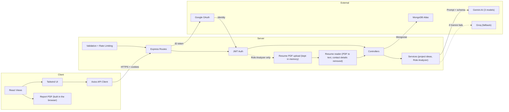
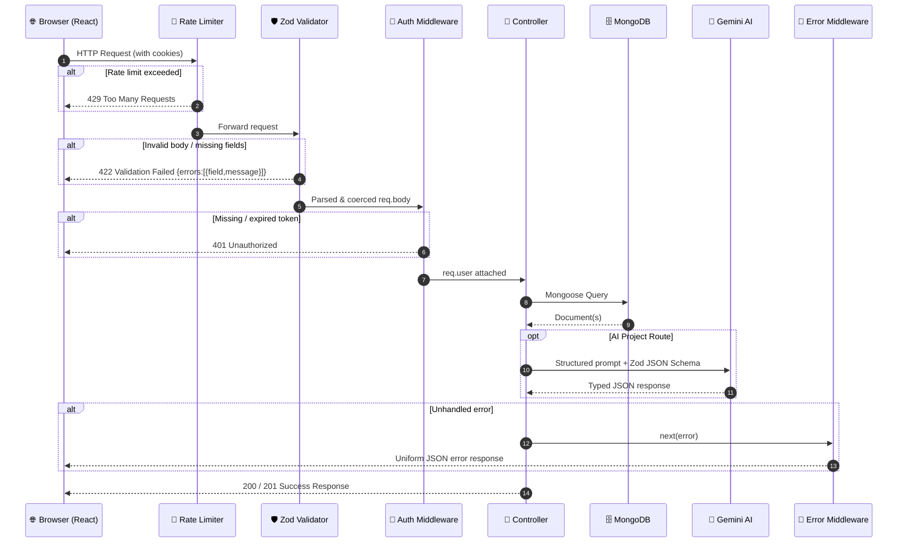
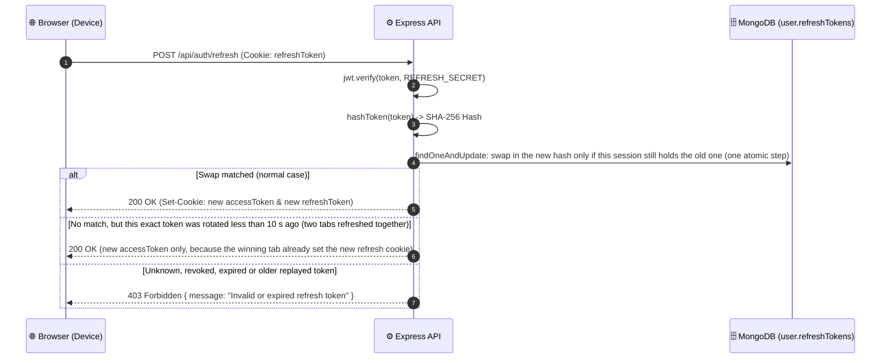
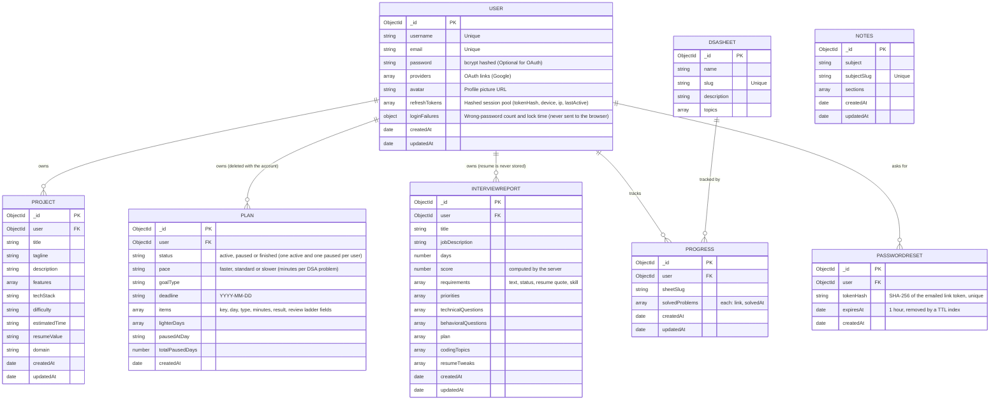

readme till 19-11-2026


# PrepStack 🚀 <!-- omit in toc -->

<div align="center">

[](LICENSE)
[](https://github.com/SahilSameer18/prepstack/pulls)
[](https://react.dev/)
[](https://tailwindcss.com/)
[](https://expressjs.com/)
[](https://ai.google.dev/)

**A free study plan for software interviews that fits your hours and survives a missed week.**

[Live Demo](https://prepstack-ss.vercel.app) · [Report Bug](https://github.com/SahilSameer18/prepstack/issues) · [Request Feature](https://github.com/SahilSameer18/prepstack/issues)

</div>

---

Most people do not fail interview preparation for lack of material. They fail because the plan breaks: they miss a week, fall behind, feel guilty and quit. PrepStack is built around that problem.

**What it does**

- **Builds a plan from your goal and your hours** (campus placements, a switch to a developer role, or big-tech interviews). It shows what fits before you sign in, and an honest finish date when it does not.
- **Keeps going after a bad week.** Pause, resume, rebuild from today, lighter days and a changed study calendar all show a preview before anything is saved, and finished work is kept.
- **Brings problems back for review** (spaced reviews that depend on whether you solved it alone, with hints, or needed the solution).
- **Keeps everything in one place:** five DSA sheets, sourced CS notes with quizzes (OS, DBMS, networks, OOP, system design), roadmaps, and a Role Analyzer that matches your resume to a job description and turns the gaps into a plan.
- **The schedule is plain code, not AI guesses**, so the same input gives the same plan. AI is used only for project ideas and for reading a resume and a job description, and its replies are checked by code.

**Free.** Reading (sheets, notes, roadmaps, the plan preview) needs no account; saving a plan and progress needs a login.

**Status, honestly:** built and heavily tested (see [Testing](#-testing)) and live at [prepstack-ss.vercel.app](https://prepstack-ss.vercel.app), but **not yet validated with a group of real students**, and the Role Analyzer has not been measured against a hand-labelled set of resumes. See [Known Limitations](#️-known-limitations).

## 📸 Product Tour <!-- omit in toc -->

_Screenshots use disposable test data._

| | |
|---|---|
| **See what fits, before you sign in.** The planner preview shows the hours and the finish date. | **Today stays simple:** only today's tasks, the time needed and one Start button. |
|  |  |
| **The whole schedule** can be adjusted with a preview before saving. | **On a phone** the same screen fits at 390 px. |
|  |  |
| **DSA sheets** (Blind 75, NeetCode 150, Striver, Love Babbar) with progress. | **CS notes** written from sources, with a last-checked date and quizzes. |
|  |  |

**My plan** is a free goal-based study planner: preview at `/my-plan`, then save and study from the dashboard or `/my-plan/study`. It includes estimated daily work, results, quizzes, reviews, schedule adjustments, optional revision practice and read-only history. Analyzer reports can be merged or used as a replacement after an explicit preview and confirmation. Study calendars support saved timezone and day rollover, explicit pause/resume, review catch-up and one paused main plan alongside an active interview sprint. Current, paused and historical plans are removed with the account. The report-import API uses `POST /api/plan/reports/:reportId/preview` and `/apply`; implementation and remaining human validation are tracked in [the plan](docs/plans/MY_PLAN_PLAN.md).

---

## 📋 Table of Contents <!-- omit in toc -->

- [📸 Product Tour](#-product-tour)
- [🎯 The Problem PrepStack Solves](#-the-problem-prepstack-solves)
- [⚡ High-Yield Technical Highlights](#-high-yield-technical-highlights)
- [📁 Directory Structure](#-directory-structure)
- [🏗️ Architectural Blueprint](#️-architectural-blueprint)
- [✨ Core Features \& Business Value](#-core-features--business-value)
- [🛠️ Deep-Dive Tech Stack](#️-deep-dive-tech-stack)
- [💾 Database Schema ERD](#-database-schema-erd)
- [🔗 API Endpoint Reference](#-api-endpoint-reference)
- [🚀 Local Installation \& Seeding Guide](#-local-installation--seeding-guide)
- [💼 Available Scripts](#-available-scripts)
- [🧪 Testing](#-testing)
- [⚠️ Known Limitations](#️-known-limitations)
- [🤝 Contributing](#-contributing)
- [📄 License](#-license)

---

## 🎯 The Problem PrepStack Solves

Candidates scatter their preparation across disconnected tools: LeetCode or a sheet for DSA, blog posts for CS theory, a general chatbot for project ideas, a spreadsheet or notes app for the schedule. Each is good at its own job. The part that breaks is the schedule that ties them together, because a fixed 90-day calendar does not survive a missed week.

**How PrepStack is different, and where it is not**

1. **The plan is the product.** It fits your hours, shows what does not fit, brings problems back for review, and recovers when you fall behind. A chatbot can write a plan once; it does not keep it honest week after week.
2. **One place for the pieces the plan points at:** the sheets, the notes, the roadmaps and the resume-to-job gap analysis link into each other.
3. **Where it is weaker than the alternatives:** LeetCode is better for actually solving and judging code, roadmap.sh has a bigger roadmap community, and dedicated resume tools have more mature resume workflows. PrepStack does not try to replace them; it plans around them.

The technical sections below explain how it is built and why.

---

## ⚡ High-Yield Technical Highlights

- **Single-Roundtrip Dashboard Engine:** Aggregates all sheet progress, problem statistics, and AI project metrics into a single optimized `/api/user/dashboard-summary` endpoint using parallel Mongoose lookups and O(1) in-memory progress mapping.
- **Type-Safe GenAI Pipeline:** Builds the response schema with Zod's built-in `z.toJSONSchema` and sends it to the Gemini SDK. The reply is then checked again with `safeParse` before anything is saved; a malformed or incomplete reply never reaches the database.
- **Multi-Device Hashed Auth:** Refresh tokens are never stored in plaintext: they are stored at rest as **SHA-256 hashes** (`crypto.createHash('sha256')`, from Node's built-in `crypto`, no extra package). Supports up to 10 simultaneous active devices with single-device logout and global session flushing (`/logout-all`).
- **Refresh-Token Replay Defence:** if a refresh token that was already rotated is used again after the 10-second grace window, the whole login session is deleted, so a stolen copy and the real user are both signed out. Password change and account deletion allow 10 failed attempts per 15 minutes per signed-in user.
- **Per-Account Login Lock:** 10 wrong passwords on one account within 15 minutes lock password logins for that account for 15 minutes, even when the guesses come from many different addresses. Google sign-in, token refresh and devices that are already logged in are not affected. The count is one atomic database update, so parallel guesses cannot skip it. Known trade-off: someone can lock a victim out for 15 minutes by failing on purpose.
- **Password Reset by Email:** "Forgot password?" answers the same for known and unknown emails, and sends the mail in the background through Brevo's SMTP relay. The link holds 32 random bytes; only its SHA-256 hash is stored; it works once for 1 hour; setting the new password signs out every device and lifts any login lock, and changing the password in Settings cancels any link that is still waiting.
- **Layered Request Validation:** Custom Express middleware `validate(schema)` intercepts and validates incoming HTTP requests using Zod schemas before hitting controllers, returning structured `422` field-specific errors.
- **Route Rate Limiting:** Limits via `express-rate-limit`. 12 of the 14 limiters count in **Redis** when it is on, so every server copy shares one count and a restart keeps it (login uses a sliding window, the rest a fixed window; both are atomic Lua scripts); the two chatty, low-risk ones (plan ticks and problem note saves) count in memory by default because a Redis count costs about 36 ms per request (measured), and `RATE_LIMIT_REDIS` opts them in. When Redis is off or fails every limiter counts in memory, per server. Keyed as before: keyed by client IP (`req.ip`, using Express `trust proxy`) for `authLimiter` (10 failed tries / 15 min, used by login, Google sign-in and set-password), `registerLimiter` (30 / 15 min), `linkGoogleLimiter` (5 / 15 min), `refreshLimiter` (30 / 15 min), `forgotPasswordLimiter` (5 / 15 min) and `resetPasswordLimiter` (10 failed / 15 min), and by user id for the AI generator (4 / hour) and the Role Analyzer (3 / hour). On login and Google sign-in only **failed** attempts count (so wrong-password guessing is throttled, but many students behind one campus Wi-Fi address can still log in); sign-ups and refreshes count every request; the AI limiter skips failed requests. Counters live in the server process: they reset on restart and are not shared between instances, so run a single instance or move them to a shared store (e.g. Redis) before scaling out.
- **Optional Redis, with graceful degradation:** `REDIS_URL` is optional. When on, it also holds the shared state of 12 of the 14 rate limits, the "an idea or report is being generated now" locks (Redis `SET NX PX` with a token, so a double click makes one AI call even across servers), the junk-technology counter, the AI circuit-breaker marks, an app-wide budget of AI calls per provider (an atomic Lua reservation; a spent provider is skipped without a call, and if every provider is spent they are all tried anyway), and a short cache of "this login session is still active" that every logout, revoke, password change or reset, account deletion and study-calendar change clears. Without it, or when Redis is unreachable, the server starts and runs on MongoDB and memory as before, prints one status line (never the address), and closes the connection cleanly on shutdown. With it, the public sheet and notes reads, the dashboard's sheet list and the My plan preview are cached (cache-aside: jittered expiry, one refill against a stampede, "not found" cached briefly, a write budget because the free host has 298 MB and evicts nothing). MongoDB stays the source of truth. The rest of the plan (a BullMQ job queue for the AI features, then hardening) is in [docs/plans/REDIS_PLAN.md](docs/plans/REDIS_PLAN.md); the interview-oriented notes are in [docs/research/REDIS_INTERVIEW_NOTES.md](docs/research/REDIS_INTERVIEW_NOTES.md).
- **Startup Secret Validation:** Fail-fast environment checks on server boot enforce the presence and minimum cryptographic length (≥32 characters) for `ACCESS_SECRET` and `REFRESH_SECRET`, and the presence of `GOOGLE_CLIENT_ID` (without it the Google sign-in token check would silently weaken).
- **Safe Startup & Shutdown:** The server listens only after MongoDB is connected, and `SIGTERM`/`SIGINT`/unhandled errors close the HTTP server and the database connection before exiting.
- **Measured scaling work:** `npm run load:test` starts the real server and measures it at 10, 50 and 100 requests at once; a CPU profile showed that the one Node thread was the limit, so read-only reads return plain objects instead of Mongoose documents, the planner's date helpers remember their answers, and an in-process cache (60 seconds, bounded) sits in front of Redis. On a 12-core laptop that took 100 simultaneous users from 24 to 122 requests a second (median 3.5 s to 0.7 s), and `npm run start:cluster` (one copy per core, needs Redis) reached 401 requests a second. Details, caveats and what is not fixed: [docs/research/SCALING_REPORT.md](docs/research/SCALING_REPORT.md).
- **Health Check & Access Log:** `GET /health` (no login) returns `200 {"status":"ok","db":"up"}` while the database is connected and `503` when it is not, for hosts and uptime monitors. Every other request writes one log line (`METHOD /path status ms`); query strings and bodies are never logged.

> **More:** 12 more engineering details (sessions, account erasure, OAuth, cookies, motion and loading work) are in [docs/ENGINEERING.md](docs/ENGINEERING.md). Testing is described in [TESTING.md](TESTING.md).

---

## 📁 Directory Structure

```text
prepstack/
├── docs/                        # More technical details (ENGINEERING.md) and working notes
├── PROJECT_STATUS.md            # What is done, what is left, and the build order
├── CLAUDE.md                    # Rules for AI agents working on the project
├── TESTING.md                   # What is tested and how
├── LICENSE                      # MIT
├── client/                      # React 19 frontend
│   ├── public/                  # Static public assets
│   ├── scripts/                 # Build-time prerender and SEO checks
│   ├── src/
│   │   ├── api/                 # Axios instance (with refresh interceptor) and service layer
│   │   ├── components/          # Navbar, Footer, home page blocks, auth guard, UI states
│   │   │   ├── analyzer/        # Score ring, requirement rows, skill gap cards, dashboard reports tab
│   │   │   └── pdf/             # The report as a PDF (loaded only on download)
│   │   ├── context/             # React Context stores (Auth, Project)
│   │   ├── data/                # Static data (roadmaps, behavioral questions)
│   │   ├── hooks/               # useAuth, useProject, useNotes, ...
│   │   ├── layout/              # MainLayout
│   │   ├── pages/               # DSA sheets, CS notes, roadmaps, AI projects, Role Analyzer, Dashboard, Profile, legal
│   │   ├── seo/                 # Per-page titles, descriptions and share tags (one source of truth)
│   │   ├── utils/               # Error messages, dates and titles, report links, PDF export, avatars
│   │   ├── app.routes.jsx       # Route table (login-protected pages use ProtectedRoute)
│   │   └── main.jsx             # React entrypoint
│   └── vite.config.js           # Bundling settings
└── server/                      # Express 5 backend
    ├── scripts/                 # Hand-run tools: list models, compare models, evaluate the analyzer, build catalogs, check a Redis host, measure the cache
    ├── src/
    │   ├── modules/             # Feature code grouped by responsibility
    │   │   ├── auth/            # Login, sessions, User model, password reset and email
    │   │   ├── user/            # Profile, dashboard summary and account deletion
    │   │   ├── sheets/          # DSA sheets, progress, problem identity and seeds
    │   │   ├── problem-notes/   # Saved problem notes and allowed choices
    │   │   ├── notes/           # CS notes, validators, content and notes seed
    │   │   ├── ai/              # AI provider chain and shared provider budgets
    │   │   ├── project/         # Generated project ideas
    │   │   ├── usage/           # Usage API
    │   │   ├── analyzer/        # Resume analysis, reports, skill catalog and PDF upload
    │   │   └── plan/            # My plan, scheduling, recovery and plan catalog
    │   ├── shared/              # Infrastructure and utilities used across features
    │   │   ├── config/          # Database, limits, Redis and seed connection setup
    │   │   ├── http/            # Errors, validation, rate limits and response helpers
    │   │   ├── infra/           # Caches, locks and rate-limit store
    │   │   ├── calendar/        # Study dates, streaks and the shared clock
    │   │   ├── usage/           # Rolling usage counts
    │   │   └── content/         # Roadmap catalog, behavioral questions and link validation
    │   └── app.js               # Express app definition
    ├── test/                    # Architecture guard, API and service tests (node:test + supertest + in-memory MongoDB; a fake Redis in test/helpers)
    ├── cluster.js               # Optional: one server copy per CPU core (needs Redis)
    └── server.js                # Startup and shutdown
```

---

## 🏗️ Architectural Blueprint

### System Overview



_The Role Analyzer path: the resume PDF is read in memory, contact details are removed, the text goes to the AI, and the reply is checked again by code. The resume itself is never stored._

---

### Request Lifecycle



_This is a simplified view. The exact middleware order differs per route: for example the Role Analyzer route runs auth first, then its rate limit, then the PDF upload, then validation._

---

### Multi-Device Hashed Token Refresh Flow



---

## ✨ Core Features & Business Value

### 🤖 AI-Powered Project Generation

- **Dynamic Prompts:** Accepts tech stack, domain (FinTech, SaaS, Web3), complexity level (`beginner`/`intermediate`/`advanced`), and extra constraints.
- **Recruiter-Ready Output:** Gemini generates project descriptions, tagging, estimated timeline, and STAR resume bullets.
- **Reliable AI cascade (free tier only):** idea generation tries `gemini-3-flash-preview`, then `gemini-3.5-flash-lite`, then `gemini-3.1-flash-lite`, then Groq `openai/gpt-oss-120b`. One retry for "overloaded" errors (never for quota errors), 20 s per call, 55 s in total, at most 5 calls, and a circuit breaker that skips a provider that keeps failing. Model names and keys are settings (`GEMINI_*_MODEL`, `GROQ_MODEL`, `GROQ_API_KEY`), so retiring a model is a config change. If every provider fails the user gets a clear message and the attempt does not count.
- **Abuse Protection:** 4 project requests per hour and 15 saved ideas per 24 hours per signed-in user (failed requests are not counted), and only one idea can be generated at a time per user (a second request gets `409`). The page offers 13 tech stack buttons plus **Other (type your own)**: a typed name must be 2 to 40 characters of letters, numbers and `+ # . / & ( ) -`, and the AI is first asked whether it is a real technology (answers are remembered; if the check cannot run the idea is still generated). A user who gets 5 "not a technology" answers in an hour is paused for the rest of the hour, so junk input cannot drain the shared free quota.

### 🎯 Role Analyzer (resume vs job description)

Paste a job description and add your resume (PDF or pasted text). You get a report with a match score, each requirement marked met / partly / missing with a quote from your resume, the skills you lack with where to learn them, likely technical and behavioral questions, and a day-by-day plan. Everything it links to is something PrepStack really has.

- **The code decides, not the AI.** The AI only reads the text: it lists the job's requirements, marks each one, and quotes proof. The score is computed by the server (must-have = 3 points, nice-to-have = 1; met = full, partly = half). Every quote is checked against the resume; a quote that cannot be found downgrades that requirement. Skill names come from a closed list of 120 skills (`server/src/modules/analyzer/skillCatalog.json`; the AI may write any text, and the code turns a name that is not on the list into "none"), titles must come from the job description (and are shown in Title Case, at most 60 characters), and plan links are kept only if they point at content that exists (Blind 75 topics, CS notes sections, roadmaps, behavioral questions).
- **Privacy:** the resume is never stored. Email, phone number and links are removed before anything leaves the server, and only the report (with short quotes) is saved. The user must tick a consent box (the text goes to Google and, if Gemini is busy, to Groq). Deleting an account deletes its reports.
- **Limits:** PDF only (checked by its first bytes), 3 MB, 5 pages, 10 s to read, scanned PDFs are rejected with a clear message. 3 reports per hour and 5 per 24 hours per user (`ANALYZER_DAILY_LIMIT`; failed attempts are not counted), one report at a time (`409`).
- **Skill advice is computed on every read** from the catalog (never stored), so improving the catalog improves old reports. Each skill points at DSA topics, CS notes, a roadmap, the Behavioral Prep page (soft skills) or an AI project idea (`/ai-projects?stack=...`), plus official docs. About half of the catalog has no PrepStack lessons yet; those skills show docs links only.
- **Screens:** `/analyzer` (form and recent reports) and `/analyzer/:id` (tabs: Plan, Skills, Questions, Resume tips). Both are behind login and hidden from search engines.
- **PDF download:** built in the browser with `@react-pdf/renderer` (PrepStack links and docs links stay clickable). The library is a separate ~1.2 MB chunk that loads only when the user clicks Download PDF. It uses the standard PDF fonts, so characters outside basic Latin may not draw.

### 📈 Dynamic DSA Trackers

- **Industry Sheets:** Tracks Blind 75, NeetCode 150, Striver A2Z, Striver SDE, and Love Babbar 450.
- **Live Sync:** Problem completions toggle asynchronously, instantly refreshing dashboard metrics.

### 📚 CS Fundamentals Library

- **Notes written from sources:** All five subjects are written as Markdown sections from sources: DBMS 10, Computer Networks 10, Operating Systems 11, OOP 10 (OOP uses Java, and every Java example was compiled and run) and System Design 23 (11 concepts and 12 case studies, with architecture and sequence diagrams and every number computed by a script). Each has an overview, topics with an example and a failure case, interview questions, mistakes, a 5-question quiz and diagrams, in easy words, with a source list and a claims table in `docs/content/`. Diagrams are drawn from plain data in four kinds: flow, layers, graph (architecture pictures with database, queue and cache shapes, zone boxes and numbered or dashed arrows) and sequence (messages over time); the planned System Design notes (`docs/archive/HLD_NOTES_PLAN.md`) may have up to 6 per section, every other subject 3. A section shows its last-checked date; none has been read by an outside reviewer yet.

### 📝 STAR Resume & Behavioral Hub

- **STAR Prompts:** Complete, interactive STAR templates for mapping experiences.
- **Behavioral Bank:** 50 questions in 10 groups (personal, teamwork, conflict, failure, leadership, responsibility, deadlines, unclear situations, feedback, motivation). Each has what the interviewer is looking for, a four-part STAR plan, a made-up example answer and two mistakes to avoid, in easy words.

### 🗺️ Curated Developer Roadmaps

- **9 Learning Tracks:** **Frontend**, **Backend**, **Full Stack MERN**, **Android Development**, **Data Analytics**, **Machine Learning**, **DSA & Problem Solving**, **Java & Spring Boot** and **DevOps & Cloud**. Every step has a goal, topics, a time range, practice links into PrepStack, a checkpoint, a mini-project and 2 to 3 free official resources, all in plain words.
- **Actionable Steps & Milestones:** Breaks down complex subjects into step-by-step milestones with estimated completion times, difficulty tiers, and curated free resources.

### 🗓️ My Plan (goal-based study planner)

The planner is free to preview and needs a login to save. You pick a goal (big-tech SDE, placements, a role roadmap), a sheet, the weeks you have and the hours you can study, and the server builds a day-by-day plan.

- **Plain code, no AI.** The schedule is made by deterministic code (`planGenerator.js`, `planAdjust.js`): about 85% of each day is planned, 70% of that for new items and 15% for reviews. Core topics come first, in dependency order. The same input always gives the same plan, and the numbers can be tested.
- **Public preview.** `/my-plan` shows the totals and week 1 without an account. Saving, studying and syncing need a login.
- **A fair share when time is short.** Sheet plans target at least one problem per DSA topic and three sections per chosen CS subject when time allows. Hard problems are trimmed first. The plan and its preview explain what only partly fits and what was left out. A roadmap step longer than the whole plan is planned in parts and the rest is reported as not included, so a role plan is never empty while there are study hours. When something does not fit, the preview also says when the whole syllabus would be finished at the same hours (found by planning the same request over the longest plan allowed, 52 weeks; "more than a year" beyond that).
- **My pace.** Faster, Standard or Slower changes the minutes planned for each DSA problem. It can be changed later with a preview.
- **Calm Today screen.** Only today's items, the time they need and one Start button. Graphs, history, reviews and settings live in other tabs.
- **Review ladder.** Finishing a problem schedules reviews at fixed gaps that depend on how you solved it (alone, with hints, or with the solution). Today shows due reviews within its review allowance. The Reviews tab shows the full due list.
- **Sheet sync.** Ticking a problem in the plan ticks it on its DSA sheet, and a problem already solved on a sheet shows as done in the plan. A problem split over several days is solved on the sheet only when its last part is done.
- **Safe changes.** Rebuild from today (optionally with a later deadline), new hours and lighter days always show a preview with a diff first. Nothing is saved until you confirm, and a stale preview is refused.
- **Life happens.** A study calendar (your timezone and the hour the day starts, for night owls), pause and resume (the whole calendar and all review dates move forward together), review catch-up that spreads overdue reviews over several days, one paused main plan next to a short interview sprint, and a substitute for a problem whose link is dead or paywalled (the original stays unsolved).
- **From the Role Analyzer.** A report's study plan can be merged into the plan, or replace it, after a preview. History of replaced and finished plans is read-only.
- **Privacy.** Plans belong to the account and are deleted with it.

Design and decisions: [docs/plans/MY_PLAN_PLAN.md](docs/plans/MY_PLAN_PLAN.md).

---

### 👤 Unified Profile & Security Hub

- **Dual-Identity Management:** Seamlessly link Google OAuth and Email/Password authentications, including the ability for OAuth-only users to establish a permanent password directly from their profile page.
- **Active Devices & Sessions Manager:** Visual inspection of all authenticated devices (*"Chrome on Windows 11"*, *"Safari on iPhone"*) with IP addresses, last-active timestamps, live current device indicators, and individual remote session revocation.
- **Password Reset by Email:** "Forgot password?" on the login page sends a one-time link (valid for 1 hour, works once). Setting a new password signs out all devices.
- **Dual Session Sign-Out Controls:** Supports isolated single-device logout or global session flushing (*"Sign Out of All Devices"* via `POST /api/auth/logout-all`).
- **Self-Service Account Deletion:** Built-in modal allowing users to permanently erase their account with password/email verification. All of their data (progress, projects and role reports) is wiped in one step; this is a single transaction on a replica set such as MongoDB Atlas, and falls back to a plain sequence of deletes on a standalone MongoDB.
- **Full-Screen Logout Overlay:** Seamless full-screen transition overlay that smoothly clears session state with visual feedback.
- **Dynamic Avatars:** Integrates the open-source DiceBear API to automatically generate unique, tech-themed robot avatars for users without Google profile pictures.
- **Live Stats Engine:** Aggregation of your total solved DSA problems, generated AI projects and role reports, shown in a dashboard with DSA / Projects / Reports tabs.

---

## 🛠️ Deep-Dive Tech Stack

### Frontend

| Technology          | Version | Role                                        |
| ------------------- | ------- | ------------------------------------------- |
| React               | 19.2    | UI library (concurrent rendering)           |
| Vite                | 7       | Build tooling & HMR                         |
| Tailwind CSS        | v4      | Utility-first styling engine                |
| Framer Motion       | 12      | Fluid UI transitions & animations           |
| React Router DOM    | 7       | Client routing layer                        |
| Axios               | latest  | Configured HTTP client (with credentials)   |
| @react-oauth/google | latest  | Secure Google Identity Services integration |
| DiceBear API        | 7.x     | Dynamic, deterministic avatar generation    |
| @react-pdf/renderer | 4.9     | Role Analyzer report PDF (loaded only on download) |
| react-hot-toast     | 2.6     | Toast notifications                         |

### Backend

| Technology          | Version | Role                                                  |
| ------------------- | ------- | ----------------------------------------------------- |
| Node.js + Express   | 5.2     | Web app framework (native async errors)               |
| Mongoose            | 9       | MongoDB Object Document Mapper (ODM)                  |
| Zod                 | 4       | Server validation and structured schema config        |
| helmet              | 8       | Standard HTTP security headers                        |
| @google/genai       | 1.47    | Official SDK client for Gemini integrations           |
| groq-sdk            | 1.6     | Backup AI provider when Gemini is busy                |
| nodemailer          | 10.4    | Sends the password reset email (Brevo SMTP)           |
| multer              | 2.5     | Resume PDF upload (kept in memory, never written to disk) |
| pdf-parse           | 2.4     | Reads the text of an uploaded PDF resume              |
| jsonwebtoken        | 9       | Cryptographic user session tokens                     |
| bcrypt              | 6       | Salted security hashing (12 rounds)                   |
| cookie-parser       | 1.4     | Secure browser cookie management                      |
| express-rate-limit  | 8.5     | IP request flood limiter (in memory for now)          |
| ioredis-mock (dev)  | 8.13    | Test-only Redis with a Lua engine, so the real rate-limit and lock scripts run in the tests |
| ioredis             | 5.11    | Optional Redis (Valkey) client: cache for public reads and the plan preview; the app runs without it |
| google-auth-library | latest  | Official backend SDK for Google ID token verification |

---

## 💾 Database Schema ERD



---

## 🔗 API Endpoint Reference

### Authentication: `/api/auth`

| Method   | Endpoint                | Auth   | Description                                                    |
| -------- | ----------------------- | ------ | -------------------------------------------------------------- |
| `POST`   | `/register`             | None   | Register user _(rate-limited: 30/15min)_                       |
| `POST`   | `/login`                | None   | Login user _(10 failed tries/15min per address; 10 per account locks it for 15min)_ |
| `POST`   | `/google`               | None   | Google OAuth login/registration                                |
| `POST`   | `/link-google`          | ✅ JWT | Link Google account to existing user _(rate-limited: 5/15min)_ |
| `PUT`    | `/set-password`         | ✅ JWT | Sets a permanent password for OAuth-only users                 |
| `POST`   | `/forgot-password`      | None   | Emails a one-time reset link _(same answer for any email; 5/15min)_ |
| `POST`   | `/reset-password`       | None   | Sets a new password with the link, signs out all devices _(10 failed/15min)_ |
| `POST`   | `/refresh`              | Cookie | Rotates access token and refresh token hash _(30/15min)_        |
| `POST`   | `/logout`               | ✅ JWT | Clears session cookie on current device                        |
| `POST`   | `/logout-all`           | ✅ JWT | Revokes all active device sessions globally                    |
| `GET`    | `/sessions`             | ✅ JWT | Lists all active device sessions with telemetry                |
| `DELETE` | `/sessions/:sessionId`  | ✅ JWT | Revokes a specific active device session                       |
| `GET`    | `/current-user`         | ✅ JWT | Retrieves current user session data                            |

### User Profile: `/api/user`

| Method   | Endpoint             | Auth   | Description                                                     |
| -------- | -------------------- | ------ | --------------------------------------------------------------- |
| `GET`    | `/dashboard-summary` | ✅ JWT | Single-roundtrip pre-aggregated dashboard metrics & sheet stats, plus the current streak (IST days) and each sheet's last solved date |
| `GET`    | `/stats`             | ✅ JWT | Aggregates and returns total solved DSA and AI projects         |
| `PUT`    | `/profile`           | ✅ JWT | Updates unique username and avatar with strict Zod validation   |
| `PUT`    | `/change-password`   | ✅ JWT | Verifies password, updates hash, and revokes other devices      |
| `DELETE` | `/account`           | ✅ JWT | Permanently deletes the account and all of its data              |

### Usage: `/api/usage`

| Method   | Endpoint | Auth   | Description                                                                                      |
| -------- | -------- | ------ | ------------------------------------------------------------------------------------------------ |
| `GET`    | `/`      | ✅ JWT | How much of today's allowance is used for project ideas and reports (`used`, `allowed`, `resetsAt`, last 24 hours) |

### AI Projects: `/api/project`

| Method   | Endpoint      | Auth   | Description                                          |
| -------- | ------------- | ------ | ---------------------------------------------------- |
| `POST`   | `/generate`   | ✅ JWT | Generates an idea with the AI cascade _(4/hr, 15/24h, one at a time)_ |
| `GET`    | `/`           | ✅ JWT | Returns 20 saved projects, newest first, with the total; `?before=<id>` gives the next 20 |
| `GET`    | `/:projectId` | ✅ JWT | Returns specific project metadata                    |
| `DELETE` | `/:projectId` | ✅ JWT | Deletes project profile                              |

### Role Analyzer: `/api/analyzer`

| Method   | Endpoint | Auth   | Description                                                                                          |
| -------- | -------- | ------ | ---------------------------------------------------------------------------------------------------- |
| `POST`   | `/`      | ✅ JWT | Creates a report from a resume (PDF field `resume` or `resumeText`), `jobDescription`, `days`, `consent` _(3/hr, 5/24h, one at a time)_ |
| `GET`    | `/`      | ✅ JWT | Lists your reports (title, score, date), newest first                                                |
| `GET`    | `/today` | ✅ JWT | Today's plan items from your latest report (the dashboard "Today" card); `null` when there is no report with a plan |
| `GET`    | `/:id`   | ✅ JWT | Returns one report with computed skill advice and `todayDay` (the plan day that is today, in IST)     |
| `PATCH`  | `/:id/plan` | ✅ JWT | Ticks or unticks one study-plan item: body `{ day, index, done }`; sets the state (does not flip it) _(60/min)_ |
| `DELETE` | `/:id`   | ✅ JWT | Deletes a report                                                                                     |

### DSA Sheets: `/api/sheets`

| Method | Endpoint          | Auth   | Description                                |
| ------ | ----------------- | ------ | ------------------------------------------ |
| `GET`  | `/`               | None   | Lists all DSA sheets (cached; `Cache-Control: public, max-age=300, stale-while-revalidate=600`) |
| `GET`  | `/:slug`          | None   | Returns sheet sections and problem links (cached, same header) |
| `GET`  | `/:slug/progress` | ✅ JWT | Returns active user solved problems        |
| `POST` | `/:slug/progress` | ✅ JWT | Toggles state of problem (solved/unsolved) |

### Problem notes: `/api/problem-notes`

Your notes on DSA problems (pattern, time and space complexity, up to 5,000 characters of text), saved to your account. One note per problem link; the same link in two sheets is one note. Notes are deleted with the account.

| Method   | Endpoint  | Auth   | Description |
| -------- | --------- | ------ | ----------- |
| `GET`    | `/`       | ✅ JWT | Lists your notes, newest first |
| `PUT`    | `/`       | ✅ JWT | Saves one whole note `{ problemLink, pattern, timeComplexity, spaceComplexity, approach }`; the link must belong to a sheet _(120/min)_ |
| `DELETE` | `/?problemLink=` | ✅ JWT | Deletes a note (also for a link no longer in any sheet) _(120/min)_ |
| `POST`   | `/import` | ✅ JWT | One-time move of the notes kept in the browser, at most 15 per request. It only adds: a note the account already has is never overwritten _(120/min)_ |

### Study plan: `/api/plan`

Everything except the preview and the options needs a login. Changes are two calls: a preview that returns a checksum, then an apply that must send it back.

| Method | Endpoint | Auth | Description |
| ------ | -------- | ---- | ----------- |
| `GET` | `/options` | Public | Goals, sheets, roadmaps and limits for the builder |
| `POST` | `/preview` | Public | Totals and week 1 for a form, plus when the whole syllabus would finish when something does not fit; writes nothing; cached for about 10 minutes per input when Redis is on _(20/min per IP)_ |
| `GET` | `/` | ✅ JWT | The active plan, Today, the study calendar and any paused plan |
| `POST` | `/` | ✅ JWT | Saves a plan; `replace: true` keeps the old one as history _(10 saved an hour)_ |
| `DELETE` | `/` | ✅ JWT | Deletes the active plan |
| `POST` | `/changes/preview`, `/changes/apply` | ✅ JWT | Rebuild (optionally with a later deadline), new hours, lighter days, a new pace _(20/min)_ |
| `POST` | `/lifecycle/preview`, `/lifecycle/apply` | ✅ JWT | Study calendar, pause, resume, discard a paused plan, review catch-up |
| `GET` | `/paused/:id` | ✅ JWT | Read-only snapshot of the paused plan |
| `POST` | `/reports/:reportId/preview`, `/apply` | ✅ JWT | Merge or replace from a Role Analyzer report |
| `GET` | `/review` | ✅ JWT | Weekly review: done, moved, on-track and weak topics |
| `GET`, `DELETE` | `/history`, `/history/:id` | ✅ JWT | Read-only finished plans; clear history |
| `POST` | `/items` | ✅ JWT | Adds your own task |
| `PATCH` | `/items/:id` | ✅ JWT | Ticks or unticks an item (and its sheet problem when the last part is done) |
| `POST` | `/items/:id/result`, `/review`, `/skip`, `/unskip` | ✅ JWT | Result (alone, hints, solution), a review, skip, unskip |
| `PATCH` | `/items/:id/star` | ✅ JWT | Stars an item |
| `GET`, `POST` | `/items/:id/substitutes`, `/substitute` | ✅ JWT | Suggests and adds a replacement for an unfinished problem |

### CS Notes: `/api/notes`

| Method | Endpoint    | Auth | Description                               |
| ------ | ----------- | ---- | ----------------------------------------- |
| `GET`  | `/`         | None | Returns each subject with its section count, topic count, reading time and last checked date (no sections); cached, with the public `Cache-Control` header above |
| `GET`  | `/:subject` | None | Returns the subject with its sections; each section has a permanent `id` and its reading time; cached, same header |

---

## 🚀 Local Installation & Seeding Guide

### 1. Setup Codebase

```bash
git clone https://github.com/SahilSameer18/prepstack.git
cd prepstack
```

### 2. Configure Server (`server/`)

```bash
cd server
npm install
cp .env.example .env
```

Configure your `.env` file under `/server`:

```env
PORT=3000
MONGO_URI=mongodb://127.0.0.1:27017/prepstack
ACCESS_SECRET=your_ultra_secure_access_token_secret
REFRESH_SECRET=your_ultra_secure_refresh_token_secret
GOOGLE_API_KEY=AIzaSyYourGeminiApiKeyHere
GOOGLE_CLIENT_ID=your_google_oauth_client_id

# Optional AI fallbacks (all in server/.env.example): a Groq key and the model names tried, in order
GROQ_API_KEY=
GEMINI_PRIMARY_MODEL=gemini-3-flash-preview
GEMINI_FALLBACK_MODEL=gemini-3.5-flash-lite
GEMINI_FALLBACK_2_MODEL=gemini-3.1-flash-lite
GROQ_MODEL=openai/gpt-oss-120b
AI_DAILY_LIMIT=15
ANALYZER_DAILY_LIMIT=5

# Password reset email (Brevo SMTP). Without these, "Forgot password?" answers 503.
EMAIL_PROVIDER=brevo
EMAIL_FROM="PrepStack <your-verified-sender@example.com>"
BREVO_SMTP_LOGIN=
BREVO_SMTP_KEY=
CLIENT_URL=http://localhost:5173

# Optional (all explained in server/.env.example)
NODE_ENV=development
ALLOWED_ORIGINS=
ENABLE_CUSTOM_DNS=
REDIS_URL=
REDIS_PREFIX=
RATE_LIMIT_MEMORY_ONLY=
CACHE_MEMORY_SECONDS=
WEB_CONCURRENCY=
AI_BUDGETS=
AI_BUDGET_DAY_TIMEZONE=
SESSION_CACHE=
```

`REDIS_URL` is optional: empty means the server runs without Redis (memory and MongoDB only), and an unreachable Redis never stops the server; the address holds a password, so keep it in your own `.env` only. `REDIS_PREFIX` defaults to `prepstack:<NODE_ENV>:` so development and the live site never share keys. `RATE_LIMIT_MEMORY_ONLY` is the way back if a Redis limiter misbehaves: `all`, or a list such as `login,register`, keeps those limiters in memory. `RATE_LIMIT_REDIS` (`plan-tick`, `problem-note`, or `all`) counts the two chatty limiters in Redis too, for example when you run several servers. `CACHE_MEMORY_SECONDS` (default 60, `0` = off) is how long the in-process cache in front of Redis keeps a sheet, notes or preview answer. `WEB_CONCURRENCY` is the number of server copies for `npm run start:cluster` (default: the number of cores, at most 8). `AI_BUDGETS` is an optional JSON budget of AI calls per provider or family, for example `{"gemini":{"perMinute":5,"perDay":20}}`, taken from your own AI consoles: a provider whose budget is spent is skipped without a call, a provider with no entry has no limit, and if every provider is spent they are all tried anyway (so a wrong number never means "AI is down"); the day starts at midnight in `AI_BUDGET_DAY_TIMEZONE` (default `America/Los_Angeles`). `SESSION_CACHE=off` turns off the cache of "this login session is still active" in the auth middleware (default on: 5 seconds in the process, up to 30 seconds in Redis; every logout, revoke, password change or reset, replayed refresh token, account deletion and study-calendar change clears it). `npm run redis:check` checks a Redis service (version, eviction policy, locks, counters, Lua); `npm run test:redis-live` runs the opt-in live test, and `npm run measure:cache` counts database reads and generator runs for 400 public requests with and without Redis. When Redis is on, the public sheet and notes reads, the dashboard's sheet list and the My plan preview are cached for about 10 minutes (the seed scripts clear them), and the four public reads send `Cache-Control: public, max-age=300, stale-while-revalidate=600`.

`ALLOWED_ORIGINS` is a comma-separated list of extra front-end URLs allowed by CORS (exact match). Set `ENABLE_CUSTOM_DNS=true` only if your ISP cannot resolve `mongodb+srv://` addresses. On a production host set `NODE_ENV=production` and add your deployed front-end URL to `ALLOWED_ORIGINS`.

Boot Express server:

```bash
npm run dev
```

### 3. Configure Client (`client/`)

In a new terminal:

```bash
cd client
npm install
cp .env.example .env.development
```

Configure your `.env.development` file under `/client`:

```env
VITE_API_URL=http://localhost:3000
VITE_GOOGLE_CLIENT_ID=your_google_oauth_client_id
```

Optional (production builds only): `VITE_SITE_URL` (your public address, used in canonical links and the sitemap) and `VITE_GSC_VERIFICATION` (Google Search Console verification code).

Boot Vite dev server:

```bash
npm run dev
```

### 4. Database Seed

To populate sheets and CS revision datasets:

```bash
cd server
npm run seed:all
```

_(Uses idempotent upsert logic: safe to run multiple times)._

---

## 💼 Available Scripts

### Backend (`server/`)

| Script               | Description                                |
| -------------------- | ------------------------------------------ |
| `npm run dev`        | Boots dev environment using nodemon        |
| `npm start`          | Launches server (one process, one CPU core) |
| `npm run start:cluster` | One server copy per CPU core (`WEB_CONCURRENCY`, at most 8); refuses to start without `REDIS_URL`, because the copies share rate limits, locks and caches through Redis |
| `npm run load:test`  | Starts the real server on an in-memory database and measures requests per second and latency at 10, 50 and 100 at once; `PROFILE=1` adds a CPU profile, `ONLY=` one request kind, `CLUSTER=4` four copies |
| `npm run benchmark:analyzer` | Runs the real Role Analyzer on labelled resume and job pairs and prints how often it agrees with the labels, how much repeat runs and models disagree, and the false-reassurance rate (real AI calls; without `--data` it runs 7 made-up pairs as a smoke test; see [docs/research/ANALYZER_BENCHMARK.md](docs/research/ANALYZER_BENCHMARK.md)) |
| `node scripts/student-check-report.js <usernames>` | Read-only counts for the student check (tasks done, days active, reviews); never prints emails (see [docs/research/STUDENT_CHECK.md](docs/research/STUDENT_CHECK.md)) |
| `npm run seed:notes` | Validates and atomically replaces CS notes; requires a MongoDB replica set/Atlas, rolls back failures, and returns a failing exit code (run after changing `src/modules/notes/content`) |
| `npm run check:links` | Checks that the outside links (roadmaps, skill catalog, resume guide tools) still answer; run by hand before a release, needs the network |
| `npm run seed:all`   | Idempotently seeds DSA Sheets and CS notes (both seeds also clear the cached copies when Redis is set) |
| `npm run build:plan-catalogs` | Rebuilds the planner's roadmap and sheet-topic catalogs after a roadmap or sheet change; a test fails until you do |
| `npm run build:seo-content` | Rebuilds the two generated files the search pages use (`client/src/seo/content.js` and `contentBody.js`) after a notes or sheet change; a test fails until you do |
| `npm run redis:check` | Checks the Redis service in `server/.env`: version, eviction policy, expiry, locks, counters, Lua, connections; prints no address |
| `npm run test:redis-live` | Opt-in test of the app's Redis connection against the real service (unique key prefix, deletes only its own keys) |
| `npm run measure:cache` | Counts database reads and generator runs for 400 public requests without Redis and with the real service |
| `npm run measure:limits` | Times a cheap request (a problem note save) with Redis off, with Redis on but the limiter in memory, and with that limiter opted in to Redis; the last minus the middle row is the cost of a Redis limiter |
| `node scripts/migrate-solved-at.js` | One-time: converts old solved-problem links to the dated format (`--dry-run` only prints counts). Run it on the live database before deploying the dated-progress code |
| `npm test`           | Runs the API test suite (in-memory database, no real keys needed) |
| `npm run test:coverage` | Same, with a coverage report              |

### Frontend (`client/`)

| Script            | Description                       |
| ----------------- | --------------------------------- |
| `npm run dev`     | Launches dev build server         |
| `npm run build`   | Builds the bundle, then writes one HTML page per route (title, description, share tags, and for notes sections, sheets, roadmaps and the behavioral guide the real text), `sitemap.xml` (91 pages, 64 of them notes sections) and `robots.txt`, and fails if any SEO check fails |
| `npm run build:app` | Plain Vite build only (no SEO step) |
| `npm run lint`    | Analyzes code styling with ESLint |
| `npm run preview` | Previews production bundle output |

---

## 🧪 Testing

The server has **1128 automated tests** (`node:test` + `supertest` + an in-memory MongoDB). They need no real keys and no network: the AI providers, Google sign-in and Redis are faked (a small in-memory fake Redis with its own clock, in `server/test/helpers/fake-redis.js`). Two Redis checks need the real service and are opt-in: `npm run test:redis-live` and `npm run measure:cache`.

```bash
cd server
npm test
```

They cover auth and sessions (refresh rotation, replay defence, revocation), the DSA, notes and project APIs, account deletion, the per-account login lock, password reset by email (the mail sender is faked), rate limits, the AI provider chain, and the Role Analyzer (score maths, quote checking, closed skill list, PDF checks, privacy rules). The client has **122 tests** (`cd client && npm test`, Vitest, no browser): 14 for the login token refresh plus a Google conflict hook check (refresh once, share it between parallel requests, sign out only when the server refuses it, never on a timeout) , 5 that fail when a component uses a raw color instead of a design token, 2 for the resume checklist PDF (it must draw as one page), and the rest for the notes quiz scoring and diagram layout, the roadmap data rules and links, the Analyzer link builder, the study-plan checklist helpers, the problem-note import and merge helpers and the page titles. Eleven Playwright browser flows now cover the dashboard, report imports and daily study workspace at phone and desktop widths: task results, quizzes, plan controls, reviews, practice and read-only history. Run them with npm run test:browser from client; installed Chrome and both client/server dependencies are required. The harness uses fresh disposable servers on 3100 and 5175 and does not load the real server environment. Details, and what is not covered: [TESTING.md](TESTING.md).

The client has 135 unit tests, and 28 browser flows (My plan, the signed-out pages, first-time experience) (`cd client && npm run test:browser`; they start their own servers on ports 3100 and 5175 and need Chrome).

The Role Analyzer was also checked against the real AI with hand-run scripts in `server/scripts/` (they need your own keys and use free-tier quota).

---

## ⚠️ Known Limitations

- **Rate limits are only shared while Redis is on, and two never are by default.** 12 of the 14 limiters count in Redis when it is on (every server shares one count, and a restart keeps it); plan ticks and problem note saves count per server in memory unless `RATE_LIMIT_REDIS` opts them in. Without Redis, or while it is down, each server counts for itself in memory: counts reset on restart, are not shared, and a limit can be exceeded by the number of servers, so run one instance. Other costs: each Redis-counted request makes one Redis round trip (measured 36 ms median, 40 ms at the 95th percentile, from a laptop to the free Aiven service); the sliding window (login) takes its time from the app server's clock; and the free Aiven service is not meant for production use. `RATE_LIMIT_MEMORY_ONLY` puts chosen limiters back in memory.
- **Redis is optional and not required to run.** The free Aiven Valkey service has a 298 MB memory limit, evicts nothing and saves snapshots only (no append-only file), and can be powered off when unused. Cached public reads can show content up to about 15 minutes old after a reseed (10 minutes in the server cache plus the browser's 5-minute header).
- **The session cache can show a revoked session for a few seconds in one case.** Revoking clears the answer at once on the server that handled it and raises a version number in Redis, so other server copies refuse the cached answer on their next Redis read; but a copy that holds the answer in its own memory keeps it for up to 5 seconds, and if Redis is down exactly during a revoke the Redis copy can live up to 30 seconds. With one server (the free Render plan) the 5-second case cannot happen. The cache has not been measured against the live site, so its latency gain is unproven: a Redis read costs about 36 ms from a laptop, which is no faster than a MongoDB read, so the saving comes from the in-process layer. Switch it off with `SESSION_CACHE=off`.
- **The AI budget is only as good as its numbers.** `AI_BUDGETS` was set on Render on 19 Nov 2026 from the Gemini and Groq consoles (a little under each per-minute and per-day limit). If a provider changes its limits the numbers must be edited by hand; Google counts one quota for the whole project, so calls made with the same key outside PrepStack are not counted; and Groq's tokens-per-minute limit is not counted at all (only requests).
- **One server process uses one CPU core, and the plan generator runs on that core.** A burst of people building plans at the same time slows every other request on that process (about 20 ms of CPU per preview, more for saving or rebuilding a plan). `npm run start:cluster` uses all cores but needs `REDIS_URL` and a host with several cores; the free Render instance has about 0.1 of a CPU. The load-test numbers come from a laptop with an in-memory database, so they rank the bottlenecks but are not the capacity of the live site. See [docs/research/SCALING_REPORT.md](docs/research/SCALING_REPORT.md).
- **Not yet validated with real students.** No group of students has used My plan end to end, so there is no data on how many finish a plan, return the next week, or find the estimates right. A check with a few students is planned ([docs/research/STUDENT_CHECK.md](docs/research/STUDENT_CHECK.md)).
- **The Role Analyzer has not been measured against a hand-labelled set** of resumes and job descriptions. The score is computed by code and every quote is checked against the resume, but how well it agrees with a human judge is unknown. A benchmark is planned ([docs/research/ANALYZER_BENCHMARK.md](docs/research/ANALYZER_BENCHMARK.md)).
- **The AI runs on free tiers** (Gemini, then Groq). A quota or an outage can make generation fail for a while; the user then gets a clear message and the attempt is not counted. Reports and ideas can differ from run to run.
- **77 of the 120 skills in the Role Analyzer's catalog point at PrepStack lessons (notes, DSA topics or a roadmap); the other 43 link only to official documentation.** Four soft skills point at the Behavioral page.
- **Resume PDFs must contain text.** Scanned (image-only) PDFs are rejected, and the PDF export uses standard fonts, so characters outside basic Latin may not draw.
- **Password reset emails go out through Brevo's free plan (300 a day) from a free Gmail address.** They reached the inbox in the owner's test, but other mail providers may put them in spam. A domain you own, authenticated in Brevo, is the proper fix.
- **Account deletion is one transaction only on a replica set** (for example MongoDB Atlas). On a standalone MongoDB it falls back to separate deletes.

---

## 🤝 Contributing

We welcome open-source contributions! Please follow the **[Conventional Commits](https://www.conventionalcommits.org/)** specification when submitting pull requests.

1. Fork the Project.
2. Create your Feature Branch (`git checkout -b feat/amazing-feature`).
3. Commit changes using Conventional Commits format (`git commit -m 'feat: add amazing feature'`).
   - `feat: ...` for new features
   - `fix: ...` for bug fixes
   - `refactor: ...` for code restructuring
   - `docs: ...` for documentation updates
4. Push feature branch (`git push origin feat/amazing-feature`).
5. Open a Pull Request.

---

## 📄 License

Distributed under the MIT License. See `LICENSE` for details.

---

<p align="center">Engineered by <a href="https://www.linkedin.com/in/sahil-sameer-siddique/">Sahil Sameer Siddique</a> &middot; <a href="https://www.linkedin.com/in/sahil-sameer-siddique/">LinkedIn</a></p>

