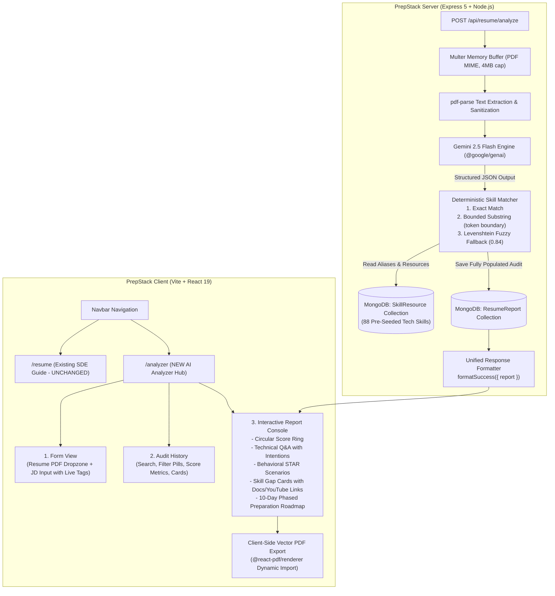

# SkillBridgeAI $\to$ PrepStack: Detailed Integration Master Plan

> [!IMPORTANT]
> **Core Architectural Directives:**
> 1. **Preserve Existing Features**: The current SDE Resume Architecture & ATS Guidelines page at `/resume` remains **100% untouched and independent**.
> 2. **Dedicated Standalone Feature**: The AI Resume & Job Description Analyzer will live on its own dedicated route (`/analyzer`) and have its own navigation link in the Navbar alongside Problems, Projects, and Resume.
> 3. **Clean Dependency Management**: No hardcoded version numbers. Dependencies (`multer`, `pdf-parse`, `@react-pdf/renderer`) will be installed using standard `npm install` to allow npm to resolve optimal versions compatible with our React 19, Express 5, and Node environment.
> 4. **Strict Security & Compliance**: Never expose `.env` files. Strip internal MongoDB metadata (`__v`). All API endpoints must adhere to the unified response contract (`{ success: true, message, data }` and `{ success: false, message, errors }`).

---

## 1. End-to-End System Architecture



---

## 2. Dependencies to Install

### Backend (`server/`)
```bash
npm install multer pdf-parse
```
- `multer`: In-memory file reception without writing temporary files to disk.
- `pdf-parse`: Buffer-based text extraction from candidate PDF resumes.
- *(Note: `@google/genai`, `express`, `mongoose`, and `zod` are already present in PrepStack).*

### Frontend (`client/`)
```bash
npm install @react-pdf/renderer
```
- `@react-pdf/renderer`: In-browser client-side vector PDF generator. Dynamically imported only when the user clicks *"Download PDF"* to ensure zero impact on initial bundle size.

---

## 3. Database Architecture & Data Models (MongoDB / Mongoose)

### 3.1 `SkillResource` Model (`server/src/models/skillResource.model.js`)
Stores the curated technical skills, aliases, and direct external learning links (official documentation and free YouTube courses).

```javascript
import mongoose from "mongoose";

const learningResourceSchema = new mongoose.Schema({
  type: {
    type: String,
    enum: ["DOCUMENTATION", "VIDEO"],
    required: true,
  },
  title: { 
    type: String, 
    required: true,
    trim: true,
  },
  url: { 
    type: String, 
    required: true,
    trim: true,
  },
});

const skillResourceSchema = new mongoose.Schema(
  {
    name: {
      type: String,
      required: true,
      unique: true,
      trim: true,
      index: true,
    },
    aliases: {
      type: [String],
      default: [],
      index: true,
    },
    category: {
      type: String,
      enum: [
        "Frontend",
        "Backend",
        "DevOps/Cloud",
        "Databases",
        "System Design",
        "Security",
        "Mobile",
        "UI/UX",
        "Languages",
        "General",
      ],
      default: "General",
    },
    resources: [learningResourceSchema],
  },
  { 
    timestamps: true,
    toJSON: {
      transform: (doc, ret) => {
        delete ret.__v;
        return ret;
      },
    },
  }
);

export default mongoose.model("SkillResource", skillResourceSchema);
```

### 3.2 `ResumeReport` Model (`server/src/models/resumeReport.model.js`)
Persists candidate resume analyses, match compatibility scores, and interview strategy.

```javascript
import mongoose from "mongoose";

const technicalQuestionSchema = new mongoose.Schema({
  question: { type: String, required: true },
  intention: { type: String, required: true },
  answer: { type: String, required: true },
});

const behavioralQuestionSchema = new mongoose.Schema({
  question: { type: String, required: true },
  intention: { type: String, required: true },
  answer: { type: String, required: true },
});

const skillGapSchema = new mongoose.Schema({
  skill: { type: String, required: true },
  severity: {
    type: String,
    enum: ["low", "medium", "high"],
    default: "medium",
  },
  skillRef: {
    type: mongoose.Schema.Types.ObjectId,
    ref: "SkillResource",
    default: null,
  },
});

const preparationPlanSchema = new mongoose.Schema({
  day: { type: Number, required: true },
  focus: { type: String, required: true },
  tasks: [{ type: String }],
});

const resumeReportSchema = new mongoose.Schema(
  {
    userId: {
      type: mongoose.Schema.Types.ObjectId,
      ref: "User",
      required: true,
      index: true,
    },
    title: { 
      type: String, 
      default: "Interview Strategy Report",
      trim: true,
    },
    jobDescription: { 
      type: String, 
      required: true,
    },
    resumeText: { 
      type: String, 
      required: true,
    },
    matchScore: { 
      type: Number, 
      required: true, 
      min: 0, 
      max: 100,
    },
    technicalQuestions: [technicalQuestionSchema],
    behavioralQuestions: [behavioralQuestionSchema],
    skillGaps: [skillGapSchema],
    preparationPlan: [preparationPlanSchema],
  },
  { 
    timestamps: true,
    toJSON: {
      transform: (doc, ret) => {
        delete ret.__v;
        return ret;
      },
    },
  }
);

// Compound index for high-speed chronological listing per user
resumeReportSchema.index({ userId: 1, createdAt: -1 });

export default mongoose.model("ResumeReport", resumeReportSchema);
```

---

## 4. Backend Implementation Specifications

### 4.1 Curated Skills Seed Script (`server/src/seeds/skills.seed.js`)
- Migrates the **88 skills** from SkillBridgeAI (covering React, TypeScript, Node.js, Express, Next.js, Redis, Docker, Kubernetes, AWS, GraphQL, MongoDB, PostgreSQL, System Design, OWASP, Microservices, CI/CD, etc.).
- Each skill includes:
  - Official Documentation Link (MDN, official project docs, or dev manuals).
  - High-rated, curated YouTube Tutorial / Crash Course Link (freeCodeCamp, Traversy Media, etc.).
  - Aliases array for resilient token matching.
- **Idempotency**: Uses `findOneAndUpdate({ name: skill.name }, { ... }, { upsert: true })` so re-running the seed never duplicates data or breaks existing `skillRef` IDs.

### 4.2 Deterministic Skill Matcher (`server/src/services/skillMatcher.service.js`)
A 3-tier algorithm that maps free-text skill gaps from Gemini to seeded database records without making additional AI calls:
1. **Cache Loading**: Pre-loads all seeded skills and their lowercased terms once per report request into an in-memory array.
2. **Tier 1 (Exact Match)**: Normalizes raw skill gap text and checks if it exactly equals a skill name or alias.
3. **Tier 2 (Bounded Substring Match)**: Uses `findBoundedSubstring(text, term)` to check for whole-word boundaries.
   - Prevents `"java"` from triggering inside `"javascript"`.
   - Prevents `"go"` from triggering inside `"django"` or `"mongo"`.
   - Prevents `"js"` from triggering inside `"json"`.
   - If multiple skills are mentioned, the earliest whole-word occurrence wins.
4. **Tier 3 (Levenshtein Fuzzy Match)**: Tokenizes the raw skill text (tokens $\ge 3$ characters), computes Levenshtein distance against terms (length $\ge 4$), and matches if similarity score $\ge 0.84$.
   - Catches real typos like `"Doker"` $\to$ `"Docker"`, `"Kubernetis"` $\to$ `"Kubernetes"`.
5. **Fallback**: If no match is found, returns `skillRef: null` gracefully without failing the report.

### 4.3 PDF Upload Middleware (`server/src/middlewares/file.middleware.js`)
```javascript
import multer from "multer";
import ApiError from "../utils/ApiError.js";

const uploadResume = multer({
  storage: multer.memoryStorage(),
  limits: {
    fileSize: 4 * 1024 * 1024, // 4MB limit
  },
  fileFilter: (req, file, cb) => {
    if (file.mimetype !== "application/pdf") {
      return cb(new ApiError(400, "Only PDF files are allowed for resume upload."));
    }
    cb(null, true);
  },
});

export default uploadResume;
```

### 4.4 AI Resume Analyzer Service (`server/src/services/ai.service.js`)
Extends PrepStack's existing Gemini client with `generateResumeMatchReport({ resumeText, jobDescription })`:
- Uses model `gemini-2.5-flash`.
- Specifies `responseMimeType: "application/json"`.
- Instructs Gemini to return:
  - `matchScore`: Integer between 0 and 100.
  - `title`: Extracted target job title (e.g., *"Senior Full Stack Engineer"*).
  - `technicalQuestions`: Array of at least 5 questions tailored to the candidate's stated background and job expectations, each with `question`, `intention` (*"Why interviewers ask this"*), and `answer`.
  - `behavioralQuestions`: Array of at least 5 situational questions evaluated against the STAR framework.
  - `skillGaps`: Array of at least 3 identified gaps with `skill` name and `severity` (`'low' | 'medium' | 'high'`).
  - `preparationPlan`: 10-day preparation roadmap with `day`, `focus`, and `tasks` (array of strings).

### 4.5 Controller & Endpoints (`server/src/controllers/resume.controller.js`)
All endpoints wrap responses using PrepStack's `formatSuccess` / `formatError`:

1. **`POST /api/resume/analyze`**
   - Protected via `protect`.
   - Multer parses single file `resume`.
   - Validates `jobDescription` string (min 20 chars).
   - Extracts resume text using `pdf-parse`.
   - Calls `generateResumeMatchReport`.
   - Runs `attachSkillIds` to bind skill gaps to seeded `SkillResource` records.
   - Saves `ResumeReport` to MongoDB.
   - Populates `skillGaps.skillRef` and returns `{ success: true, message: "...", data: { report } }`.
2. **`GET /api/resume/reports`**
   - Protected.
   - Accepts query params `page` (default 1) and `limit` (default 6).
   - Projects lightweight fields: `id`, `title`, `matchScore`, `createdAt`, `updatedAt`, `jobDescription` snippet.
   - Returns `{ success: true, data: { reports, totalCount, currentPage, totalPages } }`.
3. **`GET /api/resume/reports/:id`**
   - Protected.
   - Verifies `userId === req.user._id`.
   - Populates `skillGaps.skillRef.resources`.
   - Returns `{ success: true, data: { report } }`.
4. **`DELETE /api/resume/reports/:id`**
   - Protected.
   - Deletes report owned by the requesting user.
   - Returns `{ success: true, message: "Report deleted successfully" }`.

---

## 5. Frontend Architecture & UI Design (`client/`)

### 5.1 Route & Navigation Setup
- In `client/src/App.jsx`:
  ```jsx
  <Route path="/analyzer" element={<Protected><Analyzer /></Protected>} />
  <Route path="/analyzer/:reportId" element={<Protected><Analyzer /></Protected>} />
  ```
- In `client/src/components/layout/Navbar.jsx`:
  - Add **"AI Analyzer"** nav link pointing to `/analyzer`.
  - Existing `/resume` link continues to point to the SDE Resume Architecture guide.

### 5.2 State Management (`client/src/context/AnalyzerContext.jsx` & `useAnalyzer.js`)
Manages:
- `activeReport`: Current displayed report.
- `reportsList`: User's past audited reports.
- `totalReports`: Total count of audits for pagination.
- `isAnalyzing`: Boolean loading state.
- `loadingStep`: Number index for the phased loader (0: Parsing PDF, 1: Scanning Job Description, 2: Evaluating Technical Fit, 3: Synthesizing Roadmap).

### 5.3 UI Component Breakdown (`client/src/pages/Analyzer/`)

#### 1. Form View (`AnalyzerForm.jsx`)
- **`JobDescriptionInput.jsx`**:
  - 180ms debounced input.
  - Live common skill tag detector (`React`, `TypeScript`, `Node`, `Docker`, `PostgreSQL`, etc.) that renders pills as the user types.
  - Character counter (max 5000 chars).
- **`ResumeUpload.jsx`**:
  - Drag-and-drop dropzone with file size limit (4MB) and PDF type check.
  - Displays selected file name, formatted size, and quick remove button.
  - Visual status icon: Idle $\to$ Dragging $\to$ Validated $\to$ Error.
- **`LoadingScreen.jsx`**:
  - Ambient obsidian/amber glow backdrop.
  - Visual step progress tracker:
    - Step 1: *Parsing resume structure & experience*
    - Step 2: *Extracting target role requirements*
    - Step 3: *Synthesizing technical & STAR behavioral questions*
    - Step 4: *Calibrating 10-day roadmap & matching learning resources*

#### 2. Report View (`ReportView.jsx`)
- **Match Score Ring**:
  - Animated SVG circular gauge.
  - Dynamic color coding: Emerald Green for $\ge 80\%$, Amber for $60\text{--}79\%$, Crimson for $<60\%$.
- **Sidebar / Pill Navigation**:
  - Switches between:
    - **Technical Questions** (5+ deep dive technical questions).
    - **Behavioral Questions** (5+ STAR framework questions).
    - **Skill Gaps & Resources** (Prioritized gaps with direct links to docs & YouTube).
    - **10-Day Targeted Plan** (Phased preparation roadmap).
- **Interactive Question Cards**:
  - Collapsible accordions with index badge.
  - *"Why Interviewers Ask This"* intention callout.
  - Production-grade model answer with one-click copy to clipboard.
- **Skill Gap Cards**:
  - Priority badge: `High Priority`, `Medium Priority`, `Low Priority`.
  - Direct clickable links to **Official Documentation** and **YouTube Video Tutorials**.
- **Roadmap Timeline**:
  - Vertical connected timeline with day badges and checklist tasks.

#### 3. Audit History (`HistoryView.jsx`)
- Metric summary cards: *Total Roles Audited*, *Average Match Compatibility*, *Strong Alignments ($80\%+$)*.
- Live search bar (by role title or job description).
- Filter pills: `All`, `Strong (80%+)`, `Mid (60-79%)`, `Calibration (<60%)`.
- Grid of past audited cards with quick "View Report", "Download PDF", and "Delete" actions.

#### 4. Client-Side Vector PDF Export (`ReportPDFDocument.jsx` + `exportReportPdf.js`)
- Dynamically imports `@react-pdf/renderer` only on click.
- Renders an executive, multi-page vector PDF containing:
  - Header branding & analysis date.
  - Target role title, compatibility score badge, and summary.
  - Complete technical questions and behavioral STAR questions with answers.
  - Skill gaps breakdown with resource URLs.
  - 10-Day preparation checklist.

---

## 6. Execution Phases & Verification Plan

```
[Phase 1: Backend Foundation & Seeds]
      │
      ▼
[Phase 2: PDF Parsing & Skill Matcher]
      │
      ▼
[Phase 3: Controller, Routes & Response Envelopes]
      │
      ▼
[Phase 4: Frontend Development & UI Polish]
      │
      ▼
[Phase 5: End-to-End Verification & Testing]
```

### Phase 1: Backend Foundation & Seeds
- [ ] Install `multer` and `pdf-parse` in `server/`.
- [ ] Create `server/src/models/skillResource.model.js`.
- [ ] Create `server/src/models/resumeReport.model.js`.
- [ ] Create `server/src/seeds/skills.seed.js` with the 88 curated technical skills.
- [ ] Execute seed script and verify in MongoDB that all 88 records are created with documentation and YouTube links.

### Phase 2: PDF Parsing & Skill Matcher
- [ ] Create `server/src/middlewares/file.middleware.js` with multer memory storage.
- [ ] Port `server/src/services/skillMatcher.service.js` with 3-tier matching (exact, bounded substring, Levenshtein fuzzy fallback).
- [ ] Add `generateResumeMatchReport` in `server/src/services/ai.service.js` using `@google/genai`.
- [ ] Unit test the skill matcher with test tokens (`"React"`, `"Docker"`, `"Doker"`, `"java"`, `"javascript"`).

### Phase 3: Controller, Routes & Response Envelopes
- [ ] Create `server/src/controllers/resume.controller.js` implementing:
  - `analyzeResumeController`
  - `getReportByIdController`
  - `getAllReportsController`
  - `deleteReportController`
- [ ] Create `server/src/routes/resume.routes.js` and mount under `/api/resume` in `server/src/app.js`.
- [ ] Run an automated test script (`verify_resume_api.js`) verifying PDF upload, text parsing, AI report generation, skill gap linking, pagination, and deletion.

### Phase 4: Frontend Development & UI Polish
- [ ] Install `@react-pdf/renderer` in `client/`.
- [ ] Create `AnalyzerContext.jsx` and `useAnalyzer.js` in `client/src/context/` and `hooks/`.
- [ ] Build `JobDescriptionInput.jsx` with live skill chips.
- [ ] Build `ResumeUpload.jsx` with drag-and-drop and PDF validation.
- [ ] Build `LoadingScreen.jsx` with multi-step progress tracker.
- [ ] Build `ReportView.jsx` with animated SVG score ring, question accordions, skill cards, and 10-day roadmap.
- [ ] Build `HistoryView.jsx` with search, filter pills, and metric cards.
- [ ] Build `ReportPDFDocument.jsx` and `exportReportPdf.js` for on-demand vector PDF export.
- [ ] Assemble `client/src/pages/Analyzer/Analyzer.jsx`.

### Phase 5: End-to-End Verification & Testing
- [ ] Register `/analyzer` and `/analyzer/:reportId` in `client/src/App.jsx`.
- [ ] Add "AI Analyzer" navigation link in `client/src/components/layout/Navbar.jsx`.
- [ ] Verify that `/resume` remains 100% functional, displaying the SDE Resume Architecture guide.
- [ ] Test the entire user flow: Upload a PDF resume + enter JD $\to$ watch phased loader $\to$ view generated report $\to$ download vector PDF $\to$ view report in history $\to$ delete report.
- [ ] Run `npm run lint` and `npm run build` to confirm zero compilation or lint errors.